# Figure 4 rebuttal — Decade distance uncertainty (Panels A & D)
Chen Zhan
22 Sep 2026

- [Overview](#overview)
- [Setup](#setup)
- [Helper functions](#helper-functions)
- [1. Gene-expression posterior
  draws](#1-gene-expression-posterior-draws)
- [2. Body-level gene-expression distances by
  draw](#2-body-level-gene-expression-distances-by-draw)
  - [Distance by draw (body gene)](#distance-by-draw-body-gene)
  - [Sanity check — body gene vs Fig4
    (mean-then-distance)](#sanity-check--body-gene-vs-fig4-mean-then-distance)
  - [Plot — Fig4 Panel A style (body
    gene)](#plot--fig4-panel-a-style-body-gene)
  - [Plot options — 95% intervals (body
    gene)](#plot-options--95-intervals-body-gene)
- [3. Tissue-level gene-expression distances by
  draw](#3-tissue-level-gene-expression-distances-by-draw)
  - [Prepare tissue gene draws](#prepare-tissue-gene-draws)
  - [Distance by draw (all tissues)](#distance-by-draw-all-tissues)
  - [Sanity check — tissue gene vs Fig4 (blood + all
    tissues)](#sanity-check--tissue-gene-vs-fig4-blood--all-tissues)
  - [Plot — Fig4 Panel D style (tissue
    gene)](#plot--fig4-panel-d-style-tissue-gene)
  - [Plot options — 95% intervals (blood
    gene)](#plot-options--95-intervals-blood-gene)
- [4. Composition posterior draws](#4-composition-posterior-draws)
  - [Cells of interest (same contrast filter as
    Fig4)](#cells-of-interest-same-contrast-filter-as-fig4)
  - [Validation — sccomp robust summary ≡ manual median (same
    rng)](#validation--sccomp-robust-summary--manual-median-same-rng)
  - [Prepare body composition draws](#prepare-body-composition-draws)
- [5. Body-level composition distances by
  draw](#5-body-level-composition-distances-by-draw)
  - [Distance by draw (body
    composition)](#distance-by-draw-body-composition)
  - [Plot — Fig4 Panel A style (body
    composition)](#plot--fig4-panel-a-style-body-composition)
  - [Plot options — 95% intervals (body
    composition)](#plot-options--95-intervals-body-composition)
- [6. Tissue-level composition distances by
  draw](#6-tissue-level-composition-distances-by-draw)
  - [Prepare tissue composition
    draws](#prepare-tissue-composition-draws)
  - [Distance by draw (all tissues)](#distance-by-draw-all-tissues-1)
  - [Plot — Fig4 Panel D style (tissue
    composition)](#plot--fig4-panel-d-style-tissue-composition)
  - [Plot options — 95% intervals (blood
    composition)](#plot-options--95-intervals-blood-composition)
- [7. Panel D — ageing velocity from draw-level
  step_dist](#7-panel-d--ageing-velocity-from-draw-level-step_dist)
- [8. Summary tables for later
  plotting](#8-summary-tables-for-later-plotting)
  - [Session info](#session-info)

# Overview

Propagate posterior prediction uncertainty through the decade-resolved
immune-remodelling distance calculation used in Figure 4A/D, rather than
calculating distances only from posterior mean trajectories.

This report reuses the Figure 4 scientific definition of distance
(`log1p` / CLR → scale/center → Euclidean / `sqrt(n_features)` between
consecutive age decades), but keeps posterior draws through the distance
step:

**previously:** posterior predictions → posterior mean / robust median
profile → distance

**now (gene):** distance within each draw → mean + 95% CI

**now (composition):** median proportion profile → distance (Fig4
plug-in centre) + 95% CI from draw-level distances (validated vs sccomp
robust summary on one shared rng)

Scope here is **data processing and statistical calculation only** (no
final Panel A/D plot redesign).

Caches: `vignettes/data/intermediate/fig4_rebuttal/` and
`vignettes/data/figure_ready/fig4_rebuttal/`.

``` r
# From vignettes/rebuttal_analyse/:
quarto::quarto_render(
  "Fig4_panel_A_D_rebuttal_analyse.qmd",
  output_format = "html"
)
quarto::quarto_render(
  "Fig4_panel_A_D_rebuttal_analyse.qmd",
  output_format = "gfm"
)
# Outputs in this folder:
#   Fig4_panel_A_D_rebuttal_analyse.html
#   Fig4_panel_A_D_rebuttal_analyse.md
```

# Setup

Portable roots only (same pattern as `Fig4.qmd`). No machine-specific
absolute paths in this report. Optional overrides: `NEW_PRED_DIR`,
`SCCOMP_ESTIMATES_DIR` (see `vignettes/config/paths.example.env`).

``` r
# Report lives in vignettes/rebuttal_analyse/ → ../R/paths.R
.path_candidates <- c(
  file.path("..", "R", "paths.R"),
  if (requireNamespace("here", quietly = TRUE)) {
    file.path(here::here(), "vignettes", "R", "paths.R")
  },
  file.path("R", "paths.R")
)
.path_candidates <- .path_candidates[!is.na(.path_candidates) & nzchar(.path_candidates)]
.path_file <- .path_candidates[file.exists(.path_candidates)][1]
if (is.na(.path_file)) {
  stop("Cannot find vignettes/R/paths.R (run from vignettes/rebuttal_analyse/).")
}
source(.path_file)

dir.create(path_intermediate("fig4_rebuttal"), recursive = TRUE, showWarnings = FALSE)
dir.create(path_figure_ready("fig4_rebuttal"), recursive = TRUE, showWarnings = FALSE)

# Gene decade predictions (Fig4 intermediates; override with NEW_PRED_DIR if needed)
new_pred_root <- Sys.getenv("NEW_PRED_DIR", unset = path_intermediate("fig4"))
```

``` r
library(tidyverse)
library(tidybulk)
library(tidySummarizedExperiment)
library(glue)
# compositions::clr used explicitly (do not attach — masks dplyr::count)
```

# Helper functions

Run the `helpers` chunk before any distance/summary chunk (interactive
sessions included). It defines `pred_to_age_distance`,
`smooth_ageing_velocity`, and `summarise_distance_draws`.

``` r
# Same distance helper as Fig4.qmd (unchanged scientific definition).
pred_to_age_distance <- function(pred,
                                 scale = TRUE,
                                 center = TRUE,
                                 normalise_by_n_feature = TRUE,
                                 trans_fx = identity,
                                 distance_method = "euclidean",
                                 .abundance,
                                 ...) {

  se <-
    pred |>
    tidybulk::as_SummarizedExperiment(
      .sample = sample_id,
      .transcript = L3,
      .abundance = !!enquo(.abundance)
    ) |>
    mutate(age_decade_continuous = age_decade |> as.character() |> as.integer()) |>
    mutate(age_decade = age_decade |> fct_relevel(as.character(1:9)))

  se_matrix <- se %>% assay() %>% trans_fx() %>% as.matrix() %>% t
  se_matrix[se_matrix %>% is.na()] <- 0

  if (scale || center) {
    se_matrix <- scale(se_matrix, center = center, scale = scale)
  }

  if (distance_method == "euclidean")
    dist_obj <- dist(se_matrix, method = "euclidean")

  if (normalise_by_n_feature)
    dist_obj <- dist_obj / sqrt(ncol(se_matrix))

  se_sample <- se %>% pivot_sample() %>% arrange(age_decade_continuous)
  samps <- se_sample$sample_id
  dm <- dist_obj %>% as.matrix() %>% as.data.frame %>% .[samps, samps]

  prev <- head(samps, -1)
  nex  <- tail(samps, -1)
  step_dists <- mapply(function(a, b) dm[b, a], prev, nex)
  cum_dists  <- cumsum(step_dists)

  se_sample$step_dist <- c(0, step_dists %>% unname())
  se_sample$cum_dist  <- c(0, cum_dists  %>% unname())

  se_sample <- se_sample %>%
    mutate(
      min_age_decade = min(se$age_decade_continuous),
      max_age_decade = max(se$age_decade_continuous)
    )

  # Drop the baseline (first) age row; do not use step_dist == 0 (true zeros possible).
  se_sample %>% dplyr::filter(age_decade_continuous != min_age_decade)
}

find_peaks <- function(x) {
  n <- length(x)
  if (n == 1) return(TRUE)
  peaks <- rep(FALSE, n)
  if (n >= 3) {
    peaks[2:(n - 1)] <- (x[2:(n - 1)] > x[1:(n - 2)] & x[2:(n - 1)] > x[3:n])
  }
  peaks[1] <- x[1] > x[2]
  peaks[n] <- x[n] > x[n - 1]
  if (all(x == x[1])) peaks[] <- FALSE
  peaks
}

# Slightly leaner than Fig4: only needs tissue_groups + distance_df.
smooth_ageing_velocity <- function(linear_distance_tissue, fine_grid) {
  linear_distance_tissue %>%
    dplyr::select(tissue_groups, distance_df) %>%
    unnest(distance_df) %>%
    group_by(tissue_groups) %>%
    nest() %>%
    mutate(
      peaks = map(data, ~ {
        d <- .
        d$local_max <- find_peaks(d$step_dist)
        d %>% filter(local_max)
      }),
      main_peak_age = map_dbl(peaks, ~ .x$age_decade_continuous[which.max(.x$step_dist)] %||% NA_real_),
      secondary_peak_age = map2_dbl(
        peaks, main_peak_age,
        ~ {
          if (nrow(.x) < 2) return(NA_real_)
          .x2 <- .x %>% filter(abs(age_decade_continuous - .y) >= 3)
          if (nrow(.x2) == 0) return(NA_real_)
          .x2$age_decade_continuous[which.max(.x2$cum_dist)]
        }
      ),
      interp = map(data, ~ tibble(
        age_decade_continuous = fine_grid,
        step_dist = approx(.x$age_decade_continuous, .x$step_dist, xout = fine_grid, rule = 2)$y,
        cum_dist  = approx(.x$age_decade_continuous, .x$cum_dist,  xout = fine_grid, rule = 2)$y,
        min_age_decade = unique(.x$min_age_decade),
        max_age_decade = unique(.x$max_age_decade)
      ))
    ) |>
    unnest(interp) %>%
    ungroup()
}

# Summarise draw-level step/cum distances (diagnostics + CI).
# These are summaries of T(draw), not T(summary profile).
summarise_distance_draws <- function(distance_draws, group_vars) {
  distance_draws %>%
    group_by(across(all_of(group_vars))) %>%
    summarise(
      step_dist_draw_mean   = mean(step_dist, na.rm = TRUE),
      step_dist_draw_median = unname(stats::median(step_dist, na.rm = TRUE)),
      step_dist_lower       = unname(quantile(step_dist, 0.025, na.rm = TRUE)),
      step_dist_upper       = unname(quantile(step_dist, 0.975, na.rm = TRUE)),
      cum_dist_draw_mean    = mean(cum_dist, na.rm = TRUE),
      cum_dist_draw_median  = unname(stats::median(cum_dist, na.rm = TRUE)),
      cum_dist_lower        = unname(quantile(cum_dist, 0.025, na.rm = TRUE)),
      cum_dist_upper        = unname(quantile(cum_dist, 0.975, na.rm = TRUE)),
      n_draws               = dplyr::n(),
      .groups = "drop"
    )
}
```

# 1. Gene-expression posterior draws

Same gene short lists and prediction objects as `Fig4.qmd`, but keep
`draws` instead of collapsing to `count_mean`.

``` r
gene_hyp_df <- readRDS(file.path(path_intermediate("fig4"), "new_gene_hyp_df.rds"))

short_list_fixed <-
  gene_hyp_df %>%
  filter(cell_type != "monocytic") %>%
  filter(component == "fixed") %>%
  group_by(cell_type, .feature) %>%
  summarise(n = n(), max_abs_est = max(abs_est, na.rm = TRUE), .groups = "drop") %>%
  group_by(cell_type) %>%
  arrange(desc(n), desc(max_abs_est), .by_group = TRUE) %>%
  slice_head(n = 10) %>%
  ungroup()

short_list_total <-
  gene_hyp_df %>%
  filter(cell_type != "monocytic") %>%
  filter(component == "total") %>%
  group_by(tissue, cell_type, .feature) %>%
  summarise(n = n(), max_abs_est = max(abs_est, na.rm = TRUE), .groups = "drop") %>%
  group_by(tissue, cell_type) %>%
  arrange(desc(n), desc(max_abs_est), .by_group = TRUE) %>%
  slice_head(n = 10) %>%
  ungroup()
```

``` r
pred_fixed <- readRDS(file.path(new_pred_root, "pred_fixed.rds"))
if (!all(pred_fixed$.feature == short_list_fixed$.feature)) {
  stop("gene list unmatch!")
}

pred_fixed_draws <-
  pred_fixed %>%
  mutate(cell_type = short_list_fixed$cell_type) %>%
  unnest(pred_df) %>%
  mutate(
    sample_id = paste0("my_sample_", age_decade),
    L3 = paste0(cell_type, "_", .feature),
    age_decade = factor(age_decade, levels = as.character(1:10))
  )

glimpse(pred_fixed_draws)
```

    Rows: 720,000
    Columns: 8
    $ .feature   <chr> "ENSG00000055163", "ENSG00000055163", "ENSG00000055163", "E…
    $ tar_group  <int> 376, 376, 376, 376, 376, 376, 376, 376, 376, 376, 376, 376,…
    $ age_decade <fct> 5, 5, 5, 5, 5, 5, 5, 5, 5, 5, 5, 5, 5, 5, 5, 5, 5, 5, 5, 5,…
    $ draws      <chr> "1", "10", "100", "101", "102", "103", "104", "105", "106",…
    $ count_avg  <dbl> 403.5000, 231.0000, 429.5833, 346.6667, 327.7500, 301.2500,…
    $ cell_type  <chr> "b memory", "b memory", "b memory", "b memory", "b memory",…
    $ sample_id  <chr> "my_sample_5", "my_sample_5", "my_sample_5", "my_sample_5",…
    $ L3         <chr> "b memory_ENSG00000055163", "b memory_ENSG00000055163", "b …

``` r
pred_fixed_draws %>%
  dplyr::count(draws) %>%
  summarise(n_draws = dplyr::n(), rows_per_draw = unique(n))
```

    # A tibble: 1 × 2
      n_draws rows_per_draw
        <int>         <int>
    1     400          1800

# 2. Body-level gene-expression distances by draw

### Distance by draw (body gene)

``` r
path_dist_gene_body_draws <-
  file.path(path_intermediate("fig4_rebuttal"), "distance_body_gene_draws.rds")

if (file.exists(path_dist_gene_body_draws)) {
  distance_body_gene_draws <- readRDS(path_dist_gene_body_draws)
} else {
  distance_body_gene_draws <-
    pred_fixed_draws %>%
    nest(data = -draws) %>%
    mutate(
      distance_df = map(
        data,
        pred_to_age_distance,
        scale = TRUE,
        trans_fx = log1p,
        .abundance = count_avg
      )
    ) %>%
    dplyr::select(draws, distance_df) %>%
    unnest(distance_df)

  saveRDS(distance_body_gene_draws, path_dist_gene_body_draws)
}

distance_body_gene <-
  summarise_distance_draws(
    distance_body_gene_draws,
    group_vars = c("age_decade_continuous")
  ) %>%
  # Gene centre plotted here = mean(distance(draw)); alias for existing plot code.
  dplyr::rename(
    step_dist_mean = step_dist_draw_mean,
    cum_dist_mean = cum_dist_draw_mean
  ) %>%
  mutate(modality = "gene_expr", level = "body")

print(distance_body_gene)
```

    # A tibble: 9 × 12
      age_decade_continuous step_dist_mean step_dist_draw_median step_dist_lower
                      <int>          <dbl>                 <dbl>           <dbl>
    1                     2          1.21                  1.21            1.06 
    2                     3          1.27                  1.27            1.15 
    3                     4          1.03                  1.03            0.899
    4                     5          0.855                 0.857           0.732
    5                     6          0.926                 0.926           0.815
    6                     7          0.935                 0.937           0.809
    7                     8          0.991                 0.989           0.881
    8                     9          1.53                  1.53            1.39 
    9                    10          2.01                  2.01            1.87 
    # ℹ 8 more variables: step_dist_upper <dbl>, cum_dist_mean <dbl>,
    #   cum_dist_draw_median <dbl>, cum_dist_lower <dbl>, cum_dist_upper <dbl>,
    #   n_draws <int>, modality <chr>, level <chr>

### Sanity check — body gene vs Fig4 (mean-then-distance)

Fig4 publishes **distance(posterior-mean profile)**.  
This rebuttal’s `*_mean` columns are **mean(distance(each draw))**.  
Those need not match (nonlinear distance). Intervals below are quantiles
of draw-level distances — that part is the correct posterior summary of
the distance functional.

``` r
# Rebuild Fig4 body trajectory from the same predictions (collapse draws first).
path_fig4_body <-
  file.path(path_intermediate("fig4_rebuttal"), "distance_body_gene_fig4.rds")

if (file.exists(path_fig4_body)) {
  distance_body_gene_fig4 <- readRDS(path_fig4_body)
} else {
  pred_fixed_mean_profile <-
    pred_fixed_draws %>%
    group_by(cell_type, .feature, age_decade, sample_id, L3) %>%
    summarise(count_mean = mean(count_avg, na.rm = TRUE), .groups = "drop")

  distance_body_gene_fig4 <-
    pred_fixed_mean_profile %>%
    pred_to_age_distance(scale = TRUE, trans_fx = log1p, .abundance = count_mean) %>%
    as_tibble() %>%
    dplyr::select(age_decade_continuous, step_dist, cum_dist)
  saveRDS(distance_body_gene_fig4, path_fig4_body)
}

gene_body_sanity <-
  distance_body_gene_fig4 %>%
  left_join(
    distance_body_gene %>%
      dplyr::select(
        age_decade_continuous,
        step_dist_mean, step_dist_lower, step_dist_upper,
        cum_dist_mean, cum_dist_lower, cum_dist_upper
      ),
    by = "age_decade_continuous"
  ) %>%
  mutate(
    d_step = step_dist_mean - step_dist,
    d_cum = cum_dist_mean - cum_dist,
    step_in_ci = step_dist >= step_dist_lower & step_dist <= step_dist_upper,
    cum_in_ci = cum_dist >= cum_dist_lower & cum_dist <= cum_dist_upper
  )

print(gene_body_sanity %>%
  dplyr::select(age_decade_continuous, step_dist, step_dist_mean, d_step,
                cum_dist, cum_dist_mean, d_cum, step_in_ci, cum_in_ci))
```

    # A tibble: 9 × 9
      age_decade_continuous step_dist step_dist_mean  d_step cum_dist cum_dist_mean
                      <int>     <dbl>          <dbl>   <dbl>    <dbl>         <dbl>
    1                     2     0.947          1.21   0.262     0.947          1.21
    2                     3     1.13           1.27   0.140     2.08           2.48
    3                     4     0.845          1.03   0.184     2.92           3.51
    4                     5     0.636          0.855  0.219     3.56           4.37
    5                     6     0.881          0.926  0.0454    4.44           5.29
    6                     7     0.874          0.935  0.0608    5.32           6.23
    7                     8     0.945          0.991  0.0456    6.26           7.22
    8                     9     1.39           1.53   0.134     7.65           8.74
    9                    10     2.30           2.01  -0.285     9.95          10.8 
    # ℹ 3 more variables: d_cum <dbl>, step_in_ci <lgl>, cum_in_ci <lgl>

``` r
# Interval construction check: summarise == hand quantiles over draws
.stopif_diff <- function(a, b, tol = 1e-10) max(abs(a - b)) > tol
.hand <- distance_body_gene_draws %>%
  group_by(age_decade_continuous) %>%
  summarise(
    step_m = mean(step_dist),
    step_lo = unname(quantile(step_dist, 0.025)),
    step_hi = unname(quantile(step_dist, 0.975)),
    cum_m = mean(cum_dist),
    cum_lo = unname(quantile(cum_dist, 0.025)),
    cum_hi = unname(quantile(cum_dist, 0.975)),
    .groups = "drop"
  )
stopifnot(
  !.stopif_diff(distance_body_gene$step_dist_mean, .hand$step_m),
  !.stopif_diff(distance_body_gene$step_dist_lower, .hand$step_lo),
  !.stopif_diff(distance_body_gene$step_dist_upper, .hand$step_hi),
  !.stopif_diff(distance_body_gene$cum_dist_mean, .hand$cum_m),
  !.stopif_diff(distance_body_gene$cum_dist_lower, .hand$cum_lo),
  !.stopif_diff(distance_body_gene$cum_dist_upper, .hand$cum_hi)
)
message(
  "Body gene: interval summarise OK. ",
  "max |mean(dist)-dist(mean)| step=",
  signif(max(abs(gene_body_sanity$d_step)), 3),
  ", cum=", signif(max(abs(gene_body_sanity$d_cum)), 3)
)
```

### Plot — Fig4 Panel A style (body gene)

``` r
# Original Fig4 Panel A style (gene expression only): horizontal cum_dist track.
plot_gene_body_distance_original <-
  distance_body_gene %>%
  mutate(cum_dist_scaled = scales::rescale(cum_dist_mean, to = c(0, 10))) %>%
  ggplot(aes(x = cum_dist_scaled, y = 0)) +
  geom_line() +
  geom_point(color = "red", size = 3) +
  geom_text(aes(label = age_decade_continuous * 10 - 10), vjust = -1, size = 3) +
  theme_minimal() +
  theme(
    axis.title.x = element_blank(), axis.text.x = element_blank(), axis.ticks.x = element_blank(),
    axis.title.y = element_blank(), axis.text.y = element_blank(), axis.ticks.y = element_blank(),
    panel.grid.major = element_blank(), panel.grid.minor = element_blank()
  ) +
  labs(title = "Gene expression — body (posterior mean cum_dist)")

plot_gene_body_distance_original
```

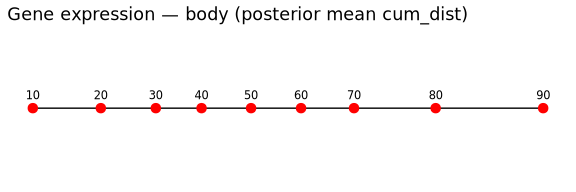

### Plot options — 95% intervals (body gene)

Several options for showing the 95% interval alongside the trajectory
(gene body for now — pick one later for the rebuttal figure):

1.  **Age on x, distance on y + vertical error bars** — clearest for
    reading interval width per decade (separate panels for `step_dist`
    and `cum_dist`).
2.  **Original horizontal track + vertical whiskers** — keep Fig4A
    layout; y encodes the CI for that decade’s distance (needs a shared
    y scale).
3.  **Ribbon / shaded band vs age** — continuous uncertainty envelope
    (good for `cum_dist`; denser for fine grids later).
4.  **Horizontal interval on the cum_dist axis** — CI as left–right
    whiskers along the track (emphasises uncertainty in “how far aged”,
    not step size).

``` r
age_years <- function(d) d * 10 - 10

# --- Option 1: age vs distance, vertical 95% error bars -----------------------
plot_gene_body_step_errorbar <-
  distance_body_gene %>%
  ggplot(aes(x = age_years(age_decade_continuous), y = step_dist_mean)) +
  geom_line(linewidth = 0.4) +
  geom_point(color = "red", size = 2.5) +
  geom_errorbar(
    aes(ymin = step_dist_lower, ymax = step_dist_upper),
    width = 2, linewidth = 0.4
  ) +
  theme_minimal() +
  labs(
    title = "Option 1a — step_dist mean ± 95% CI",
    x = "Age (years)", y = "Step distance"
  )

plot_gene_body_cum_errorbar <-
  distance_body_gene %>%
  ggplot(aes(x = age_years(age_decade_continuous), y = cum_dist_mean)) +
  geom_line(linewidth = 0.4) +
  geom_point(color = "red", size = 2.5) +
  geom_errorbar(
    aes(ymin = cum_dist_lower, ymax = cum_dist_upper),
    width = 2, linewidth = 0.4
  ) +
  theme_minimal() +
  labs(
    title = "Option 1b — cum_dist mean ± 95% CI",
    x = "Age (years)", y = "Cumulative distance"
  )

# --- Option 3: ribbon vs age (same data, smoother read of interval) -----------
plot_gene_body_cum_ribbon <-
  distance_body_gene %>%
  ggplot(aes(x = age_years(age_decade_continuous), y = cum_dist_mean)) +
  geom_ribbon(aes(ymin = cum_dist_lower, ymax = cum_dist_upper), alpha = 0.25) +
  geom_line(linewidth = 0.5) +
  geom_point(color = "red", size = 2.5) +
  theme_minimal() +
  labs(
    title = "Option 3 — cum_dist ribbon (95% CI)",
    x = "Age (years)", y = "Cumulative distance"
  )

plot_gene_body_step_ribbon <-
  distance_body_gene %>%
  ggplot(aes(x = age_years(age_decade_continuous), y = step_dist_mean)) +
  geom_ribbon(aes(ymin = step_dist_lower, ymax = step_dist_upper), alpha = 0.25) +
  geom_line(linewidth = 0.5) +
  geom_point(color = "red", size = 2.5) +
  theme_minimal() +
  labs(
    title = "Option 3b — step_dist ribbon (95% CI)",
    x = "Age (years)", y = "Step distance"
  )

# --- Option 4: horizontal track with CI along the cum_dist (x) axis -----------
plot_gene_body_cum_horizontal_ci <-
  distance_body_gene %>%
  mutate(
    x = cum_dist_mean,
    xmin = cum_dist_lower,
    xmax = cum_dist_upper
  ) %>%
  ggplot(aes(x = x, y = 0)) +
  geom_line() +
  geom_errorbarh(aes(xmin = xmin, xmax = xmax), height = 0.15, linewidth = 0.4) +
  geom_point(color = "red", size = 3) +
  geom_text(aes(label = age_years(age_decade_continuous)), vjust = -1.2, size = 3) +
  theme_minimal() +
  theme(
    axis.title.y = element_blank(), axis.text.y = element_blank(), axis.ticks.y = element_blank(),
    panel.grid.major.y = element_blank(), panel.grid.minor = element_blank()
  ) +
  labs(
    title = "Option 4 — horizontal cum_dist track with 95% CI whiskers",
    x = "Cumulative distance"
  )

print(plot_gene_body_step_errorbar)
```

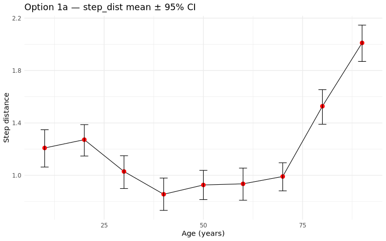

``` r
print(plot_gene_body_cum_errorbar)
```

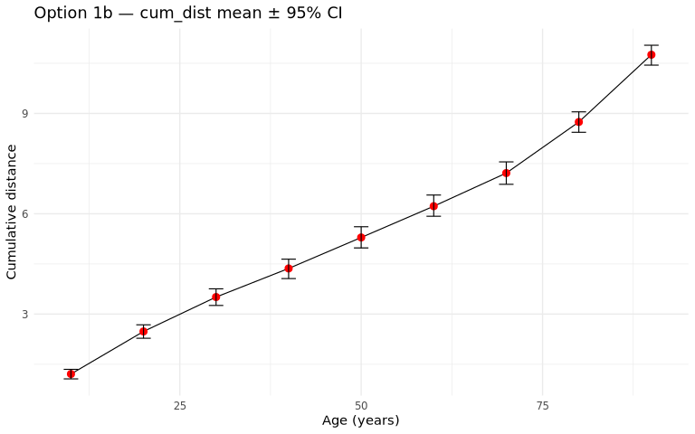

``` r
print(plot_gene_body_step_ribbon)
```

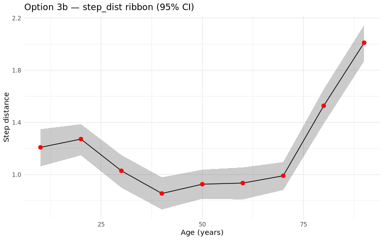

``` r
print(plot_gene_body_cum_ribbon)
```

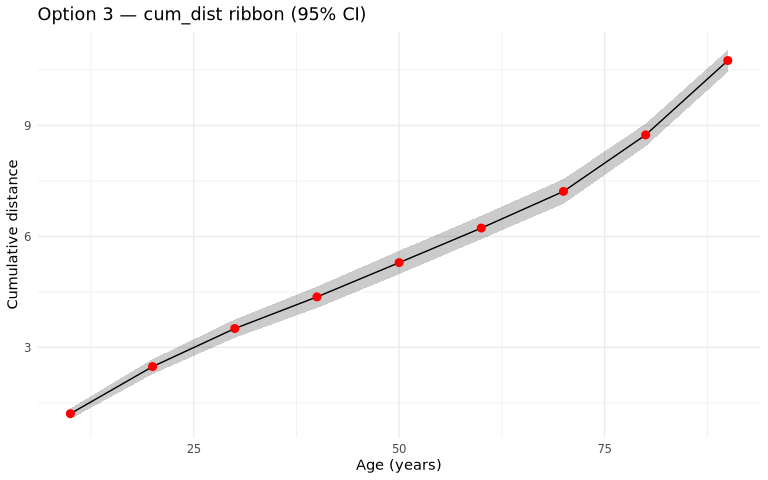

``` r
print(plot_gene_body_cum_horizontal_ci)
```

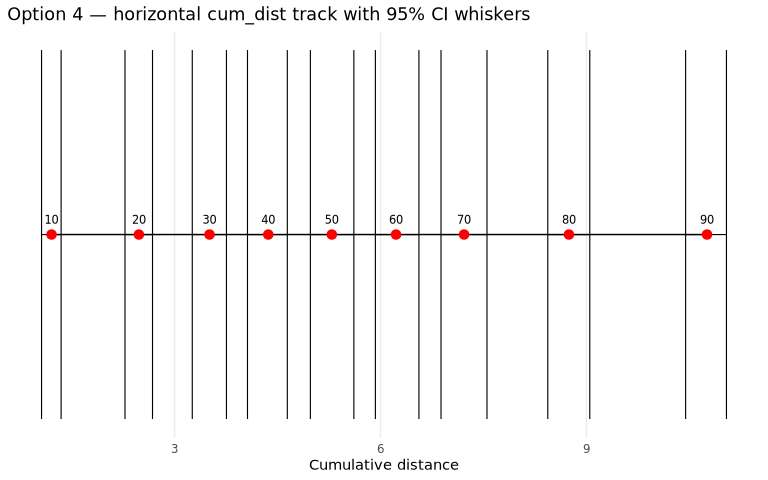

# 3. Tissue-level gene-expression distances by draw

### Prepare tissue gene draws

``` r
path_pred_tissue_gene_draws <-
  file.path(path_intermediate("fig4_rebuttal"), "pred_tissue_gene_draws.rds")
path_dist_gene_tissue_draws <-
  file.path(path_intermediate("fig4_rebuttal"), "distance_tissue_gene_draws.rds")

# Skip heavy unnest when draw-level distances are already cached.
if (file.exists(path_dist_gene_tissue_draws)) {
  message("Using cached tissue gene distances; skipping prediction unnest.")
  pred_tissue_gene_draws <- NULL
} else if (file.exists(path_pred_tissue_gene_draws)) {
  pred_tissue_gene_draws <- readRDS(path_pred_tissue_gene_draws)
  glimpse(pred_tissue_gene_draws)
} else {
  pred_total_path <- file.path(new_pred_root, "pred_total.rds")
  if (!file.exists(pred_total_path)) {
    stop(
      "Missing pred_total.rds at:\n  ", pred_total_path, "\n",
      "Place it under vignettes/data/intermediate/fig4/ ",
      "(or set NEW_PRED_DIR). Not needed if distance_tissue_gene_draws.rds ",
      "is already cached under fig4_rebuttal/."
    )
  }
  pred_total         <- readRDS(pred_total_path)
  pred_total_stomach <- readRDS(file.path(new_pred_root, "pred_total_stomach.rds"))
  pred_total_missing <- readRDS(file.path(new_pred_root, "pred_total_missing.rds"))

  if (!all(pred_total$.feature == short_list_total$.feature)) {
    stop("gene list unmatch!")
  }

  pred_tissue_gene_draws <-
    pred_total %>%
    mutate(cell_type = short_list_total$cell_type) %>%
    dplyr::select(-tar_group) %>%
    bind_rows(pred_total_stomach %>% dplyr::select(.feature, pred_df, cell_type)) %>%
    unnest(pred_df) %>%
    filter(!tissue_groups %in% unique(pred_total_missing$tissue_groups)) %>%
    bind_rows(
      pred_total_missing %>%
        dplyr::select(-tissue_groups) %>%
        unnest(pred_df) %>%
        dplyr::select(.feature, age_decade, tissue_groups, draws, count_avg, cell_type)
    ) %>%
    # Same collapse as Fig4 (mean over draws), but keep draws:
    # Fig4: group_by(tissue, cell_type, .feature, age) %>% mean(count_avg)
    group_by(tissue_groups, cell_type, .feature, age_decade, draws) %>%
    summarise(count_avg = mean(count_avg, na.rm = TRUE), .groups = "drop") %>%
    mutate(
      sample_id = paste0("my_sample_", age_decade),
      L3 = paste0(cell_type, "_", .feature),
      age_decade = factor(age_decade, levels = as.character(1:9))
    ) %>%
    filter(age_decade %in% as.character(1:9))

  saveRDS(pred_tissue_gene_draws, path_pred_tissue_gene_draws)
  glimpse(pred_tissue_gene_draws)
}
```

### Distance by draw (all tissues)

``` r
if (file.exists(path_dist_gene_tissue_draws)) {
  distance_tissue_gene_draws <- readRDS(path_dist_gene_tissue_draws)
} else {
  distance_tissue_gene_draws <-
    pred_tissue_gene_draws %>%
    nest(data = -c(tissue_groups, draws)) %>%
    filter(map_int(data, ~ .x |> distinct(age_decade) |> nrow()) > 2) %>%
    filter(tissue_groups |> str_detect("trachea|sensory|endocrine", negate = TRUE)) %>%
    mutate(
      distance_df = map(
        data,
        pred_to_age_distance,
        trans_fx = log1p,
        .abundance = count_avg
      )
    ) %>%
    dplyr::select(tissue_groups, draws, distance_df) %>%
    unnest(distance_df)

  saveRDS(distance_tissue_gene_draws, path_dist_gene_tissue_draws)
}

distance_tissue_gene <-
  summarise_distance_draws(
    distance_tissue_gene_draws,
    group_vars = c("tissue_groups", "age_decade_continuous")
  ) %>%
  dplyr::rename(
    step_dist_mean = step_dist_draw_mean,
    cum_dist_mean = cum_dist_draw_mean
  ) %>%
  mutate(modality = "gene_expr", level = "tissue")

print(distance_tissue_gene %>% group_by(tissue_groups) %>% summarise(n_ages = dplyr::n(), .groups = "drop"))
```

    # A tibble: 25 × 2
       tissue_groups                       n_ages
       <chr>                                <int>
     1 adipose tissue                           5
     2 blood                                    8
     3 bone marrow                              6
     4 brainstem and cerebellar structures      6
     5 breast                                   7
     6 cardiovascular system                    3
     7 cerebral lobes and cortical areas        7
     8 digestive system (general)               4
     9 female reproductive system               5
    10 general brain and major structures       3
    # ℹ 15 more rows

``` r
print(distance_tissue_gene %>% filter(tissue_groups == "blood"))
```

    # A tibble: 8 × 13
      tissue_groups age_decade_continuous step_dist_mean step_dist_draw_median
      <chr>                         <int>          <dbl>                 <dbl>
    1 blood                             2          1.89                  1.88 
    2 blood                             3          1.51                  1.51 
    3 blood                             4          1.00                  1.00 
    4 blood                             5          0.960                 0.961
    5 blood                             6          0.951                 0.952
    6 blood                             7          0.998                 0.996
    7 blood                             8          1.08                  1.08 
    8 blood                             9          1.52                  1.52 
    # ℹ 9 more variables: step_dist_lower <dbl>, step_dist_upper <dbl>,
    #   cum_dist_mean <dbl>, cum_dist_draw_median <dbl>, cum_dist_lower <dbl>,
    #   cum_dist_upper <dbl>, n_draws <int>, modality <chr>, level <chr>

### Sanity check — tissue gene vs Fig4 (blood + all tissues)

Same distinction as body: Fig4 = distance(mean profile); rebuttal mean =
mean(distance). Check blood in detail; report max discrepancy across
tissues.

``` r
path_fig4_tissue <-
  file.path(path_intermediate("fig4_rebuttal"), "distance_tissue_gene_fig4.rds")

if (file.exists(path_fig4_tissue)) {
  distance_tissue_gene_fig4 <- readRDS(path_fig4_tissue)
} else if (!is.null(pred_tissue_gene_draws)) {
  pred_tissue_mean_profile <-
    pred_tissue_gene_draws %>%
    group_by(tissue_groups, cell_type, .feature, age_decade, sample_id, L3) %>%
    summarise(count_mean = mean(count_avg, na.rm = TRUE), .groups = "drop")

  distance_tissue_gene_fig4 <-
    pred_tissue_mean_profile %>%
    filter(age_decade %in% as.character(1:9)) %>%
    nest(data = -tissue_groups) %>%
    filter(map_int(data, ~ .x |> distinct(age_decade) |> nrow()) > 2) %>%
    filter(tissue_groups |> str_detect("trachea|sensory|endocrine", negate = TRUE)) %>%
    mutate(distance_df = map(
      data, pred_to_age_distance, trans_fx = log1p, .abundance = count_mean
    )) %>%
    dplyr::select(tissue_groups, distance_df) %>%
    unnest(distance_df) %>%
    as_tibble() %>%
    dplyr::select(tissue_groups, age_decade_continuous, step_dist, cum_dist)
  saveRDS(distance_tissue_gene_fig4, path_fig4_tissue)
} else {
  stop("Need distance_tissue_gene_fig4.rds or pred_tissue_gene_draws to sanity-check.")
}

gene_tissue_sanity <-
  distance_tissue_gene_fig4 %>%
  inner_join(
    distance_tissue_gene %>%
      dplyr::select(
        tissue_groups, age_decade_continuous,
        step_dist_mean, cum_dist_mean,
        step_dist_lower, step_dist_upper,
        cum_dist_lower, cum_dist_upper
      ),
    by = c("tissue_groups", "age_decade_continuous")
  ) %>%
  mutate(
    d_step = step_dist_mean - step_dist,
    d_cum = cum_dist_mean - cum_dist
  )

cat("Blood (Fig4 vs mean-of-draw distances):\n")
```

    Blood (Fig4 vs mean-of-draw distances):

``` r
print(
  gene_tissue_sanity %>%
    filter(tissue_groups == "blood") %>%
    dplyr::select(age_decade_continuous, step_dist, step_dist_mean, d_step,
                  cum_dist, cum_dist_mean, d_cum)
)
```

    # A tibble: 8 × 7
      age_decade_continuous step_dist step_dist_mean  d_step cum_dist cum_dist_mean
                      <int>     <dbl>          <dbl>   <dbl>    <dbl>         <dbl>
    1                     2     1.93           1.89  -0.0496     1.93          1.89
    2                     3     1.52           1.51  -0.0146     3.46          3.39
    3                     4     1.10           1.00  -0.104      4.56          4.40
    4                     5     1.05           0.960 -0.0905     5.61          5.36
    5                     6     0.756          0.951  0.195      6.37          6.31
    6                     7     0.785          0.998  0.213      7.15          7.30
    7                     8     0.842          1.08   0.242      8.00          8.39
    8                     9     1.44           1.52   0.0804     9.43          9.90
    # ℹ 1 more variable: d_cum <dbl>

``` r
message(
  "All tissues: max |d_step|=", signif(max(abs(gene_tissue_sanity$d_step)), 3),
  ", max |d_cum|=", signif(max(abs(gene_tissue_sanity$d_cum)), 3)
)

# Interval construction check (blood)
.hand_b <- distance_tissue_gene_draws %>%
  filter(tissue_groups == "blood") %>%
  group_by(age_decade_continuous) %>%
  summarise(
    step_m = mean(step_dist),
    step_lo = unname(quantile(step_dist, 0.025)),
    step_hi = unname(quantile(step_dist, 0.975)),
    cum_m = mean(cum_dist),
    cum_lo = unname(quantile(cum_dist, 0.025)),
    cum_hi = unname(quantile(cum_dist, 0.975)),
    .groups = "drop"
  )
.rb <- distance_tissue_gene %>% filter(tissue_groups == "blood")
.stopif_diff <- function(a, b, tol = 1e-10) max(abs(a - b)) > tol
stopifnot(
  !.stopif_diff(.rb$step_dist_mean, .hand_b$step_m),
  !.stopif_diff(.rb$step_dist_lower, .hand_b$step_lo),
  !.stopif_diff(.rb$step_dist_upper, .hand_b$step_hi),
  !.stopif_diff(.rb$cum_dist_mean, .hand_b$cum_m),
  !.stopif_diff(.rb$cum_dist_lower, .hand_b$cum_lo),
  !.stopif_diff(.rb$cum_dist_upper, .hand_b$cum_hi)
)
message("Blood gene: interval summarise OK (n_draws = ", unique(.rb$n_draws), ").")
```

### Plot — Fig4 Panel D style (tissue gene)

``` r
# Replicate Fig4 Panel D for gene expression only (same smooth + rescale).
# Use posterior-mean step/cum distances in place of Fig4's point-estimate trajectory.

linear_distance_tissue_gene <-
  distance_tissue_gene_draws %>%
  group_by(tissue_groups, age_decade_continuous) %>%
  summarise(
    step_dist = mean(step_dist, na.rm = TRUE),
    cum_dist  = mean(cum_dist, na.rm = TRUE),
    min_age_decade = min(min_age_decade, na.rm = TRUE),
    max_age_decade = max(max_age_decade, na.rm = TRUE),
    .groups = "drop"
  ) %>%
  nest(distance_df = -tissue_groups)

smoothed_df_2D_gene_expr <-
  smooth_ageing_velocity(linear_distance_tissue_gene, fine_grid = seq(1, 9, by = 0.05))

# Same scaling / ordering as Fig4.qmd Panel D (gene_expr branch only).
smoothed_df_2D_gene <-
  smoothed_df_2D_gene_expr %>%
  filter(!tissue_groups %in% c("digestive system (general)")) %>%
  mutate(version = "gene_expr") %>%
  mutate(step_dist_scaled = scales::rescale(step_dist, to = c(0, 10))) %>%
  group_by(tissue_groups) %>%
  mutate(min_main_peak = min(main_peak_age, na.rm = TRUE)) %>%
  ungroup() %>%
  arrange(-min_main_peak, tissue_groups)

pin_first <- c("thymus", "blood")

tissue_order <-
  smoothed_df_2D_gene %>%
  group_by(tissue_groups) %>%
  summarise(min_main_peak = min(main_peak_age, na.rm = TRUE), .groups = "drop") %>%
  arrange(desc(min_main_peak), tissue_groups) %>%
  pull(tissue_groups) %>%
  as.character()

tissue_order <- c(
  tissue_order[!tissue_order %in% pin_first],
  pin_first[pin_first %in% tissue_order]
)

smoothed_df_2D_gene <-
  smoothed_df_2D_gene %>%
  mutate(tissue_groups = factor(tissue_groups, levels = tissue_order))

plot_tissue_gene_panel_D_original <-
  smoothed_df_2D_gene %>%
  filter(between(age_decade_continuous, min_age_decade, max_age_decade)) %>%
  ggplot(aes(x = age_decade_continuous * 10, y = tissue_groups)) +
  geom_line(aes(color = step_dist_scaled, linewidth = step_dist_scaled)) +
  scale_color_gradientn(
    colors = rev(RColorBrewer::brewer.pal(11, "RdYlBu")),
    name = "gene_expr"
  ) +
  scale_linewidth(range = c(0.5, 4), guide = "none") +
  geom_point(aes(x = main_peak_age * 10), color = "black", size = 0.9) +
  geom_point(aes(x = secondary_peak_age * 10), shape = 12, size = 0.6, color = "black") +
  scale_y_discrete(limits = tissue_order) +
  theme_minimal() +
  labs(
    title = "Panel D (gene expression) — Fig4-style smoothing & scaling",
    x = "Age years",
    y = "Tissue"
  ) +
  theme(legend.position = "right")

plot_tissue_gene_panel_D_original
```

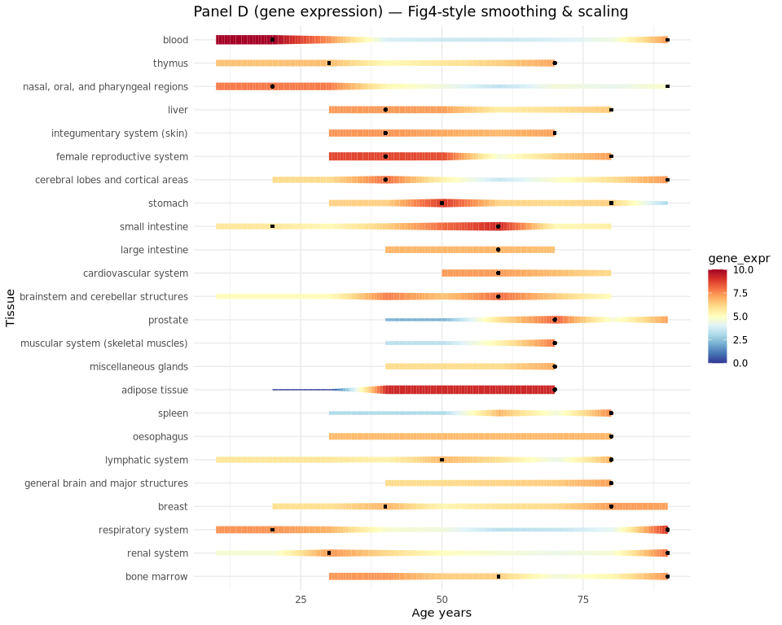

### Plot options — 95% intervals (blood gene)

Same interval sketches as body gene, restricted to **blood** from
`distance_tissue_gene` (pick one later for the rebuttal figure):

1.  Vertical error bars for `step_dist` and `cum_dist`
2.  Ribbon / shaded band vs age
3.  Horizontal cum_dist track with CI whiskers

``` r
age_years <- function(d) d * 10 - 10

distance_blood_gene <-
  distance_tissue_gene %>%
  filter(tissue_groups == "blood")

# --- Option 1: age vs distance, vertical 95% error bars -----------------------
plot_blood_gene_step_errorbar <-
  distance_blood_gene %>%
  ggplot(aes(x = age_years(age_decade_continuous), y = step_dist_mean)) +
  geom_line(linewidth = 0.4) +
  geom_point(color = "red", size = 2.5) +
  geom_errorbar(
    aes(ymin = step_dist_lower, ymax = step_dist_upper),
    width = 2, linewidth = 0.4
  ) +
  theme_minimal() +
  labs(
    title = "Blood gene — Option 1a: step_dist mean ± 95% CI",
    x = "Age (years)", y = "Step distance"
  )

plot_blood_gene_cum_errorbar <-
  distance_blood_gene %>%
  ggplot(aes(x = age_years(age_decade_continuous), y = cum_dist_mean)) +
  geom_line(linewidth = 0.4) +
  geom_point(color = "red", size = 2.5) +
  geom_errorbar(
    aes(ymin = cum_dist_lower, ymax = cum_dist_upper),
    width = 2, linewidth = 0.4
  ) +
  theme_minimal() +
  labs(
    title = "Blood gene — Option 1b: cum_dist mean ± 95% CI",
    x = "Age (years)", y = "Cumulative distance"
  )

# --- Option 3: ribbon vs age --------------------------------------------------
plot_blood_gene_step_ribbon <-
  distance_blood_gene %>%
  ggplot(aes(x = age_years(age_decade_continuous), y = step_dist_mean)) +
  geom_ribbon(aes(ymin = step_dist_lower, ymax = step_dist_upper), alpha = 0.25) +
  geom_line(linewidth = 0.5) +
  geom_point(color = "red", size = 2.5) +
  theme_minimal() +
  labs(
    title = "Blood gene — Option 3a: step_dist ribbon (95% CI)",
    x = "Age (years)", y = "Step distance"
  )

plot_blood_gene_cum_ribbon <-
  distance_blood_gene %>%
  ggplot(aes(x = age_years(age_decade_continuous), y = cum_dist_mean)) +
  geom_ribbon(aes(ymin = cum_dist_lower, ymax = cum_dist_upper), alpha = 0.25) +
  geom_line(linewidth = 0.5) +
  geom_point(color = "red", size = 2.5) +
  theme_minimal() +
  labs(
    title = "Blood gene — Option 3b: cum_dist ribbon (95% CI)",
    x = "Age (years)", y = "Cumulative distance"
  )

# --- Option 4: horizontal cum_dist track with CI whiskers ---------------------
plot_blood_gene_cum_horizontal_ci <-
  distance_blood_gene %>%
  mutate(
    x = cum_dist_mean,
    xmin = cum_dist_lower,
    xmax = cum_dist_upper
  ) %>%
  ggplot(aes(x = x, y = 0)) +
  geom_line() +
  geom_errorbarh(aes(xmin = xmin, xmax = xmax), height = 0.15, linewidth = 0.4) +
  geom_point(color = "red", size = 3) +
  geom_text(aes(label = age_years(age_decade_continuous)), vjust = -1.2, size = 3) +
  theme_minimal() +
  theme(
    axis.title.y = element_blank(), axis.text.y = element_blank(), axis.ticks.y = element_blank(),
    panel.grid.major.y = element_blank(), panel.grid.minor = element_blank()
  ) +
  labs(
    title = "Blood gene — Option 4: horizontal cum_dist track with 95% CI",
    x = "Cumulative distance"
  )

print(plot_blood_gene_step_errorbar)
```

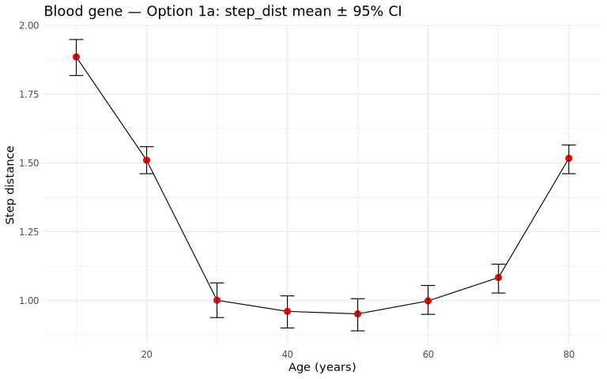

``` r
print(plot_blood_gene_cum_errorbar)
```

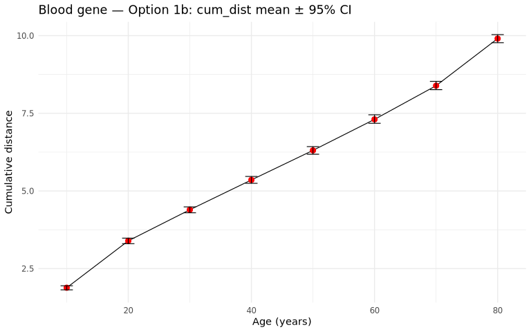

``` r
print(plot_blood_gene_step_ribbon)
```

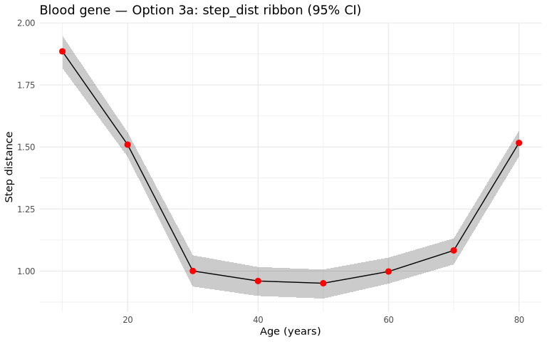

``` r
print(plot_blood_gene_cum_ribbon)
```

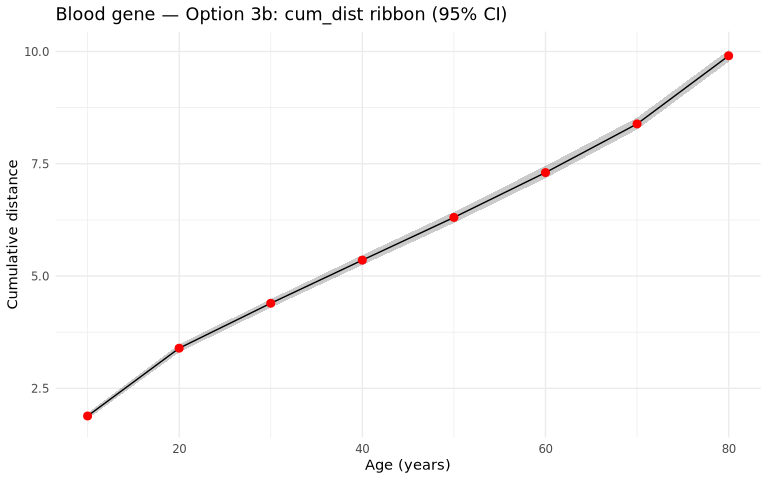

``` r
print(plot_blood_gene_cum_horizontal_ci)
```

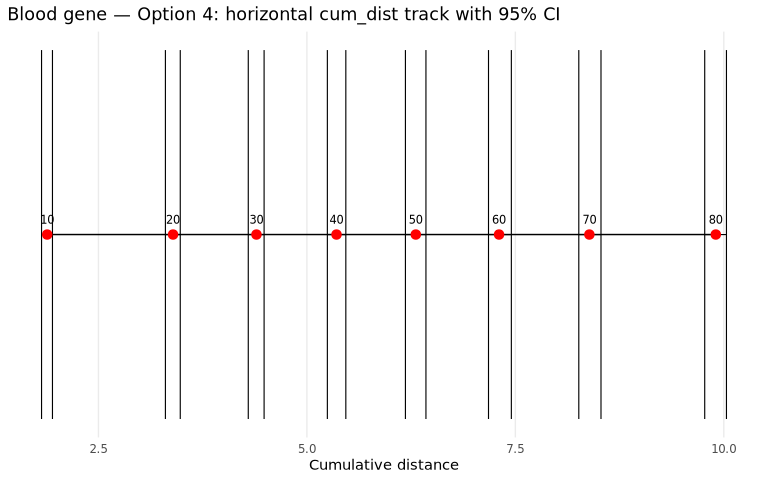

# 4. Composition posterior draws

Centre = distance(median proportion profile) — Fig4 plug-in estimand  
(`sccomp` `proportion_mean` with `robust = TRUE` is the median).  
Uncertainty = 2.5%/97.5% of distances computed **per draw**.  
`mean`/`median` of draw-level distances are diagnostics only
(`T(median(P)) ≠ median(T(P))`).

### Cells of interest (same contrast filter as Fig4)

``` r
path_cells <- file.path(path_intermediate("fig4_rebuttal"), "cells_of_interest.rds")

if (file.exists(path_cells)) {
  cells_of_interest <- readRDS(path_cells)
} else {
  # Same split_at_* contrast logic as Fig4; needs sccomp estimates to rebuild.
  est <- readRDS(
    path_sccomp_estimates("estimates_age_decade___L3___disease_FALSE___immune_only_TRUE.rds")
  )
  all_decades <- 1:9
  make_contrast_string <- function(k) {
    left  <- paste0("age_decade", all_decades[1:k], collapse = " + ")
    right <- paste0("age_decade", all_decades[(k + 1):length(all_decades)], collapse = " + ")
    sprintf("(%s)/%d - (%s)/%d", right, length(all_decades) - k, left, k)
  }
  contrast_strings <- sapply(1:(length(all_decades) - 1), make_contrast_string)
  contrast_strings <- map_chr(
    contrast_strings,
    ~ str_replace_all(.x, "\\b(age_decade\\d+|0)\\b", "`\\1`")
  )
  contrast_strings <- map_chr(contrast_strings, ~ str_replace_all(.x, "`age_decade5`", "0"))
  names(contrast_strings) <- paste0("split_at_", all_decades[2:length(all_decades)])
  my_test <- est |> sccomp::sccomp_test(contrasts = contrast_strings)
  cells_of_interest <-
    my_test |>
    dplyr::filter(c_pH0 < 0.05) |>
    dplyr::count(L3) |>
    dplyr::arrange(dplyr::desc(n)) |>
    dplyr::pull(L3)
  saveRDS(cells_of_interest, path_cells)
}

cells_of_interest
```

     [1] "b naive"         "cd16 mono"       "cd4 naive"       "cd4 th1/th17 em"
     [5] "cd4 th17 em"     "cd4 th2 em"      "cd8 naive"       "cd8 tem"        
     [9] "cytotoxic"       "granulocyte"     "nkt"             "plasma"         

### Validation — sccomp robust summary ≡ manual median (same rng)

One shared `replicate_data()` rng → native
`summary_to_tibble(..., robust = TRUE)` vs manual median / 2.5%–97.5% of
those draws → both through `pred_to_age_distance()`. Two separate
`sccomp_predict()` calls are not a same-draw test. Caches:
`*_validation_seed12345.rds` under `fig4_rebuttal/` (delete to rebuild).

``` r
sccomp_validation_seed <- 12345L
sccomp_validation_n_draws <- 500L
tol_soft <- 1e-8

path_validation_draws <- file.path(
  path_intermediate("fig4_rebuttal"),
  sprintf("sccomp_age_pred_draws_validation_seed%d.rds", sccomp_validation_seed)
)
path_validation_summary <- file.path(
  path_intermediate("fig4_rebuttal"),
  sprintf("sccomp_age_pred_summary_validation_seed%d.rds", sccomp_validation_seed)
)
path_validation_distance <- file.path(
  path_intermediate("fig4_rebuttal"),
  sprintf("distance_body_composition_validation_seed%d.rds", sccomp_validation_seed)
)

est_validation <- readRDS(
  path_sccomp_estimates("estimates_age_decade___L3___disease_FALSE___immune_only_TRUE.rds")
)

new_data_validation <-
  est_validation |>
  attr("count_data") |>
  sccomp:::.subset(sample_id) |>
  dplyr::distinct(age_decade) |>
  dplyr::mutate(sex = NA, ethnicity_groups_imputed = NA) |>
  dplyr::arrange(age_decade) |>
  dplyr::mutate(sample_id = paste0("my_sample_", dplyr::row_number()))

.sample_val <- attr(est_validation, ".sample")
.cell_group_val <- attr(est_validation, ".cell_group")
model_input_val <- attr(est_validation, "model_input")
sample_names_val <- new_data_validation |>
  dplyr::distinct(!!.sample_val) |>
  dplyr::pull(!!.sample_val)

sccomp_attach_prediction_ids <- function(prediction_df) {
  pred <-
    prediction_df |>
    tidyr::nest(data = -N) |>
    dplyr::arrange(N) |>
    dplyr::mutate(!!.sample_val := sample_names_val) |>
    tidyr::unnest(data) |>
    tidyr::nest(data = -M) |>
    dplyr::mutate(!!.cell_group_val := colnames(model_input_val$y)) |>
    tidyr::unnest(data) |>
    dplyr::select(-N, -M) |>
    dplyr::select(!!.cell_group_val, !!.sample_val, dplyr::everything())
  dplyr::left_join(new_data_validation, pred, by = dplyr::join_by(!!.sample_val))
}

if (file.exists(path_validation_summary) && file.exists(path_validation_draws)) {
  pred_comp_summary_validation <- readRDS(path_validation_summary)
  pred_comp_draws_validation <- readRDS(path_validation_draws)
} else {
  set.seed(sccomp_validation_seed)
  rng_validation <- sccomp:::replicate_data(
    est_validation,
    formula_composition = ~ age_decade * sex + ethnicity_groups_imputed,
    formula_variability = ~1,
    new_data = new_data_validation,
    number_of_draws = sccomp_validation_n_draws,
    mcmc_seed = sccomp_validation_seed
  )
  pred_comp_summary_validation <-
    sccomp:::summary_to_tibble(rng_validation, "mu", "M", "N", robust = TRUE) |>
    dplyr::select(
      M, N,
      proportion_mean = dplyr::any_of(c("mean", "median")),
      proportion_lower = `2.5%`,
      proportion_upper = `97.5%`
    ) |>
    sccomp_attach_prediction_ids()
  pred_comp_draws_validation <-
    sccomp:::draws_to_tibble_x_y(rng_validation, "mu", "M", "N") |>
    dplyr::select(M, N, proportion = .value, .draw) |>
    sccomp_attach_prediction_ids()
  saveRDS(pred_comp_summary_validation, path_validation_summary)
  saveRDS(pred_comp_draws_validation, path_validation_draws)
}

pred_comp_manual_validation <-
  pred_comp_draws_validation %>%
  dplyr::group_by(sample_id, age_decade, L3) %>%
  dplyr::summarise(
    proportion_manual = stats::median(proportion, na.rm = TRUE),
    proportion_lower_manual = unname(stats::quantile(proportion, 0.025, na.rm = TRUE)),
    proportion_upper_manual = unname(stats::quantile(proportion, 0.975, na.rm = TRUE)),
    .groups = "drop"
  )

comp_prop_validation <-
  pred_comp_summary_validation %>%
  dplyr::select(sample_id, age_decade, L3, proportion_mean, proportion_lower, proportion_upper) %>%
  dplyr::inner_join(pred_comp_manual_validation, by = c("sample_id", "age_decade", "L3")) %>%
  dplyr::mutate(
    d_centre = proportion_manual - proportion_mean,
    d_lower = proportion_lower_manual - proportion_lower,
    d_upper = proportion_upper_manual - proportion_upper
  )

validation_prop_summary <- tibble::tibble(
  max_abs_diff_centre = max(abs(comp_prop_validation$d_centre), na.rm = TRUE),
  mean_abs_diff_centre = mean(abs(comp_prop_validation$d_centre), na.rm = TRUE),
  max_abs_diff_lower = max(abs(comp_prop_validation$d_lower), na.rm = TRUE),
  max_abs_diff_upper = max(abs(comp_prop_validation$d_upper), na.rm = TRUE),
  n_rows = nrow(comp_prop_validation)
)
print(validation_prop_summary)
```

    # A tibble: 1 × 5
      max_abs_diff_centre mean_abs_diff_centre max_abs_diff_lower max_abs_diff_upper
                    <dbl>                <dbl>              <dbl>              <dbl>
    1                   0                    0                  0                  0
    # ℹ 1 more variable: n_rows <int>

``` r
if (max(
  validation_prop_summary$max_abs_diff_centre,
  validation_prop_summary$max_abs_diff_lower,
  validation_prop_summary$max_abs_diff_upper
) > tol_soft) {
  stop(
    "FAIL: same-rng proportion summaries diverge. ",
    "max|centre|=", signif(validation_prop_summary$max_abs_diff_centre, 6),
    ", max|lower|=", signif(validation_prop_summary$max_abs_diff_lower, 6),
    ", max|upper|=", signif(validation_prop_summary$max_abs_diff_upper, 6)
  )
}
message("PASS: native robust summary ≈ manual median/quantile.")

distance_native_validation <-
  pred_comp_summary_validation %>%
  dplyr::filter(L3 %in% cells_of_interest) %>%
  pred_to_age_distance(scale = TRUE, trans_fx = compositions::clr, .abundance = proportion_mean) %>%
  tibble::as_tibble() %>%
  dplyr::select(age_decade_continuous, step_dist, cum_dist)

distance_manual_validation <-
  pred_comp_manual_validation %>%
  dplyr::filter(L3 %in% cells_of_interest) %>%
  pred_to_age_distance(scale = TRUE, trans_fx = compositions::clr, .abundance = proportion_manual) %>%
  tibble::as_tibble() %>%
  dplyr::select(age_decade_continuous, step_dist, cum_dist)

comp_dist_validation <-
  distance_native_validation %>%
  dplyr::inner_join(
    distance_manual_validation,
    by = "age_decade_continuous",
    suffix = c("_native", "_manual")
  ) %>%
  dplyr::mutate(
    d_step = step_dist_manual - step_dist_native,
    d_cum = cum_dist_manual - cum_dist_native
  )

validation_dist_summary <- tibble::tibble(
  max_abs_diff_step = max(abs(comp_dist_validation$d_step), na.rm = TRUE),
  max_abs_diff_cum = max(abs(comp_dist_validation$d_cum), na.rm = TRUE)
)
print(validation_dist_summary)
```

    # A tibble: 1 × 2
      max_abs_diff_step max_abs_diff_cum
                  <dbl>            <dbl>
    1                 0                0

``` r
if (max(
  validation_dist_summary$max_abs_diff_step,
  validation_dist_summary$max_abs_diff_cum
) > tol_soft) {
  stop(
    "FAIL: same-rng distances diverge. ",
    "max|step|=", signif(validation_dist_summary$max_abs_diff_step, 6),
    ", max|cum|=", signif(validation_dist_summary$max_abs_diff_cum, 6)
  )
}
message("PASS: distance(native robust) ≈ distance(manual median).")

saveRDS(
  list(
    prop = validation_prop_summary,
    dist = validation_dist_summary,
    seed = sccomp_validation_seed,
    n_draws = sccomp_validation_n_draws
  ),
  path_validation_distance
)
```

### Prepare body composition draws

``` r
path_sccomp_age_pred_draws <-
  file.path(path_intermediate("fig4_rebuttal"), "sccomp_age_pred_draws.rds")

if (file.exists(path_sccomp_age_pred_draws)) {
  pred_comp_draws <- readRDS(path_sccomp_age_pred_draws)
} else {
  est <- readRDS(
    path_sccomp_estimates("estimates_age_decade___L3___disease_FALSE___immune_only_TRUE.rds")
  )
  pred_comp_draws <-
    est |>
    sccomp::sccomp_predict(
      formula_composition = ~ age_decade * sex + ethnicity_groups_imputed,
      new_data =
        est |>
        attr("count_data") |>
        sccomp:::.subset(sample_id) |>
        dplyr::distinct(age_decade) |>
        dplyr::mutate(sex = NA, ethnicity_groups_imputed = NA) |>
        dplyr::arrange(age_decade) |>
        dplyr::mutate(sample_id = paste0("my_sample_", dplyr::row_number())),
      summary_instead_of_draws = FALSE,
      number_of_draws = 500
    ) |>
    dplyr::mutate(sample_id_original = sample_id) |>
    tidyr::unite("sample_id", c(sample_id, .draw), remove = FALSE)
  saveRDS(pred_comp_draws, path_sccomp_age_pred_draws)
}

pred_comp_draws <-
  pred_comp_draws %>%
  dplyr::mutate(draws = as.character(.draw)) %>%
  dplyr::filter(L3 %in% cells_of_interest)

dplyr::glimpse(pred_comp_draws)
```

    Rows: 55,000
    Columns: 9
    $ age_decade               <fct> 5, 5, 5, 5, 5, 5, 5, 5, 5, 5, 5, 5, 5, 5, 5, …
    $ sex                      <lgl> NA, NA, NA, NA, NA, NA, NA, NA, NA, NA, NA, N…
    $ ethnicity_groups_imputed <lgl> NA, NA, NA, NA, NA, NA, NA, NA, NA, NA, NA, N…
    $ sample_id                <chr> "my_sample_1_1", "my_sample_1_2", "my_sample_…
    $ L3                       <chr> "b naive", "b naive", "b naive", "b naive", "…
    $ proportion               <dbl> 0.010121599, 0.042062808, 0.030379482, 0.0329…
    $ .draw                    <int> 1, 2, 3, 4, 5, 6, 7, 8, 9, 10, 11, 12, 13, 14…
    $ sample_id_original       <chr> "my_sample_1", "my_sample_1", "my_sample_1", …
    $ draws                    <chr> "1", "2", "3", "4", "5", "6", "7", "8", "9", …

# 5. Body-level composition distances by draw

### Distance by draw (body composition)

``` r
path_dist_comp_body_draws <-
  file.path(path_intermediate("fig4_rebuttal"), "distance_body_composition_draws.rds")

if (file.exists(path_dist_comp_body_draws)) {
  distance_body_composition_draws <- readRDS(path_dist_comp_body_draws)
} else {
  distance_body_composition_draws <-
    pred_comp_draws %>%
    nest(data = -draws) %>%
    mutate(
      distance_df = map(
        data,
        pred_to_age_distance,
        scale = TRUE,
        trans_fx = compositions::clr,
        .abundance = proportion
      )
    ) %>%
    dplyr::select(draws, distance_df) %>%
    unnest(distance_df)

  saveRDS(distance_body_composition_draws, path_dist_comp_body_draws)
}

# Draw-distribution summaries (diagnostics + CI only)
distance_body_composition_draw_summaries <-
  summarise_distance_draws(
    distance_body_composition_draws,
    group_vars = c("age_decade_continuous")
  )

# Centre = distance(component-wise median proportion profile) — Fig4 plug-in estimand
distance_body_composition_plugin <-
  pred_comp_draws %>%
  group_by(age_decade, sample_id_original, L3) %>%
  summarise(proportion_median = median(proportion, na.rm = TRUE), .groups = "drop") %>%
  mutate(sample_id = as.character(sample_id_original)) %>%
  pred_to_age_distance(
    scale = TRUE, trans_fx = compositions::clr, .abundance = proportion_median
  ) %>%
  as_tibble() %>%
  dplyr::select(
    age_decade_continuous,
    step_dist_centre = step_dist,
    cum_dist_centre = cum_dist
  )

distance_body_composition <-
  distance_body_composition_draw_summaries %>%
  left_join(distance_body_composition_plugin, by = "age_decade_continuous") %>%
  mutate(modality = "composition", level = "body") %>%
  dplyr::select(
    age_decade_continuous,
    step_dist_centre, step_dist_lower, step_dist_upper,
    cum_dist_centre, cum_dist_lower, cum_dist_upper,
    step_dist_draw_mean, step_dist_draw_median,
    cum_dist_draw_mean, cum_dist_draw_median,
    n_draws, modality, level
  )

print(distance_body_composition)
```

    # A tibble: 9 × 14
      age_decade_continuous step_dist_centre step_dist_lower step_dist_upper
                      <int>            <dbl>           <dbl>           <dbl>
    1                     2            0.883           0.782            1.90
    2                     3            1.44            0.895            2.06
    3                     4            0.912           0.681            1.69
    4                     5            0.578           0.380            1.04
    5                     6            0.760           0.369            1.08
    6                     7            1.07            0.632            1.78
    7                     8            0.982           0.631            1.72
    8                     9            1.17            0.719            1.86
    9                    10            1.45            1.16             2.53
    # ℹ 10 more variables: cum_dist_centre <dbl>, cum_dist_lower <dbl>,
    #   cum_dist_upper <dbl>, step_dist_draw_mean <dbl>,
    #   step_dist_draw_median <dbl>, cum_dist_draw_mean <dbl>,
    #   cum_dist_draw_median <dbl>, n_draws <int>, modality <chr>, level <chr>

### Plot — Fig4 Panel A style (body composition)

``` r
plot_comp_body_distance_original <-
  distance_body_composition %>%
  mutate(cum_dist_scaled = scales::rescale(cum_dist_centre, to = c(0, 10))) %>%
  ggplot(aes(x = cum_dist_scaled, y = 0)) +
  geom_line() +
  geom_point(color = "red", size = 3) +
  geom_text(aes(label = age_decade_continuous * 10 - 10), vjust = -1, size = 3) +
  theme_minimal() +
  theme(
    axis.title.x = element_blank(), axis.text.x = element_blank(), axis.ticks.x = element_blank(),
    axis.title.y = element_blank(), axis.text.y = element_blank(), axis.ticks.y = element_blank(),
    panel.grid.major = element_blank(), panel.grid.minor = element_blank()
  ) +
  labs(title = "Composition — body (median-profile plug-in cum_dist; Fig4 estimand)")

plot_comp_body_distance_original
```

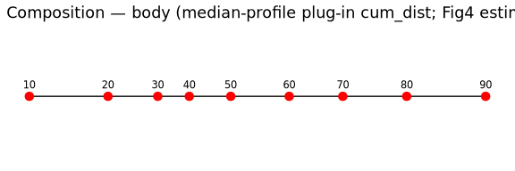

### Plot options — 95% intervals (body composition)

Same sketches as body gene (pick one later):

1.  Vertical error bars (`step_dist`, `cum_dist`)
2.  Ribbon vs age
3.  Horizontal cum_dist track with CI whiskers

``` r
age_years <- function(d) d * 10 - 10

plot_comp_body_step_errorbar <-
  distance_body_composition %>%
  ggplot(aes(x = age_years(age_decade_continuous), y = step_dist_centre)) +
  geom_line(linewidth = 0.4) +
  geom_point(color = "red", size = 2.5) +
  geom_errorbar(
    aes(ymin = step_dist_lower, ymax = step_dist_upper),
    width = 2, linewidth = 0.4
  ) +
  theme_minimal() +
  labs(
    title = "Body composition — Option 1a: step_dist plug-in ± 95% CI (draws)",
    x = "Age (years)", y = "Step distance"
  )

plot_comp_body_cum_errorbar <-
  distance_body_composition %>%
  ggplot(aes(x = age_years(age_decade_continuous), y = cum_dist_centre)) +
  geom_line(linewidth = 0.4) +
  geom_point(color = "red", size = 2.5) +
  geom_errorbar(
    aes(ymin = cum_dist_lower, ymax = cum_dist_upper),
    width = 2, linewidth = 0.4
  ) +
  theme_minimal() +
  labs(
    title = "Body composition — Option 1b: cum_dist plug-in ± 95% CI (draws)",
    x = "Age (years)", y = "Cumulative distance"
  )

plot_comp_body_step_ribbon <-
  distance_body_composition %>%
  ggplot(aes(x = age_years(age_decade_continuous), y = step_dist_centre)) +
  geom_ribbon(aes(ymin = step_dist_lower, ymax = step_dist_upper), alpha = 0.25) +
  geom_line(linewidth = 0.5) +
  geom_point(color = "red", size = 2.5) +
  theme_minimal() +
  labs(
    title = "Body composition — Option 3a: step_dist ribbon (95% CI)",
    x = "Age (years)", y = "Step distance"
  )

plot_comp_body_cum_ribbon <-
  distance_body_composition %>%
  ggplot(aes(x = age_years(age_decade_continuous), y = cum_dist_centre)) +
  geom_ribbon(aes(ymin = cum_dist_lower, ymax = cum_dist_upper), alpha = 0.25) +
  geom_line(linewidth = 0.5) +
  geom_point(color = "red", size = 2.5) +
  theme_minimal() +
  labs(
    title = "Body composition — Option 3b: cum_dist ribbon (95% CI)",
    x = "Age (years)", y = "Cumulative distance"
  )

plot_comp_body_cum_horizontal_ci <-
  distance_body_composition %>%
  mutate(x = cum_dist_centre, xmin = cum_dist_lower, xmax = cum_dist_upper) %>%
  ggplot(aes(x = x, y = 0)) +
  geom_line() +
  geom_errorbarh(aes(xmin = xmin, xmax = xmax), height = 0.15, linewidth = 0.4) +
  geom_point(color = "red", size = 3) +
  geom_text(aes(label = age_years(age_decade_continuous)), vjust = -1.2, size = 3) +
  theme_minimal() +
  theme(
    axis.title.y = element_blank(), axis.text.y = element_blank(), axis.ticks.y = element_blank(),
    panel.grid.major.y = element_blank(), panel.grid.minor = element_blank()
  ) +
  labs(
    title = "Body composition — Option 4: horizontal cum_dist track with 95% CI",
    x = "Cumulative distance"
  )

print(plot_comp_body_step_errorbar)
```

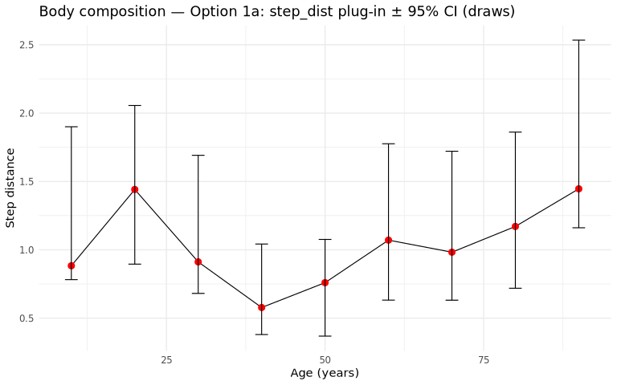

``` r
print(plot_comp_body_cum_errorbar)
```

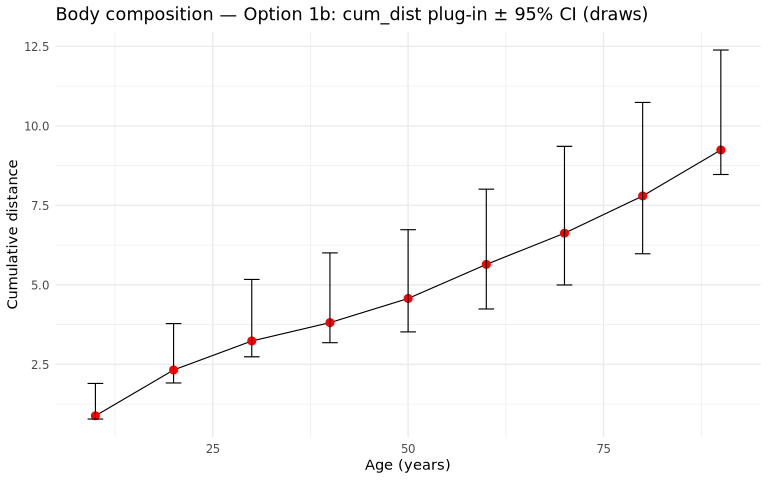

``` r
print(plot_comp_body_step_ribbon)
```

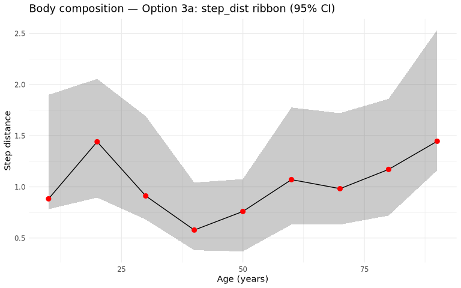

``` r
print(plot_comp_body_cum_ribbon)
```

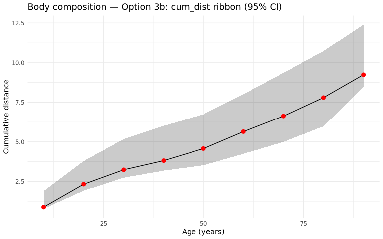

``` r
print(plot_comp_body_cum_horizontal_ci)
```

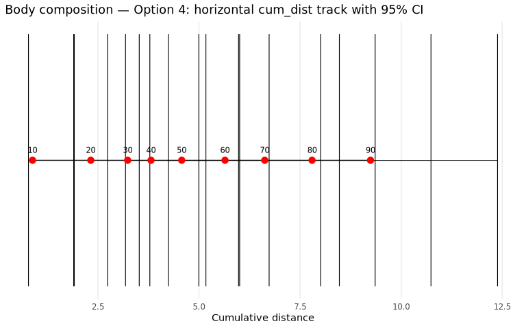

# 6. Tissue-level composition distances by draw

### Prepare tissue composition draws

``` r
path_sccomp_age_tissue_pred_draws <-
  file.path(path_intermediate("fig4_rebuttal"), "sccomp_age_tissue_pred_draws.rds")

if (file.exists(path_sccomp_age_tissue_pred_draws)) {
  pred_comp_tissue_draws <- readRDS(path_sccomp_age_tissue_pred_draws)
} else {
  est <- readRDS(
    path_sccomp_estimates("estimates_age_decade___L3___disease_FALSE___immune_only_TRUE.rds")
  )
  pred_comp_tissue_draws <-
    est |>
    sccomp::sccomp_predict(
      formula_composition = ~ age_decade * sex + ethnicity_groups_imputed +
        (age_decade * sex + ethnicity_groups_imputed | tissue_groups),
      new_data =
        est |>
        attr("count_data") |>
        sccomp:::.subset(sample_id) |>
        dplyr::distinct(age_decade, tissue_groups) |>
        dplyr::arrange(age_decade) |>
        dplyr::mutate(sex = NA, ethnicity_groups_imputed = NA) |>
        dplyr::mutate(sample_id = paste0("my_sample_", dplyr::row_number())) |>
        dplyr::mutate(sample_id = dplyr::if_else(
          is.na(sample_id),
          paste0("my_sample_imputed_", dplyr::row_number()),
          sample_id
        )),
      summary_instead_of_draws = FALSE,
      number_of_draws = 500
      # mcmc_seed default (random); delete tissue composition caches if regenerating.
    ) |>
    dplyr::mutate(sample_id_original = sample_id) |>
    tidyr::unite("sample_id", c(sample_id, .draw), remove = FALSE)
  saveRDS(pred_comp_tissue_draws, path_sccomp_age_tissue_pred_draws)
}

# Fig4 tissue composition distance uses all predicted L3 (no cells_of_interest filter).
pred_comp_tissue_draws <-
  pred_comp_tissue_draws %>%
  dplyr::mutate(draws = as.character(.draw)) %>%
  dplyr::filter(age_decade %in% as.character(1:9))

dplyr::glimpse(pred_comp_tissue_draws)
```

    Rows: 2,015,000
    Columns: 10
    $ age_decade               <fct> 5, 5, 5, 5, 5, 5, 5, 5, 5, 5, 5, 5, 5, 5, 5, …
    $ tissue_groups            <chr> "blood", "blood", "blood", "blood", "blood", …
    $ sex                      <lgl> NA, NA, NA, NA, NA, NA, NA, NA, NA, NA, NA, N…
    $ ethnicity_groups_imputed <lgl> NA, NA, NA, NA, NA, NA, NA, NA, NA, NA, NA, N…
    $ sample_id                <chr> "my_sample_1_1", "my_sample_1_2", "my_sample_…
    $ L3                       <chr> "b memory", "b memory", "b memory", "b memory…
    $ proportion               <dbl> 0.04156215, 0.05403331, 0.07260301, 0.0756877…
    $ .draw                    <int> 1, 2, 3, 4, 5, 6, 7, 8, 9, 10, 11, 12, 13, 14…
    $ sample_id_original       <chr> "my_sample_1", "my_sample_1", "my_sample_1", …
    $ draws                    <chr> "1", "2", "3", "4", "5", "6", "7", "8", "9", …

### Distance by draw (all tissues)

``` r
path_dist_comp_tissue_draws <-
  file.path(path_intermediate("fig4_rebuttal"), "distance_tissue_composition_draws.rds")

if (file.exists(path_dist_comp_tissue_draws)) {
  distance_tissue_composition_draws <- readRDS(path_dist_comp_tissue_draws)
} else {
  distance_tissue_composition_draws <-
    pred_comp_tissue_draws %>%
    nest(data = -c(tissue_groups, draws)) %>%
    filter(map_int(data, ~ .x |> distinct(age_decade) |> nrow()) > 2) %>%
    filter(tissue_groups |> str_detect("trachea|sensory|endocrine", negate = TRUE)) %>%
    mutate(
      distance_df = map(
        data,
        pred_to_age_distance,
        scale = TRUE,
        trans_fx = compositions::clr,
        .abundance = proportion
      )
    ) %>%
    dplyr::select(tissue_groups, draws, distance_df) %>%
    unnest(distance_df)

  saveRDS(distance_tissue_composition_draws, path_dist_comp_tissue_draws)
}

distance_tissue_composition_draw_summaries <-
  summarise_distance_draws(
    distance_tissue_composition_draws,
    group_vars = c("tissue_groups", "age_decade_continuous")
  )

# Centre = dist(median proportion profile) per tissue (Fig4 robust plug-in estimand)
distance_tissue_composition_plugin <-
  pred_comp_tissue_draws %>%
  group_by(tissue_groups, age_decade, sample_id_original, L3) %>%
  summarise(proportion_median = median(proportion, na.rm = TRUE), .groups = "drop") %>%
  mutate(sample_id = as.character(sample_id_original)) %>%
  nest(data = -tissue_groups) %>%
  filter(map_int(data, ~ .x |> distinct(age_decade) |> nrow()) > 2) %>%
  filter(tissue_groups |> str_detect("trachea|sensory|endocrine", negate = TRUE)) %>%
  mutate(distance_df = map(
    data,
    pred_to_age_distance,
    scale = TRUE,
    trans_fx = compositions::clr,
    .abundance = proportion_median
  )) %>%
  dplyr::select(tissue_groups, distance_df) %>%
  unnest(distance_df) %>%
  as_tibble() %>%
  dplyr::select(
    tissue_groups, age_decade_continuous,
    step_dist_centre = step_dist,
    cum_dist_centre = cum_dist
  ) %>%
  tibble::as_tibble()

distance_tissue_composition <-
  distance_tissue_composition_draw_summaries %>%
  inner_join(
    distance_tissue_composition_plugin,
    by = c("tissue_groups", "age_decade_continuous")
  ) %>%
  mutate(modality = "composition", level = "tissue") %>%
  dplyr::select(
    tissue_groups, age_decade_continuous,
    step_dist_centre, step_dist_lower, step_dist_upper,
    cum_dist_centre, cum_dist_lower, cum_dist_upper,
    step_dist_draw_mean, step_dist_draw_median,
    cum_dist_draw_mean, cum_dist_draw_median,
    n_draws, modality, level
  )

print(distance_tissue_composition %>% group_by(tissue_groups) %>% summarise(n_ages = dplyr::n(), .groups = "drop"))
```

    # A tibble: 22 × 2
       tissue_groups                     n_ages
       <chr>                              <int>
     1 adipose tissue                         6
     2 blood                                  8
     3 bone marrow                            5
     4 breast                                 7
     5 cardiovascular system                  3
     6 cerebral lobes and cortical areas      3
     7 digestive system (general)             2
     8 female reproductive system             5
     9 integumentary system (skin)            5
    10 large intestine                        6
    # ℹ 12 more rows

``` r
print(distance_tissue_composition %>% filter(tissue_groups == "blood"))
```

    # A tibble: 8 × 15
      tissue_groups age_decade_continuous step_dist_centre step_dist_lower
      <chr>                         <int>            <dbl>           <dbl>
    1 blood                             2            0.963           1.16 
    2 blood                             3            1.12            1.18 
    3 blood                             4            1.65            1.02 
    4 blood                             5            0.846           0.597
    5 blood                             6            0.744           0.546
    6 blood                             7            1.31            0.930
    7 blood                             8            0.981           1.02 
    8 blood                             9            1.06            1.02 
    # ℹ 11 more variables: step_dist_upper <dbl>, cum_dist_centre <dbl>,
    #   cum_dist_lower <dbl>, cum_dist_upper <dbl>, step_dist_draw_mean <dbl>,
    #   step_dist_draw_median <dbl>, cum_dist_draw_mean <dbl>,
    #   cum_dist_draw_median <dbl>, n_draws <int>, modality <chr>, level <chr>

### Plot — Fig4 Panel D style (tissue composition)

``` r
# Smooth the robust plug-in trajectory (median profile → distance), same as Fig4 centre.
linear_distance_tissue_comp <-
  distance_tissue_composition %>%
  dplyr::transmute(
    tissue_groups,
    age_decade_continuous,
    step_dist = step_dist_centre,
    cum_dist = cum_dist_centre
  ) %>%
  dplyr::left_join(
    distance_tissue_composition_draws %>%
      dplyr::group_by(tissue_groups) %>%
      dplyr::summarise(
        min_age_decade = min(min_age_decade, na.rm = TRUE),
        max_age_decade = max(max_age_decade, na.rm = TRUE),
        .groups = "drop"
      ),
    by = "tissue_groups"
  ) %>%
  tidyr::nest(distance_df = -tissue_groups)

smoothed_df_2D_composition <-
  smooth_ageing_velocity(linear_distance_tissue_comp, fine_grid = seq(1, 10, by = 0.05))

smoothed_df_2D_comp <-
  smoothed_df_2D_composition %>%
  filter(!tissue_groups %in% c("digestive system (general)")) %>%
  mutate(version = "composition") %>%
  mutate(step_dist_scaled = scales::rescale(step_dist, to = c(0, 10))) %>%
  group_by(tissue_groups) %>%
  mutate(min_main_peak = min(main_peak_age, na.rm = TRUE)) %>%
  ungroup() %>%
  arrange(-min_main_peak, tissue_groups)

pin_first <- c("thymus", "blood")

tissue_order_comp <-
  smoothed_df_2D_comp %>%
  group_by(tissue_groups) %>%
  summarise(min_main_peak = min(main_peak_age, na.rm = TRUE), .groups = "drop") %>%
  arrange(desc(min_main_peak), tissue_groups) %>%
  pull(tissue_groups) %>%
  as.character()

tissue_order_comp <- c(
  tissue_order_comp[!tissue_order_comp %in% pin_first],
  pin_first[pin_first %in% tissue_order_comp]
)

smoothed_df_2D_comp <-
  smoothed_df_2D_comp %>%
  mutate(tissue_groups = factor(tissue_groups, levels = tissue_order_comp))

plot_tissue_comp_panel_D_original <-
  smoothed_df_2D_comp %>%
  filter(between(age_decade_continuous, min_age_decade, max_age_decade)) %>%
  ggplot(aes(x = age_decade_continuous * 10, y = tissue_groups)) +
  geom_line(aes(color = step_dist_scaled, linewidth = step_dist_scaled)) +
  scale_color_gradientn(
    colors = rev(RColorBrewer::brewer.pal(11, "RdYlBu")),
    name = "composition"
  ) +
  scale_linewidth(range = c(0.5, 4), guide = "none") +
  geom_point(aes(x = main_peak_age * 10), color = "black", size = 0.9) +
  geom_point(aes(x = secondary_peak_age * 10), shape = 12, size = 0.6, color = "black") +
  scale_y_discrete(limits = tissue_order_comp) +
  theme_minimal() +
  labs(
    title = "Panel D (composition) — Fig4-style smoothing & scaling",
    x = "Age years",
    y = "Tissue"
  ) +
  theme(legend.position = "right")

plot_tissue_comp_panel_D_original
```

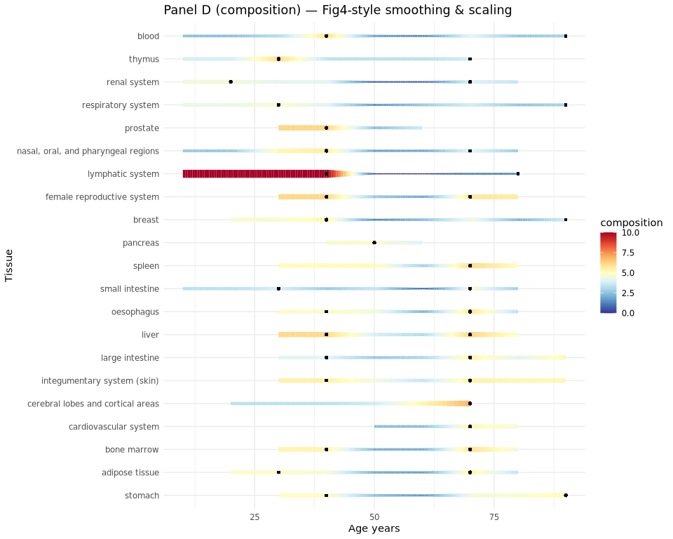

### Plot options — 95% intervals (blood composition)

``` r
age_years <- function(d) d * 10 - 10

distance_blood_composition <-
  distance_tissue_composition %>%
  filter(tissue_groups == "blood")

plot_blood_comp_step_errorbar <-
  distance_blood_composition %>%
  ggplot(aes(x = age_years(age_decade_continuous), y = step_dist_centre)) +
  geom_line(linewidth = 0.4) +
  geom_point(color = "red", size = 2.5) +
  geom_errorbar(
    aes(ymin = step_dist_lower, ymax = step_dist_upper),
    width = 2, linewidth = 0.4
  ) +
  theme_minimal() +
  labs(
    title = "Blood composition — Option 1a: step_dist plug-in ± 95% CI (draws)",
    x = "Age (years)", y = "Step distance"
  )

plot_blood_comp_cum_errorbar <-
  distance_blood_composition %>%
  ggplot(aes(x = age_years(age_decade_continuous), y = cum_dist_centre)) +
  geom_line(linewidth = 0.4) +
  geom_point(color = "red", size = 2.5) +
  geom_errorbar(
    aes(ymin = cum_dist_lower, ymax = cum_dist_upper),
    width = 2, linewidth = 0.4
  ) +
  theme_minimal() +
  labs(
    title = "Blood composition — Option 1b: cum_dist plug-in ± 95% CI (draws)",
    x = "Age (years)", y = "Cumulative distance"
  )

plot_blood_comp_step_ribbon <-
  distance_blood_composition %>%
  ggplot(aes(x = age_years(age_decade_continuous), y = step_dist_centre)) +
  geom_ribbon(aes(ymin = step_dist_lower, ymax = step_dist_upper), alpha = 0.25) +
  geom_line(linewidth = 0.5) +
  geom_point(color = "red", size = 2.5) +
  theme_minimal() +
  labs(
    title = "Blood composition — Option 3a: step_dist ribbon (95% CI)",
    x = "Age (years)", y = "Step distance"
  )

plot_blood_comp_cum_ribbon <-
  distance_blood_composition %>%
  ggplot(aes(x = age_years(age_decade_continuous), y = cum_dist_centre)) +
  geom_ribbon(aes(ymin = cum_dist_lower, ymax = cum_dist_upper), alpha = 0.25) +
  geom_line(linewidth = 0.5) +
  geom_point(color = "red", size = 2.5) +
  theme_minimal() +
  labs(
    title = "Blood composition — Option 3b: cum_dist ribbon (95% CI)",
    x = "Age (years)", y = "Cumulative distance"
  )

plot_blood_comp_cum_horizontal_ci <-
  distance_blood_composition %>%
  mutate(x = cum_dist_centre, xmin = cum_dist_lower, xmax = cum_dist_upper) %>%
  ggplot(aes(x = x, y = 0)) +
  geom_line() +
  geom_errorbarh(aes(xmin = xmin, xmax = xmax), height = 0.15, linewidth = 0.4) +
  geom_point(color = "red", size = 3) +
  geom_text(aes(label = age_years(age_decade_continuous)), vjust = -1.2, size = 3) +
  theme_minimal() +
  theme(
    axis.title.y = element_blank(), axis.text.y = element_blank(), axis.ticks.y = element_blank(),
    panel.grid.major.y = element_blank(), panel.grid.minor = element_blank()
  ) +
  labs(
    title = "Blood composition — Option 4: horizontal cum_dist track with 95% CI",
    x = "Cumulative distance"
  )

print(plot_blood_comp_step_errorbar)
```

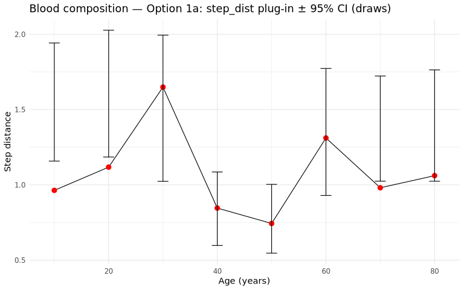

``` r
print(plot_blood_comp_cum_errorbar)
```

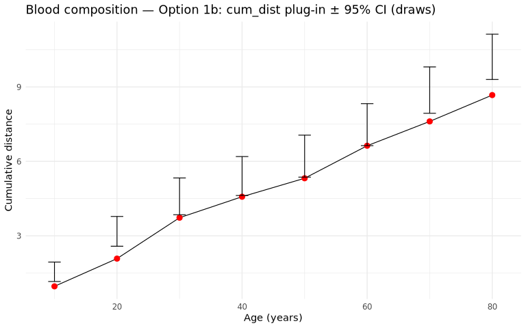

``` r
print(plot_blood_comp_step_ribbon)
```

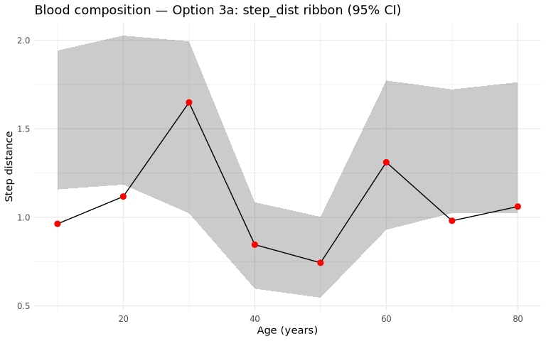

``` r
print(plot_blood_comp_cum_ribbon)
```

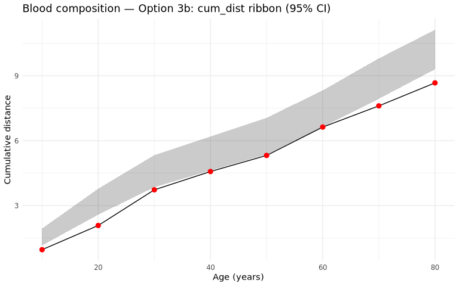

``` r
print(plot_blood_comp_cum_horizontal_ci)
```

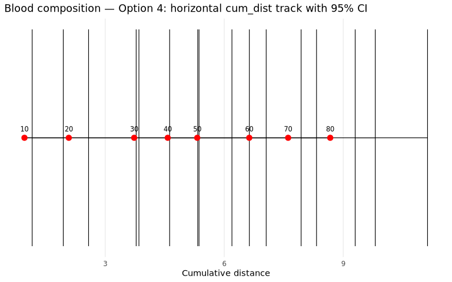

# 7. Panel D — ageing velocity from draw-level step_dist

For each draw, apply the same decade → fine-grid interpolation used in
Fig4, then summarise velocity (`step_dist`) across draws.

``` r
path_velocity_gene_draws <-
  file.path(path_intermediate("fig4_rebuttal"), "velocity_tissue_gene_draws.rds")

fine_grid_gene <- seq(1, 9, by = 0.05)

if (file.exists(path_velocity_gene_draws)) {
  velocity_tissue_gene_draws <- readRDS(path_velocity_gene_draws)
} else {
  velocity_tissue_gene_draws <-
    distance_tissue_gene_draws %>%
    nest(distance_df = -c(tissue_groups, draws)) %>%
    nest(tissue_block = -draws) %>%
    mutate(
      smoothed = map(
        tissue_block,
        ~ smooth_ageing_velocity(.x, fine_grid = fine_grid_gene)
      )
    ) %>%
    dplyr::select(draws, smoothed) %>%
    unnest(smoothed)

  saveRDS(velocity_tissue_gene_draws, path_velocity_gene_draws)
}

velocity_tissue_gene <-
  summarise_distance_draws(
    velocity_tissue_gene_draws,
    group_vars = c("tissue_groups", "age_decade_continuous")
  ) %>%
  dplyr::rename(
    step_dist_mean = step_dist_draw_mean,
    cum_dist_mean = cum_dist_draw_mean
  ) %>%
  mutate(modality = "gene_expr", level = "tissue_velocity")

glimpse(velocity_tissue_gene)
```

    Rows: 4,025
    Columns: 13
    $ tissue_groups         <chr> "adipose tissue", "adipose tissue", "adipose tis…
    $ age_decade_continuous <dbl> 1.00, 1.05, 1.10, 1.15, 1.20, 1.25, 1.30, 1.35, …
    $ step_dist_mean        <dbl> 0.4428972, 0.4428972, 0.4428972, 0.4428972, 0.44…
    $ step_dist_draw_median <dbl> 0.4458131, 0.4458131, 0.4458131, 0.4458131, 0.44…
    $ step_dist_lower       <dbl> 0.3692701, 0.3692701, 0.3692701, 0.3692701, 0.36…
    $ step_dist_upper       <dbl> 0.5096118, 0.5096118, 0.5096118, 0.5096118, 0.50…
    $ cum_dist_mean         <dbl> 0.4428972, 0.4428972, 0.4428972, 0.4428972, 0.44…
    $ cum_dist_draw_median  <dbl> 0.4458131, 0.4458131, 0.4458131, 0.4458131, 0.44…
    $ cum_dist_lower        <dbl> 0.3692701, 0.3692701, 0.3692701, 0.3692701, 0.36…
    $ cum_dist_upper        <dbl> 0.5096118, 0.5096118, 0.5096118, 0.5096118, 0.50…
    $ n_draws               <int> 400, 400, 400, 400, 400, 400, 400, 400, 400, 400…
    $ modality              <chr> "gene_expr", "gene_expr", "gene_expr", "gene_exp…
    $ level                 <chr> "tissue_velocity", "tissue_velocity", "tissue_ve…

``` r
path_velocity_comp_draws <-
  file.path(path_intermediate("fig4_rebuttal"), "velocity_tissue_composition_draws.rds")

fine_grid_comp <- seq(1, 10, by = 0.05)

if (file.exists(path_velocity_comp_draws)) {
  velocity_tissue_composition_draws <- readRDS(path_velocity_comp_draws)
} else {
  velocity_tissue_composition_draws <-
    distance_tissue_composition_draws %>%
    nest(distance_df = -c(tissue_groups, draws)) %>%
    nest(tissue_block = -draws) %>%
    mutate(
      smoothed = map(
        tissue_block,
        ~ smooth_ageing_velocity(.x, fine_grid = fine_grid_comp)
      )
    ) %>%
    dplyr::select(draws, smoothed) %>%
    unnest(smoothed)

  saveRDS(velocity_tissue_composition_draws, path_velocity_comp_draws)
}

velocity_tissue_composition <-
  summarise_distance_draws(
    velocity_tissue_composition_draws,
    group_vars = c("tissue_groups", "age_decade_continuous")
  ) %>%
  mutate(modality = "composition", level = "tissue_velocity")

glimpse(velocity_tissue_composition)
```

    Rows: 3,982
    Columns: 13
    $ tissue_groups         <chr> "adipose tissue", "adipose tissue", "adipose tis…
    $ age_decade_continuous <dbl> 1.00, 1.05, 1.10, 1.15, 1.20, 1.25, 1.30, 1.35, …
    $ step_dist_draw_mean   <dbl> 1.723237, 1.723237, 1.723237, 1.723237, 1.723237…
    $ step_dist_draw_median <dbl> 1.729041, 1.729041, 1.729041, 1.729041, 1.729041…
    $ step_dist_lower       <dbl> 1.348488, 1.348488, 1.348488, 1.348488, 1.348488…
    $ step_dist_upper       <dbl> 2.050224, 2.050224, 2.050224, 2.050224, 2.050224…
    $ cum_dist_draw_mean    <dbl> 1.723237, 1.723237, 1.723237, 1.723237, 1.723237…
    $ cum_dist_draw_median  <dbl> 1.729041, 1.729041, 1.729041, 1.729041, 1.729041…
    $ cum_dist_lower        <dbl> 1.348488, 1.348488, 1.348488, 1.348488, 1.348488…
    $ cum_dist_upper        <dbl> 2.050224, 2.050224, 2.050224, 2.050224, 2.050224…
    $ n_draws               <int> 500, 500, 500, 500, 500, 500, 500, 500, 500, 500…
    $ modality              <chr> "composition", "composition", "composition", "co…
    $ level                 <chr> "tissue_velocity", "tissue_velocity", "tissue_ve…

# 8. Summary tables for later plotting

``` r
# Named objects ready for age → mean ± 95% CI plots (not drawn here).
saveRDS(
  distance_body_composition,
  file.path(path_intermediate("fig4_rebuttal"), "distance_body_composition.rds")
)
saveRDS(
  distance_body_gene,
  file.path(path_intermediate("fig4_rebuttal"), "distance_body_gene.rds")
)
saveRDS(
  distance_tissue_composition,
  file.path(path_intermediate("fig4_rebuttal"), "distance_tissue_composition.rds")
)
saveRDS(
  distance_tissue_gene,
  file.path(path_intermediate("fig4_rebuttal"), "distance_tissue_gene.rds")
)
saveRDS(
  velocity_tissue_composition,
  file.path(path_intermediate("fig4_rebuttal"), "velocity_tissue_composition.rds")
)
saveRDS(
  velocity_tissue_gene,
  file.path(path_intermediate("fig4_rebuttal"), "velocity_tissue_gene.rds")
)

cat("\nColumn naming note: gene uses step/cum_dist_mean (= mean of draw distances);\n")
```


    Column naming note: gene uses step/cum_dist_mean (= mean of draw distances);

``` r
cat("composition uses step/cum_dist_centre (= distance of median proportion profile).\n\n")
```

    composition uses step/cum_dist_centre (= distance of median proportion profile).

``` r
cat("Body gene:\n")
```

    Body gene:

``` r
print(distance_body_gene %>% dplyr::select(age_decade_continuous, starts_with("cum_dist")))
```

    # A tibble: 9 × 5
      age_decade_continuous cum_dist_mean cum_dist_draw_median cum_dist_lower
                      <int>         <dbl>                <dbl>          <dbl>
    1                     2          1.21                 1.21           1.06
    2                     3          2.48                 2.48           2.28
    3                     4          3.51                 3.51           3.26
    4                     5          4.37                 4.36           4.06
    5                     6          5.29                 5.29           4.98
    6                     7          6.23                 6.23           5.93
    7                     8          7.22                 7.22           6.88
    8                     9          8.74                 8.75           8.44
    9                    10         10.8                 10.8           10.4 
    # ℹ 1 more variable: cum_dist_upper <dbl>

``` r
cat("\nBody composition:\n")
```


    Body composition:

``` r
print(distance_body_composition %>% dplyr::select(age_decade_continuous, starts_with("cum_dist")))
```

    # A tibble: 9 × 6
      age_decade_continuous cum_dist_centre cum_dist_lower cum_dist_upper
                      <int>           <dbl>          <dbl>          <dbl>
    1                     2           0.883          0.782           1.90
    2                     3           2.32           1.92            3.78
    3                     4           3.24           2.74            5.17
    4                     5           3.81           3.18            6.01
    5                     6           4.57           3.52            6.73
    6                     7           5.64           4.24            8.01
    7                     8           6.63           5.00            9.36
    8                     9           7.80           5.98           10.7 
    9                    10           9.24           8.47           12.4 
    # ℹ 2 more variables: cum_dist_draw_mean <dbl>, cum_dist_draw_median <dbl>

``` r
cat("\nDraw-level objects retained:\n")
```


    Draw-level objects retained:

``` r
cat("  distance_body_gene_draws\n")
```

      distance_body_gene_draws

``` r
cat("  distance_tissue_gene_draws\n")
```

      distance_tissue_gene_draws

``` r
cat("  distance_body_composition_draws\n")
```

      distance_body_composition_draws

``` r
cat("  distance_tissue_composition_draws\n")
```

      distance_tissue_composition_draws

``` r
cat("  velocity_tissue_gene_draws\n")
```

      velocity_tissue_gene_draws

``` r
cat("  velocity_tissue_composition_draws\n")
```

      velocity_tissue_composition_draws

## Session info

``` r
sessionInfo()
```

    R version 4.5.3 (2026-03-11)
    Platform: x86_64-conda-linux-gnu
    Running under: Red Hat Enterprise Linux 8.4 (Ootpa)

    Matrix products: default
    BLAS/LAPACK: /home/a1237163/miniconda3/envs/R_env/lib/libopenblasp-r0.3.29.so;  LAPACK version 3.12.0

    locale:
     [1] LC_CTYPE=en_US.UTF-8       LC_NUMERIC=C              
     [3] LC_TIME=en_US.UTF-8        LC_COLLATE=en_US.UTF-8    
     [5] LC_MONETARY=en_US.UTF-8    LC_MESSAGES=en_US.UTF-8   
     [7] LC_PAPER=en_US.UTF-8       LC_NAME=C                 
     [9] LC_ADDRESS=C               LC_TELEPHONE=C            
    [11] LC_MEASUREMENT=en_US.UTF-8 LC_IDENTIFICATION=C       

    time zone: Australia/Adelaide
    tzcode source: system (glibc)

    attached base packages:
    [1] stats4    stats     graphics  grDevices utils     datasets  methods  
    [8] base     

    other attached packages:
     [1] glue_1.8.1                      tidySummarizedExperiment_1.20.1
     [3] SummarizedExperiment_1.40.0     Biobase_2.70.0                 
     [5] GenomicRanges_1.62.1            Seqinfo_1.0.0                  
     [7] IRanges_2.44.0                  S4Vectors_0.48.1               
     [9] BiocGenerics_0.56.0             generics_0.1.4                 
    [11] MatrixGenerics_1.22.0           matrixStats_1.5.0              
    [13] tidybulk_2.3.4                  ttservice_0.5.3                
    [15] lubridate_1.9.5                 forcats_1.0.1                  
    [17] stringr_1.6.0                   dplyr_1.2.1                    
    [19] purrr_1.2.2                     readr_2.2.0                    
    [21] tidyr_1.3.2                     tibble_3.3.1                   
    [23] ggplot2_4.0.3                   tidyverse_2.0.0                

    loaded via a namespace (and not attached):
     [1] tidyselect_1.2.1            viridisLite_0.4.3          
     [3] farver_2.1.2                S7_0.2.2                   
     [5] SingleCellExperiment_1.32.0 fastmap_1.2.0              
     [7] tensorA_0.36.2.1            digest_0.6.39              
     [9] timechange_0.4.0            lifecycle_1.0.5            
    [11] ellipsis_0.3.3              sccomp_2.2.0               
    [13] processx_3.9.0              magrittr_2.0.5             
    [15] posterior_1.7.1             compiler_4.5.3             
    [17] rlang_1.3.0                 tools_4.5.3                
    [19] utf8_1.2.6                  yaml_2.3.12                
    [21] data.table_1.18.6.1         knitr_1.52                 
    [23] S4Arrays_1.10.1             labeling_0.4.3             
    [25] htmlwidgets_1.6.4           here_1.0.2                 
    [27] DelayedArray_0.36.1         RColorBrewer_1.1-3         
    [29] cmdstanr_0.9.0              abind_1.4-8                
    [31] withr_3.0.3                 grid_4.5.3                 
    [33] MASS_7.3-66                 scales_1.4.0               
    [35] dichromat_2.0-1             cli_3.6.6                  
    [37] rmarkdown_2.32              crayon_1.5.3               
    [39] otel_0.2.0                  robustbase_0.99-7          
    [41] httr_1.4.9                  tzdb_0.5.0                 
    [43] bayesm_3.1-7                parallel_4.5.3             
    [45] XVector_0.50.0              vctrs_0.7.3                
    [47] Matrix_1.7-6                jsonlite_2.0.0             
    [49] callr_3.8.0                 patchwork_1.3.2            
    [51] hms_1.1.4                   ggrepel_0.9.8              
    [53] plotly_4.12.1               DEoptimR_1.2-1             
    [55] ps_1.9.3                    distributional_0.9.0       
    [57] stringi_1.8.9               gtable_0.3.6               
    [59] instantiate_0.2.3           pillar_1.11.1              
    [61] compositions_2.0-9          htmltools_0.5.9            
    [63] R6_2.6.1                    rprojroot_2.1.1            
    [65] evaluate_1.0.5              lattice_0.23-1             
    [67] backports_1.5.1             Rcpp_1.1.2                 
    [69] SparseArray_1.10.10         checkmate_2.3.4            
    [71] xfun_0.61                   fs_2.1.0                   
    [73] pkgconfig_2.0.3            
