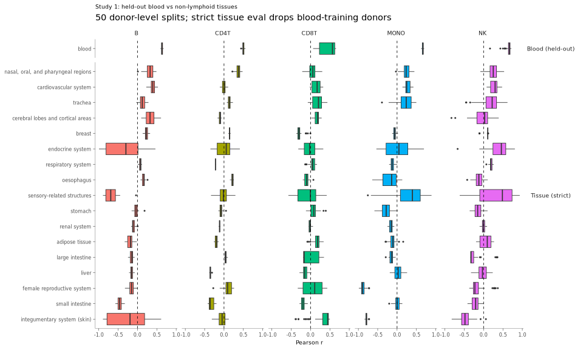
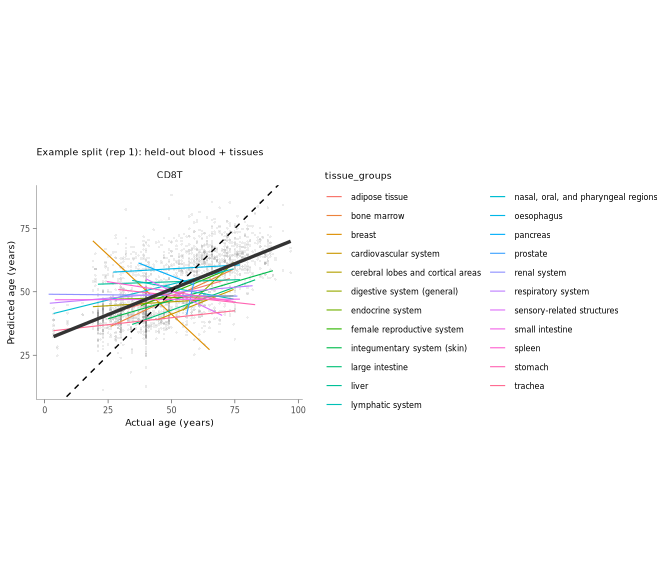
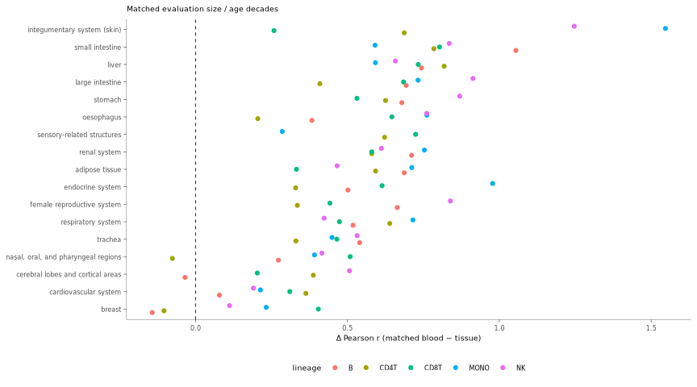
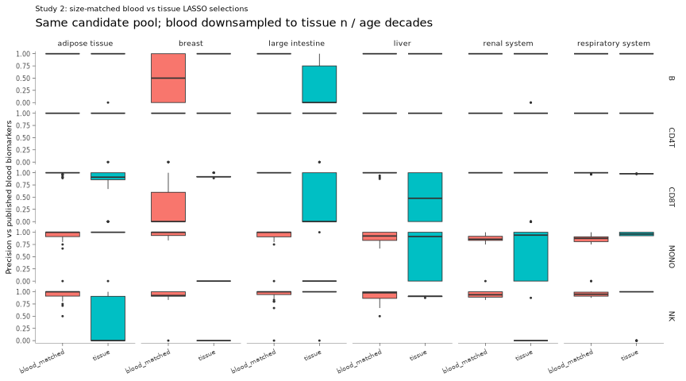
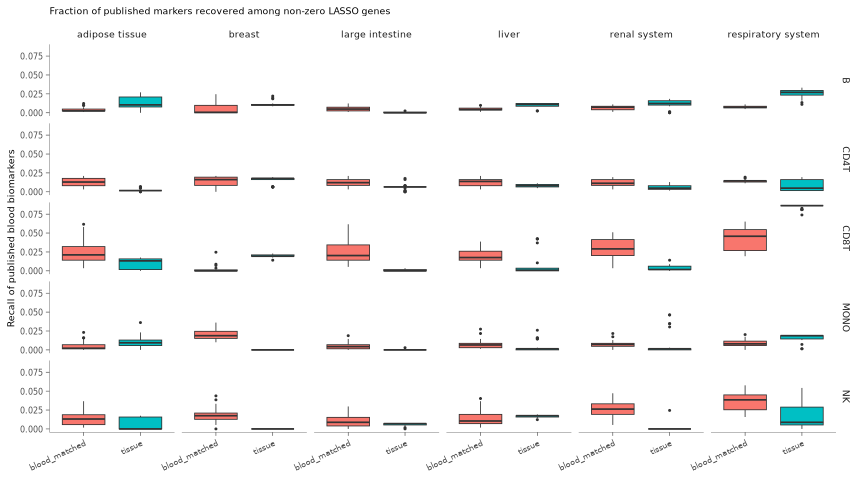

# Figure 4 rebuttal — Blood ageing clock (Panels E & F)
Chen Zhan
19 Sep 2026

- [Overview](#overview)
- [Setup](#setup)
- [Lineage matrices](#lineage-matrices)
- [Study 1 — Blood clock with proper held-out
  validation](#study-1--blood-clock-with-proper-held-out-validation)
  - [Metrics across splits](#metrics-across-splits)
  - [Size-matched evaluation](#size-matched-evaluation)
  - [Donor overlap](#donor-overlap)
- [Study 2 — Marker selection vs published blood
  biomarkers](#study-2--marker-selection-vs-published-blood-biomarkers)
- [Link to the manuscript](#link-to-the-manuscript)
- [Session info](#session-info)

# Overview

Revision of Panels E & F from `Fig4.qmd`, keeping the original setup
(scImmuAging candidate genes → LASSO on HCA blood → apply to other
tissues) but fixing independence:

1.  Split blood **by donor** into train vs held-out test.
2.  Use donor-aware folds inside `cv.glmnet()`.
3.  Freeze the blood model; do not refit on tissue.
4.  Repeat splits (~50) and summarise metric distributions.
5.  Match held-out blood (n) / age decades to each tissue for fairer
    transfer scores.
6.  Audit donors shared between blood training and tissue evaluation.

Subtype pseudobulks stay as in `Fig4.qmd` (e.g. CD4 naive, TCM, TEM
remain separate rows; they are only pooled when fitting the lineage
model).

Caches: `vignettes/data/intermediate/fig4_rebuttal/` and
`vignettes/data/figure_ready/fig4_rebuttal/`.

``` r
# From vignettes/rebuttal_analyse/:
quarto::quarto_render(
  "Fig4_panel_E_F_rebuttal_analyse.qmd",
  output_format = c("html", "gfm")
)
# Outputs in this folder:
#   Fig4_panel_E_F_rebuttal_analyse.html
#   Fig4_panel_E_F_rebuttal_analyse.md
```

# Setup

``` r
# Report lives in vignettes/rebuttal_analyse/ → ../R/paths.R
.path_candidates <- c(
  file.path("..", "R", "paths.R"),
  file.path("..", "..", "vignettes", "R", "paths.R"),
  if (requireNamespace("here", quietly = TRUE)) {
    file.path(here::here(), "vignettes", "R", "paths.R")
  },
  file.path("R", "paths.R")
)
.path_candidates <- .path_candidates[nzchar(.path_candidates) & !is.na(.path_candidates)]
.path_file <- .path_candidates[file.exists(.path_candidates)][1]
if (is.na(.path_file)) {
  stop("Cannot find vignettes/R/paths.R (run from vignettes/rebuttal_analyse/).")
}

.path_file <- normalizePath(.path_file, winslash = "/", mustWork = TRUE)
# Pin repo root from paths.R so caches always go under vignettes/data/
Sys.setenv(
  IMMUNE_HEALTHY_BODY_MAP_ROOT = normalizePath(
    file.path(dirname(.path_file), "..", ".."),
    winslash = "/",
    mustWork = TRUE
  )
)
source(.path_file)
message("Data root: ", publication_data_root())

dir.create(path_intermediate("fig4_rebuttal"), recursive = TRUE, showWarnings = FALSE)
dir.create(path_figure_ready("fig4_rebuttal"), recursive = TRUE, showWarnings = FALSE)
```

``` r
library(here)
library(tidySummarizedExperiment)
library(HDF5Array)
library(SummarizedExperiment)
library(tidyverse)
library(tidybulk)
library(glue)
library(grid)
library(ggplot2)
library(dittoSeq)
library(glmnet)
```

``` r
age_decade <- function(age_days) {
  floor(as.numeric(age_days) / (365 * 10))
}

make_donor_folds <- function(donor_ids, nfolds = 5L, seed) {
  set.seed(seed)
  ud <- unique(as.character(donor_ids))
  fold_of_donor <- sample(rep_len(seq_len(nfolds), length(ud)))
  names(fold_of_donor) <- ud
  unname(as.integer(fold_of_donor[as.character(donor_ids)]))
}

# Donor-level train/test split, stratified by age decade.
split_donors_train_test <- function(donor_age_df, train_frac = 0.7, seed) {
  set.seed(seed)
  donor_age_df <- donor_age_df %>%
    mutate(donor_id = as.character(donor_id), decade = age_decade(age_days))

  split_tbl <- donor_age_df %>%
    group_by(decade) %>%
    group_modify(function(.x, .y) {
      n <- nrow(.x)
      if (n < 2L) {
        .x$split <- "train"
        return(.x)
      }
      n_train <- max(1L, min(n - 1L, as.integer(round(n * train_frac))))
      idx <- sample.int(n)
      .x$split <- "test"
      .x$split[idx[seq_len(n_train)]] <- "train"
      .x
    }) %>%
    ungroup()

  if (!any(split_tbl$split == "test") && nrow(split_tbl) >= 2L) {
    split_tbl$split[sample(which(split_tbl$split == "train"), 1L)] <- "test"
  }
  if (!any(split_tbl$split == "train") && nrow(split_tbl) >= 1L) {
    split_tbl$split[sample.int(nrow(split_tbl), 1L)] <- "train"
  }

  list(
    train_donors = split_tbl$donor_id[split_tbl$split == "train"],
    test_donors = split_tbl$donor_id[split_tbl$split == "test"],
    membership = split_tbl
  )
}

perf_metrics <- function(actual, predicted) {
  ok <- is.finite(actual) & is.finite(predicted)
  actual <- actual[ok]
  predicted <- predicted[ok]
  n <- length(actual)
  if (n < 3L) {
    return(tibble(
      n = n, pearson_r = NA_real_, r2 = NA_real_,
      rmse = NA_real_, mae = NA_real_, bias = NA_real_
    ))
  }
  err <- predicted - actual
  ss_res <- sum(err^2)
  ss_tot <- sum((actual - mean(actual))^2)
  tibble(
    n = n,
    pearson_r = suppressWarnings(cor(actual, predicted)),
    r2 = if (ss_tot > 0) 1 - ss_res / ss_tot else NA_real_,
    rmse = sqrt(mean(err^2)),
    mae = mean(abs(err)),
    bias = mean(err)
  )
}

# Subsample source rows to match target n and age-decade counts.
match_eval_rows <- function(source_df, target_df, seed, age_col = "age_days") {
  set.seed(seed)
  source_df <- source_df %>% mutate(.decade = age_decade(.data[[age_col]]))
  target_df <- target_df %>% mutate(.decade = age_decade(.data[[age_col]]))
  tgt_counts <- target_df %>% dplyr::count(.decade, name = "n_tgt")

  out <- vector("list", nrow(tgt_counts))
  for (i in seq_len(nrow(tgt_counts))) {
    d <- tgt_counts$.decade[[i]]
    n_need <- tgt_counts$n_tgt[[i]]
    pool <- which(source_df$.decade == d)
    if (!length(pool)) pool <- seq_len(nrow(source_df))
    take <- if (length(pool) >= n_need) {
      sample(pool, n_need)
    } else {
      sample(pool, n_need, replace = TRUE)
    }
    out[[i]] <- source_df[take, , drop = FALSE]
  }
  bind_rows(out) %>% select(-.decade)
}

summarise_metric_dist <- function(metrics_df, group_vars) {
  metrics_df %>%
    group_by(across(all_of(group_vars))) %>%
    summarise(
      n_reps = n(),
      pearson_r_median = median(pearson_r, na.rm = TRUE),
      pearson_r_q25 = quantile(pearson_r, 0.25, na.rm = TRUE),
      pearson_r_q75 = quantile(pearson_r, 0.75, na.rm = TRUE),
      r2_median = median(r2, na.rm = TRUE),
      rmse_median = median(rmse, na.rm = TRUE),
      mae_median = median(mae, na.rm = TRUE),
      bias_median = median(bias, na.rm = TRUE),
      n_eval_median = median(n, na.rm = TRUE),
      .groups = "drop"
    )
}

nonzero_genes <- function(model) {
  cf <- as.matrix(coef(model, s = "lambda.min"))
  rownames(cf)[cf[, 1] != 0 & rownames(cf) != "(Intercept)"]
}

marker_overlap <- function(selected, published) {
  selected <- unique(as.character(selected))
  published <- unique(as.character(published))
  hit <- intersect(selected, published)
  u <- length(union(selected, published))
  tibble(
    n_selected = length(selected),
    n_published = length(published),
    n_overlap = length(hit),
    recall = length(hit) / max(1L, length(published)),
    precision = length(hit) / max(1L, length(selected)),
    jaccard = if (u > 0) length(hit) / u else NA_real_
  )
}

jaccard_sets <- function(a, b) {
  u <- length(union(a, b))
  if (u == 0) return(NA_real_)
  length(intersect(a, b)) / u
}

# Same TMMwsp workflow as Fig4 run_age_clock(); base SE subset avoids tidy filter
# stack overflows on large HDF5 objects.
prepare_lineage_matrix <- function(se, cell_types, feature_genes, normal_only = TRUE) {
  cd <- as.data.frame(colData(se))
  keep <- cd$cell_type_unified_ensemble %in% cell_types
  if (isTRUE(normal_only)) keep <- keep & cd$disease_groups == "Normal"
  se_cur <- se[, which(keep)]
  se_cur <- se_cur %>% keep_abundant() %>% scale_abundance(method = "TMMwsp")
  se_cur <- se_cur[intersect(feature_genes, rownames(se_cur)), ]

  mat <- as.data.frame(as.matrix(t(assay(se_cur, "counts_scaled"))))
  missing <- setdiff(feature_genes, colnames(mat))
  if (length(missing)) mat[, missing] <- 0
  mat <- mat[, feature_genes, drop = FALSE]

  list(
    x = as.matrix(mat),
    meta = as.data.frame(colData(se_cur)) %>% rownames_to_column("rowname"),
    features = feature_genes
  )
}

fit_cv_lasso <- function(ld, row_idx, seed_cv, nfolds = 5L) {
  if (length(row_idx) < 15L) return(NULL)
  y <- as.numeric(ld$meta$age_days[row_idx])
  y_var <- stats::var(y, na.rm = TRUE)
  if (!is.finite(y_var) || y_var == 0 || length(unique(y[is.finite(y)])) < 2L) {
    return(NULL)
  }
  foldid <- make_donor_folds(ld$meta$donor_id[row_idx], nfolds = nfolds, seed = seed_cv)
  if (length(unique(foldid)) < 3L) return(NULL)

  tryCatch(
    cv.glmnet(
      x = ld$x[row_idx, , drop = FALSE],
      y = y,
      foldid = foldid,
      type.measure = "mae",
      standardize = FALSE,
      relax = FALSE
    ),
    error = function(e) {
      message("Skipping glmnet: ", conditionMessage(e))
      NULL
    }
  )
}

predict_age <- function(model, x) {
  as.numeric(predict(model, newx = x, s = "lambda.min"))
}

fit_blood_clock <- function(ld, train_donors, seed_cv, nfolds = 5L) {
  meta <- ld$meta
  blood_idx <- which(meta$tissue_groups == "blood" & meta$donor_id %in% train_donors)
  if (length(blood_idx) < 20L) stop("Too few blood training rows: ", length(blood_idx))
  model <- fit_cv_lasso(ld, blood_idx, seed_cv, nfolds)
  if (is.null(model)) stop("Blood LASSO fit failed")
  list(model = model, train_idx = blood_idx)
}

run_study1 <- function(
    lineage_data,
    lineages,
    n_rep,
    train_frac,
    nfolds,
    base_seed,
    lymphoid_tissues,
    n_match_draws
) {
  library(glmnet)

  split_rows <- list()
  metric_rows <- list()
  match_rows <- list()
  overlap_rows <- list()
  coef_rows <- list()
  example_preds <- NULL

  for (lin in lineages) {
    ld <- lineage_data[[lin]]
    meta <- ld$meta
    blood_donors <- meta %>%
      filter(tissue_groups == "blood") %>%
      distinct(donor_id, age_days)

    for (rep_i in seq_len(n_rep)) {
      seed_i <- as.integer(base_seed + rep_i * 1009L + match(lin, lineages) * 17L)
      spl <- split_donors_train_test(blood_donors, train_frac, seed_i)
      fit <- fit_blood_clock(ld, spl$train_donors, seed_i + 7L, nfolds)
      pred_all <- predict_age(fit$model, ld$x)

      pred_df <- meta %>%
        mutate(
          predicted_age = pred_all,
          lineage = lin,
          rep = rep_i,
          blood_split = case_when(
            tissue_groups != "blood" ~ "tissue",
            donor_id %in% spl$train_donors ~ "train",
            donor_id %in% spl$test_donors ~ "test",
            TRUE ~ "other"
          )
        )

      nz <- nonzero_genes(fit$model)
      coef_rows[[length(coef_rows) + 1L]] <- tibble(
        lineage = lin, rep = rep_i, gene = nz
      )
      split_rows[[length(split_rows) + 1L]] <- spl$membership %>%
        mutate(lineage = lin, rep = rep_i)

      blood_test <- pred_df %>% filter(blood_split == "test")
      metric_rows[[length(metric_rows) + 1L]] <- perf_metrics(
        blood_test$age_days, blood_test$predicted_age
      ) %>%
        mutate(
          lineage = lin, rep = rep_i, tissue_groups = "blood",
          eval_set = "blood_heldout_full", strict_no_train_donor = TRUE
        )

      tissues <- sort(setdiff(unique(pred_df$tissue_groups), lymphoid_tissues))
      for (tg in tissues) {
        tissue_all <- pred_df %>% filter(tissue_groups == tg)
        tissue_strict <- tissue_all %>% filter(!donor_id %in% spl$train_donors)

        overlap_n <- n_distinct(intersect(unique(tissue_all$donor_id), spl$train_donors))
        overlap_rows[[length(overlap_rows) + 1L]] <- tibble(
          lineage = lin, rep = rep_i, tissue_groups = tg,
          n_tissue_donors = n_distinct(tissue_all$donor_id),
          n_overlap_blood_train = overlap_n,
          frac_overlap = overlap_n / max(1L, n_distinct(tissue_all$donor_id)),
          n_tissue_rows = nrow(tissue_all),
          n_tissue_rows_strict = nrow(tissue_strict)
        )

        metric_rows[[length(metric_rows) + 1L]] <- perf_metrics(
          tissue_all$age_days, tissue_all$predicted_age
        ) %>%
          mutate(
            lineage = lin, rep = rep_i, tissue_groups = tg,
            eval_set = "tissue_full", strict_no_train_donor = FALSE
          )
        metric_rows[[length(metric_rows) + 1L]] <- perf_metrics(
          tissue_strict$age_days, tissue_strict$predicted_age
        ) %>%
          mutate(
            lineage = lin, rep = rep_i, tissue_groups = tg,
            eval_set = "tissue_strict", strict_no_train_donor = TRUE
          )

        if (nrow(tissue_strict) >= 10L && nrow(blood_test) >= 10L) {
          for (m in seq_len(n_match_draws)) {
            matched_blood <- match_eval_rows(blood_test, tissue_strict, seed_i + 10000L + m)
            match_rows[[length(match_rows) + 1L]] <- bind_rows(
              perf_metrics(matched_blood$age_days, matched_blood$predicted_age) %>%
                mutate(
                  lineage = lin, rep = rep_i, match_draw = m,
                  tissue_groups = tg, eval_arm = "blood_matched"
                ),
              perf_metrics(tissue_strict$age_days, tissue_strict$predicted_age) %>%
                mutate(
                  lineage = lin, rep = rep_i, match_draw = m,
                  tissue_groups = tg, eval_arm = "tissue_strict"
                )
            )
          }
        }
      }

      if (lin == lineages[[1]] && rep_i == 1L) {
        example_preds <- pred_df %>%
          filter(blood_split %in% c("test", "tissue")) %>%
          filter(between(
            predicted_age,
            quantile(predicted_age, 0.01, na.rm = TRUE),
            quantile(predicted_age, 0.99, na.rm = TRUE)
          ))
      }
      if (rep_i %% 10L == 0L) message(lin, " rep ", rep_i, "/", n_rep)
    }
  }

  list(
    metrics = bind_rows(metric_rows),
    matched = bind_rows(match_rows),
    splits = bind_rows(split_rows),
    overlap = bind_rows(overlap_rows),
    coefs = bind_rows(coef_rows),
    example_preds = example_preds
  )
}

run_study2 <- function(
    lineage_data,
    published_markers,
    tissues,
    lineages,
    n_rep,
    nfolds,
    base_seed
) {
  library(glmnet)
  metric_rows <- list()
  gene_rows <- list()

  for (tg in tissues) {
    for (lin in lineages) {
      ld <- lineage_data[[lin]]
      meta <- ld$meta
      pub <- published_markers[[lin]]

      tissue_idx <- which(meta$tissue_groups == tg)
      blood_idx <- which(meta$tissue_groups == "blood")
      if (length(tissue_idx) < 20L || n_distinct(meta$donor_id[tissue_idx]) < 15L) next

      tissue_df <- tibble(
        idx = tissue_idx,
        age_days = meta$age_days[tissue_idx]
      )
      blood_df <- tibble(
        idx = blood_idx,
        age_days = meta$age_days[blood_idx]
      )

      for (rep_i in seq_len(n_rep)) {
        seed_i <- as.integer(
          base_seed + 70000L + rep_i * 809L +
            match(lin, lineages) * 17L + match(tg, tissues) * 31L
        )

        blood_fit_idx <- match_eval_rows(blood_df, tissue_df, seed_i)$idx
        tissue_fit_idx <- tissue_df$idx

        model_blood <- fit_cv_lasso(ld, blood_fit_idx, seed_i + 5L, nfolds)
        model_tissue <- fit_cv_lasso(ld, tissue_fit_idx, seed_i + 11L, nfolds)
        if (is.null(model_blood) || is.null(model_tissue)) next

        genes_blood <- nonzero_genes(model_blood)
        genes_tissue <- nonzero_genes(model_tissue)

        metric_rows[[length(metric_rows) + 1L]] <- bind_rows(
          marker_overlap(genes_blood, pub) %>% mutate(model = "blood_matched"),
          marker_overlap(genes_tissue, pub) %>% mutate(model = "tissue")
        ) %>%
          mutate(
            lineage = lin,
            tissue_groups = tg,
            rep = rep_i,
            n_blood_rows = length(blood_fit_idx),
            n_tissue_rows = length(tissue_fit_idx),
            n_blood_donors = n_distinct(meta$donor_id[blood_fit_idx]),
            n_tissue_donors = n_distinct(meta$donor_id[tissue_fit_idx]),
            jaccard_blood_vs_tissue = jaccard_sets(genes_blood, genes_tissue)
          )

        gene_rows[[length(gene_rows) + 1L]] <- bind_rows(
          tibble(model = "blood_matched", gene = genes_blood),
          tibble(model = "tissue", gene = genes_tissue)
        ) %>%
          mutate(lineage = lin, tissue_groups = tg, rep = rep_i)
      }
      message("Study 2 done: ", tg, " / ", lin)
    }
  }

  list(metrics = bind_rows(metric_rows), genes = bind_rows(gene_rows))
}

resolve_age_clock_se_dir <- function() {
  cands <- c(
    Sys.getenv("AGE_CLOCK_SE_DIR", unset = ""),
    file.path(publication_data_root(), "zenodo_release", "age_clock_se"),
    path.expand("~/lab/chen/cell_rebuttal/age_clock/report/data/se_all_cell_type")
  )
  cands <- cands[nzchar(cands)]
  hit <- cands[dir.exists(cands)][1]
  if (is.na(hit)) {
    stop("Age-clock SE not found. Set AGE_CLOCK_SE_DIR.")
  }
  normalizePath(hit, winslash = "/", mustWork = TRUE)
}

resolve_scimmu_rds <- function(filename, path_rebuttal_int) {
  cands <- c(
    file.path(path_rebuttal_int, filename),
    system.file("data", filename, package = "scImmuAging"),
    file.path(
      "/hpcfs/users/a1237163/R/x86_64-pc-linux-gnu-library/4.6/scImmuAging/data",
      filename
    )
  )
  cands <- cands[nzchar(cands) & file.exists(cands)]
  if (!length(cands)) stop("Cannot find ", filename)
  cands[[1]]
}
```

``` r
theme_multipanel <- theme_bw() +
  theme(
    panel.border = element_blank(),
    axis.line = element_line(linewidth = 0.1),
    panel.grid.major = element_blank(),
    panel.grid.minor = element_blank(),
    legend.position = "bottom",
    strip.background = element_blank(),
    axis.title = element_text(size = 7),
    axis.text = element_text(size = 6),
    strip.text = element_text(size = 7),
    legend.key.size = unit(5, "mm"),
    legend.title = element_text(size = 7),
    legend.text = element_text(size = 6),
    plot.title = element_text(size = 7),
    axis.ticks = element_line(linewidth = 0.2)
  )
```

``` r
# Same lineage map as Fig4.qmd
cell_type_list <- list(
  CD4T = c(
    "cd4 naive", "cd4 tcm", "cd4 th17 em", "cd4 th1/th17 em",
    "cd4 th2 em", "cd4 fh em", "cd4 tem", "cd4 th1 em", "t cd4"
  ),
  CD8T = c("cd8 naive", "cd8 tcm", "cd8 tem", "t cd8"),
  MONO = c("cd14 mono", "cd16 mono", "monocytic"),
  NK   = c("nk", "nkt"),
  B    = c("b naive", "b memory", "b")
)
lineages <- c("CD8T", "CD4T", "MONO", "NK", "B")
lymphoid_tissues <- c("blood", "lymphatic system", "spleen", "bone marrow")

n_rep <- as.integer(Sys.getenv("FIG4_REBUTTAL_N_REP", unset = "50"))
n_rep_study2 <- as.integer(Sys.getenv("FIG4_REBUTTAL_N_REP_STUDY2", unset = as.character(min(30L, n_rep))))
n_match_draws <- as.integer(Sys.getenv("FIG4_REBUTTAL_N_MATCH", unset = "20"))
train_frac <- 0.7
nfolds <- 5L
base_seed <- 20260917L
use_normal_only <- TRUE

path_rebuttal_int <- path_intermediate("fig4_rebuttal")
path_rebuttal_fig <- path_figure_ready("fig4_rebuttal")

path_metrics_full <- file.path(path_rebuttal_int, "study1_metrics_full.rds")
path_metrics_match <- file.path(path_rebuttal_int, "study1_metrics_matched.rds")
path_preds_example <- file.path(path_rebuttal_int, "study1_preds_rep01.rds")
path_split_meta <- file.path(path_rebuttal_int, "study1_split_membership.rds")
path_overlap_audit <- file.path(path_rebuttal_int, "study1_donor_overlap_audit.rds")
path_coef_freq <- file.path(path_rebuttal_int, "study1_blood_coef_frequency.rds")
path_study2 <- file.path(path_rebuttal_int, "study2_marker_consistency.rds")
path_study2_genes <- file.path(path_rebuttal_int, "study2_selected_genes.rds")
```

``` r
age_clock_se_dir <- resolve_age_clock_se_dir()
feature_set <- readRDS(resolve_scimmu_rds("all_model_inputfeatures.RDS", path_rebuttal_int))
published_models <- readRDS(resolve_scimmu_rds("all_model.RDS", path_rebuttal_int))

# Published final markers (default coef = lambda.1se), as in Fig3.qmd
published_markers <- lapply(names(published_models), function(nm) {
  cf <- as.matrix(coef(published_models[[nm]]))
  rownames(cf)[cf[, 1] != 0 & rownames(cf) != "(Intercept)"]
})
names(published_markers) <- names(published_models)

message("SE: ", age_clock_se_dir)
message("n_rep=", n_rep, " n_rep_study2=", n_rep_study2, " normal_only=", use_normal_only)
```

# Lineage matrices

TMMwsp + abundance filtering as in `Fig4.qmd`, cached per lineage.

``` r
path_lineage_cache <- function(lineage) {
  file.path(
    path_rebuttal_int,
    glue("lineage_matrix_{lineage}_normal{as.integer(use_normal_only)}.rds")
  )
}

se <- NULL
lineage_data <- setNames(vector("list", length(lineages)), lineages)

for (lin in lineages) {
  cache_f <- path_lineage_cache(lin)
  if (file.exists(cache_f)) {
    message("Cache hit: ", lin)
    lineage_data[[lin]] <- readRDS(cache_f)
  } else {
    if (is.null(se)) {
      message("Loading SE...")
      se <- loadHDF5SummarizedExperiment(age_clock_se_dir)
    }
    message("Building ", lin)
    lineage_data[[lin]] <- prepare_lineage_matrix(
      se = se,
      cell_types = cell_type_list[[lin]],
      feature_genes = feature_set[[lin]],
      normal_only = use_normal_only
    )
    saveRDS(lineage_data[[lin]], cache_f)
  }
}
rm(se)
invisible(gc())
```

# Study 1 — Blood clock with proper held-out validation

**Question:** after donor-level train/test splitting, how well does a
blood-trained immune-age LASSO transfer to non-lymphoid tissues?

``` r
study1_ready <- all(file.exists(c(
  path_metrics_full, path_metrics_match, path_split_meta, path_overlap_audit
)))

if (study1_ready) {
  study1_metrics <- readRDS(path_metrics_full)
  study1_matched <- readRDS(path_metrics_match)
  study1_splits <- readRDS(path_split_meta)
  study1_overlap <- readRDS(path_overlap_audit)
  study1_coefs <- if (file.exists(path_coef_freq)) readRDS(path_coef_freq) else NULL
  study1_example_preds <- if (file.exists(path_preds_example)) readRDS(path_preds_example) else NULL
  message("Loaded Study 1 caches.")
} else {
  study1 <- run_study1(
    lineage_data = lineage_data,
    lineages = lineages,
    n_rep = n_rep,
    train_frac = train_frac,
    nfolds = nfolds,
    base_seed = base_seed,
    lymphoid_tissues = lymphoid_tissues,
    n_match_draws = n_match_draws
  )
  study1_metrics <- study1$metrics
  study1_matched <- study1$matched
  study1_splits <- study1$splits
  study1_overlap <- study1$overlap
  study1_coefs <- study1$coefs
  study1_example_preds <- study1$example_preds

  saveRDS(study1_metrics, path_metrics_full)
  saveRDS(study1_matched, path_metrics_match)
  saveRDS(study1_splits, path_split_meta)
  saveRDS(study1_overlap, path_overlap_audit)
  saveRDS(study1_coefs, path_coef_freq)
  if (!is.null(study1_example_preds)) saveRDS(study1_example_preds, path_preds_example)
}
```

## Metrics across splits

``` r
metrics_summary <- summarise_metric_dist(
  study1_metrics %>% filter(eval_set %in% c("blood_heldout_full", "tissue_strict")),
  group_vars = c("lineage", "tissue_groups", "eval_set")
)

metrics_summary %>%
  arrange(lineage, desc(pearson_r_median)) %>%
  mutate(across(where(is.numeric), \(x) round(x, 3)))
```

    # A tibble: 112 × 12
       lineage tissue_groups          eval_set n_reps pearson_r_median pearson_r_q25
       <chr>   <chr>                  <chr>     <dbl>            <dbl>         <dbl>
     1 B       digestive system (gen… tissue_…     50            0.69          0.601
     2 B       blood                  blood_h…     50            0.634         0.62 
     3 B       cardiovascular system  tissue_…     50            0.396         0.356
     4 B       nasal, oral, and phar… tissue_…     50            0.327         0.253
     5 B       cerebral lobes and co… tissue_…     50            0.325         0.226
     6 B       breast                 tissue_…     50            0.227         0.203
     7 B       oesophagus             tissue_…     50            0.163         0.129
     8 B       trachea                tissue_…     50            0.125         0.075
     9 B       respiratory system     tissue_…     50            0.076         0.054
    10 B       stomach                tissue_…     50           -0.038        -0.071
    # ℹ 102 more rows
    # ℹ 6 more variables: pearson_r_q75 <dbl>, r2_median <dbl>, rmse_median <dbl>,
    #   mae_median <dbl>, bias_median <dbl>, n_eval_median <dbl>

``` r
keep_tissues <- metrics_summary %>%
  filter(eval_set == "tissue_strict", n_eval_median >= 20) %>%
  distinct(tissue_groups) %>%
  pull()

Plot__study1_r <- study1_metrics %>%
  filter(eval_set %in% c("blood_heldout_full", "tissue_strict")) %>%
  filter(tissue_groups == "blood" | tissue_groups %in% keep_tissues) %>%
  mutate(panel = if_else(tissue_groups == "blood", "Blood (held-out)", "Tissue (strict)")) %>%
  ggplot(aes(
    x = reorder(tissue_groups, pearson_r, FUN = median, na.rm = TRUE),
    y = pearson_r, fill = lineage
  )) +
  geom_boxplot(outlier.size = 0.4, linewidth = 0.3) +
  coord_flip() +
  facet_grid(panel ~ lineage, scales = "free_y", space = "free_y") +
  geom_hline(yintercept = 0, linetype = "dashed", linewidth = 0.3) +
  labs(
    x = NULL, y = "Pearson r",
    title = "Study 1: held-out blood vs non-lymphoid tissues",
    subtitle = glue("{n_rep} donor-level splits; strict tissue eval drops blood-training donors")
  ) +
  theme_multipanel +
  theme(legend.position = "none", strip.text.y = element_text(angle = 0))

saveRDS(Plot__study1_r, file.path(path_rebuttal_fig, "Plot__study1_pearson_box.rds"))
Plot__study1_r
```



``` r
if (!is.null(study1_example_preds)) {
  Plot__pred_example <- study1_example_preds %>%
    mutate(
      age_years = age_days / 365,
      predicted_age_scaled = predicted_age / 365
    ) %>%
    ggplot(aes(x = age_years, y = predicted_age_scaled, color = tissue_groups)) +
    geom_point(
      data = ~ filter(.x, tissue_groups == "blood"),
      alpha = 0.15, size = 0.6, shape = 16, color = "grey50"
    ) +
    geom_smooth(
      data = ~ filter(.x, tissue_groups != "blood"),
      method = "lm", se = FALSE, linewidth = 0.4
    ) +
    geom_smooth(
      data = ~ filter(.x, tissue_groups == "blood"),
      method = "lm", se = FALSE, linewidth = 1.2, color = "grey20"
    ) +
    geom_abline(intercept = 0, slope = 1, linetype = "dashed") +
    facet_wrap(~lineage) +
    labs(
      x = "Actual age (years)", y = "Predicted age (years)",
      title = "Example split (rep 1): held-out blood + tissues"
    ) +
    coord_fixed() +
    theme_multipanel +
    theme(legend.position = "right")

  saveRDS(Plot__pred_example, file.path(path_rebuttal_fig, "Plot__study1_pred_example.rds"))
  Plot__pred_example
}
```



## Size-matched evaluation

Held-out blood is repeatedly subsampled to each tissue’s strict (n) and
age decades.

``` r
matched_wide <- study1_matched %>%
  group_by(lineage, tissue_groups, eval_arm) %>%
  summarise(
    pearson_r_median = median(pearson_r, na.rm = TRUE),
    n_eval_median = median(n, na.rm = TRUE),
    .groups = "drop"
  ) %>%
  select(lineage, tissue_groups, eval_arm, pearson_r_median, n_eval_median) %>%
  pivot_wider(
    names_from = eval_arm,
    values_from = c(pearson_r_median, n_eval_median)
  ) %>%
  mutate(delta_r = pearson_r_median_blood_matched - pearson_r_median_tissue_strict) %>%
  arrange(lineage, delta_r)

matched_wide %>% mutate(across(where(is.numeric), \(x) round(x, 3)))
```

    # A tibble: 80 × 7
       lineage tissue_groups           pearson_r_median_blo…¹ pearson_r_median_tis…²
       <chr>   <chr>                                    <dbl>                  <dbl>
     1 B       breast                                   0.084                  0.227
     2 B       cerebral lobes and cor…                  0.289                  0.325
     3 B       cardiovascular system                    0.474                  0.396
     4 B       nasal, oral, and phary…                  0.6                    0.327
     5 B       oesophagus                               0.546                  0.163
     6 B       endocrine system                         0.595                  0.094
     7 B       respiratory system                       0.594                  0.076
     8 B       trachea                                  0.665                  0.125
     9 B       female reproductive sy…                  0.512                 -0.152
    10 B       stomach                                  0.641                 -0.038
    # ℹ 70 more rows
    # ℹ abbreviated names: ¹​pearson_r_median_blood_matched,
    #   ²​pearson_r_median_tissue_strict
    # ℹ 3 more variables: n_eval_median_blood_matched <dbl>,
    #   n_eval_median_tissue_strict <dbl>, delta_r <dbl>

``` r
Plot__matched_delta <- matched_wide %>%
  filter(tissue_groups %in% keep_tissues) %>%
  ggplot(aes(
    x = reorder(tissue_groups, delta_r, FUN = median, na.rm = TRUE),
    y = delta_r, color = lineage
  )) +
  geom_hline(yintercept = 0, linetype = "dashed", linewidth = 0.3) +
  geom_point(position = position_dodge(width = 0.5), size = 1.5) +
  coord_flip() +
  labs(
    x = NULL, y = "Δ Pearson r (matched blood − tissue)",
    title = "Matched evaluation size / age decades"
  ) +
  theme_multipanel

saveRDS(Plot__matched_delta, file.path(path_rebuttal_fig, "Plot__study1_matched_delta.rds"))
Plot__matched_delta
```



## Donor overlap

``` r
study1_overlap %>%
  group_by(lineage, tissue_groups) %>%
  summarise(
    frac_overlap_median = median(frac_overlap, na.rm = TRUE),
    n_overlap_median = median(n_overlap_blood_train, na.rm = TRUE),
    n_tissue_donors_median = median(n_tissue_donors, na.rm = TRUE),
    .groups = "drop"
  ) %>%
  arrange(desc(frac_overlap_median)) %>%
  mutate(across(where(is.numeric), \(x) round(x, 3)))
```

    # A tibble: 107 × 5
       lineage tissue_groups              frac_overlap_median n_overlap_median
       <chr>   <chr>                                    <dbl>            <dbl>
     1 NK      prostate                                 1                    1
     2 B       endocrine system                         0.5                  3
     3 CD4T    prostate                                 0.5                  1
     4 CD8T    digestive system (general)               0.5                  2
     5 CD8T    pancreas                                 0.5                  1
     6 CD8T    prostate                                 0.5                  1
     7 NK      digestive system (general)               0.5                  2
     8 CD4T    endocrine system                         0.375                3
     9 CD8T    endocrine system                         0.375                3
    10 B       cardiovascular system                    0.333                5
    # ℹ 97 more rows
    # ℹ 1 more variable: n_tissue_donors_median <dbl>

``` r
metrics_summary %>%
  filter(eval_set == "tissue_strict", tissue_groups %in% keep_tissues) %>%
  select(lineage, tissue_groups, tissue_r = pearson_r_median) %>%
  left_join(
    metrics_summary %>%
      filter(eval_set == "blood_heldout_full") %>%
      select(lineage, blood_r = pearson_r_median),
    by = "lineage"
  ) %>%
  mutate(transfer_gap = blood_r - tissue_r) %>%
  arrange(lineage, desc(transfer_gap)) %>%
  mutate(across(where(is.numeric), \(x) round(x, 3)))
```

    # A tibble: 85 × 5
       lineage tissue_groups               tissue_r blood_r transfer_gap
       <chr>   <chr>                          <dbl>   <dbl>        <dbl>
     1 B       sensory-related structures    -0.69    0.634        1.32 
     2 B       small intestine               -0.464   0.634        1.10 
     3 B       endocrine system              -0.299   0.634        0.933
     4 B       integumentary system (skin)   -0.192   0.634        0.826
     5 B       adipose tissue                -0.181   0.634        0.815
     6 B       liver                         -0.153   0.634        0.787
     7 B       female reproductive system    -0.152   0.634        0.786
     8 B       large intestine               -0.148   0.634        0.782
     9 B       renal system                  -0.113   0.634        0.747
    10 B       stomach                       -0.038   0.634        0.672
    # ℹ 75 more rows

Report the distributions; do not force the original transfer story.

# Study 2 — Marker selection vs published blood biomarkers

**Question:** with the same candidate gene pool and size-matched
samples, does a blood LASSO recover the published blood final biomarkers
more faithfully than tissue LASSOs?

Published scImmuAging markers came from blood. If age–gene maps are
tissue-conditioned, size-matched HCA blood fits should still agree more
with that list than tissue fits.

No train/test split here: downsample blood to each tissue’s (n) / age
decades, fit LASSO on blood vs tissue, then compare non-zero genes to
the published list (Jaccard, recall, precision). Repeat downsampling for
stability.

``` r
tissue_power <- bind_rows(lapply(lineages, function(lin) {
  lineage_data[[lin]]$meta %>%
    filter(!tissue_groups %in% lymphoid_tissues) %>%
    group_by(tissue_groups) %>%
    summarise(
      lineage = lin,
      n_pb = n(),
      n_donor = n_distinct(donor_id),
      age_span_yr = (max(age_days) - min(age_days)) / 365,
      .groups = "drop"
    )
}))

tissue_rank <- tissue_power %>%
  group_by(tissue_groups) %>%
  summarise(
    n_lineages_ok = sum(n_donor >= 25 & age_span_yr >= 25 & n_pb >= 40),
    median_donors = median(n_donor),
    median_span = median(age_span_yr),
    .groups = "drop"
  ) %>%
  filter(n_lineages_ok >= 4) %>%
  arrange(desc(median_donors), desc(median_span))

tissue_rank
```

    # A tibble: 6 × 4
      tissue_groups      n_lineages_ok median_donors median_span
      <chr>                      <int>         <dbl>       <dbl>
    1 breast                         4           175        46  
    2 respiratory system             5           161        80  
    3 renal system                   5            83        74.4
    4 liver                          5            33        56  
    5 large intestine                4            33        48.5
    6 adipose tissue                 5            27        49  

``` r
preferred <- c("respiratory system", "large intestine")
study2_tissues <- unique(c(
  intersect(preferred, tissue_rank$tissue_groups),
  tissue_rank$tissue_groups
))
message("Study 2 tissues: ", paste(study2_tissues, collapse = ", "))
```

``` r
# Refresh paths in case an interactive session still has stale values
path_rebuttal_int <- path_intermediate("fig4_rebuttal")
path_rebuttal_fig <- path_figure_ready("fig4_rebuttal")
path_study2 <- file.path(path_rebuttal_int, "study2_marker_consistency.rds")
path_study2_genes <- file.path(path_rebuttal_int, "study2_selected_genes.rds")
dir.create(path_rebuttal_int, recursive = TRUE, showWarnings = FALSE)
message("Study 2 cache: ", path_rebuttal_int)

if (file.exists(path_study2)) {
  study2_metrics <- readRDS(path_study2)
  study2_genes <- if (file.exists(path_study2_genes)) readRDS(path_study2_genes) else NULL
  message("Loaded Study 2 caches.")
} else {
  study2 <- run_study2(
    lineage_data = lineage_data,
    published_markers = published_markers,
    tissues = study2_tissues,
    lineages = lineages,
    n_rep = n_rep_study2,
    nfolds = nfolds,
    base_seed = base_seed
  )
  study2_metrics <- study2$metrics
  study2_genes <- study2$genes
  saveRDS(study2_metrics, path_study2)
  saveRDS(study2_genes, path_study2_genes)
  message("Saved ", path_study2)
}
```

``` r
study2_compare <- study2_metrics %>%
  group_by(tissue_groups, lineage, model) %>%
  summarise(
    n_reps = n(),
    recall_median = median(recall, na.rm = TRUE),
    precision_median = median(precision, na.rm = TRUE),
    jaccard_median = median(jaccard, na.rm = TRUE),
    n_selected_median = median(n_selected, na.rm = TRUE),
    .groups = "drop"
  ) %>%
  select(tissue_groups, lineage, model, recall_median, jaccard_median, precision_median) %>%
  pivot_wider(
    names_from = model,
    values_from = c(recall_median, jaccard_median, precision_median)
  ) %>%
  mutate(
    delta_recall = recall_median_blood_matched - recall_median_tissue,
    delta_jaccard = jaccard_median_blood_matched - jaccard_median_tissue
  )

study2_compare %>%
  arrange(tissue_groups, lineage) %>%
  mutate(across(where(is.numeric), \(x) round(x, 3)))
```

    # A tibble: 30 × 10
       tissue_groups  lineage recall_median_blood_matched recall_median_tissue
       <chr>          <chr>                         <dbl>                <dbl>
     1 adipose tissue B                             0.002                0.01 
     2 adipose tissue CD4T                          0.013                0.002
     3 adipose tissue CD8T                          0.021                0.013
     4 adipose tissue MONO                          0.002                0.009
     5 adipose tissue NK                            0.013                0    
     6 breast         B                             0.001                0.01 
     7 breast         CD4T                          0.016                0.018
     8 breast         CD8T                          0                    0.019
     9 breast         MONO                          0.019                0    
    10 breast         NK                            0.017                0    
    # ℹ 20 more rows
    # ℹ 6 more variables: jaccard_median_blood_matched <dbl>,
    #   jaccard_median_tissue <dbl>, precision_median_blood_matched <dbl>,
    #   precision_median_tissue <dbl>, delta_recall <dbl>, delta_jaccard <dbl>

``` r
Plot__study2 <- study2_metrics %>%
  ggplot(aes(x = model, y = precision, fill = model)) +
  geom_boxplot(outlier.size = 0.4, linewidth = 0.3) +
  facet_grid(lineage ~ tissue_groups) +
  labs(
    x = NULL,
    y = "Precision vs published blood biomarkers",
    title = "Study 2: size-matched blood vs tissue LASSO selections",
    subtitle = "Same candidate pool; blood downsampled to tissue n / age decades"
  ) +
  theme_multipanel +
  theme(axis.text.x = element_text(angle = 25, hjust = 1), legend.position = "none")

saveRDS(Plot__study2, file.path(path_rebuttal_fig, "Plot__study2_box.rds"))
Plot__study2
```



``` r
Plot__study2_recall <- study2_metrics %>%
  ggplot(aes(x = model, y = recall, fill = model)) +
  geom_boxplot(outlier.size = 0.4, linewidth = 0.3) +
  facet_grid(lineage ~ tissue_groups) +
  labs(
    x = NULL,
    y = "Recall of published blood biomarkers",
    title = "Fraction of published markers recovered among non-zero LASSO genes"
  ) +
  theme_multipanel +
  theme(axis.text.x = element_text(angle = 25, hjust = 1), legend.position = "none")

saveRDS(Plot__study2_recall, file.path(path_rebuttal_fig, "Plot__study2_recall.rds"))
Plot__study2_recall
```



If matched blood recovers the published list more than tissues, that
fits a blood-conditioned age mapping rather than a universal immune-age
gene set.

# Link to the manuscript

1.  Figure 4A–D: tissues differ in timing/magnitude of immune
    remodelling.
2.  Study 1: after independent validation, blood→tissue age prediction
    transfer is limited.
3.  Study 2: tissue LASSOs disagree more with published blood biomarkers
    than size-matched blood LASSOs.

> Blood-derived immune-age mappings incompletely represent immune ageing
> in non-lymphoid tissues, consistent with tissue-conditioned ageing
> trajectories.

# Session info

``` r
sessionInfo()
```

    R version 4.5.3 (2026-03-11)
    Platform: x86_64-conda-linux-gnu
    Running under: Red Hat Enterprise Linux 8.4 (Ootpa)

    Matrix products: default
    BLAS/LAPACK: /home/a1237163/miniconda3/envs/R_env/lib/libopenblasp-r0.3.29.so;  LAPACK version 3.12.0

    locale:
     [1] LC_CTYPE=en_US.UTF-8       LC_NUMERIC=C              
     [3] LC_TIME=en_US.UTF-8        LC_COLLATE=en_US.UTF-8    
     [5] LC_MONETARY=en_US.UTF-8    LC_MESSAGES=en_US.UTF-8   
     [7] LC_PAPER=en_US.UTF-8       LC_NAME=C                 
     [9] LC_ADDRESS=C               LC_TELEPHONE=C            
    [11] LC_MEASUREMENT=en_US.UTF-8 LC_IDENTIFICATION=C       

    time zone: Australia/Adelaide
    tzcode source: system (glibc)

    attached base packages:
    [1] grid      stats4    stats     graphics  grDevices utils     datasets 
    [8] methods   base     

    other attached packages:
     [1] glmnet_5.0                      dittoSeq_1.22.0                
     [3] glue_1.8.1                      tidybulk_2.3.4                 
     [5] lubridate_1.9.5                 forcats_1.0.1                  
     [7] stringr_1.6.0                   purrr_1.2.2                    
     [9] readr_2.2.0                     tibble_3.3.1                   
    [11] tidyverse_2.0.0                 HDF5Array_1.38.0               
    [13] h5mread_1.2.1                   rhdf5_2.54.1                   
    [15] DelayedArray_0.36.1             SparseArray_1.10.10            
    [17] S4Arrays_1.10.1                 abind_1.4-8                    
    [19] Matrix_1.7-6                    ggplot2_4.0.3                  
    [21] tidyr_1.3.2                     dplyr_1.2.1                    
    [23] tidySummarizedExperiment_1.20.1 ttservice_0.5.3                
    [25] SummarizedExperiment_1.40.0     Biobase_2.70.0                 
    [27] GenomicRanges_1.62.1            Seqinfo_1.0.0                  
    [29] IRanges_2.44.0                  S4Vectors_0.48.1               
    [31] BiocGenerics_0.56.0             generics_0.1.4                 
    [33] MatrixGenerics_1.22.0           matrixStats_1.5.0              
    [35] here_1.0.2                     

    loaded via a namespace (and not attached):
     [1] gridExtra_2.3.1             rlang_1.3.0                
     [3] magrittr_2.0.5              otel_0.2.0                 
     [5] ggridges_0.5.7              compiler_4.5.3             
     [7] vctrs_0.7.3                 pkgconfig_2.0.3            
     [9] shape_1.4.6.1               crayon_1.5.3               
    [11] fastmap_1.2.0               backports_1.5.1            
    [13] XVector_0.50.0              ellipsis_0.3.3             
    [15] labeling_0.4.3              utf8_1.2.6                 
    [17] cmdstanr_0.9.0              rmarkdown_2.32             
    [19] tzdb_0.5.0                  ps_1.9.3                   
    [21] xfun_0.61                   jsonlite_2.0.0             
    [23] rhdf5filters_1.22.0         Rhdf5lib_1.32.0            
    [25] parallel_4.5.3              R6_2.6.1                   
    [27] stringi_1.8.9               RColorBrewer_1.1-3         
    [29] Rcpp_1.1.2                  iterators_1.0.14           
    [31] knitr_1.52                  splines_4.5.3              
    [33] timechange_0.4.0            tidyselect_1.2.1           
    [35] dichromat_2.0-1             yaml_2.3.12                
    [37] codetools_0.2-20            processx_3.9.0             
    [39] lattice_0.23-1              withr_3.0.3                
    [41] S7_0.2.2                    posterior_1.7.1            
    [43] evaluate_1.0.5              survival_3.8-12            
    [45] pillar_1.11.1               tensorA_0.36.2.1           
    [47] checkmate_2.3.4             foreach_1.5.2              
    [49] distributional_0.9.0        plotly_4.12.1              
    [51] rprojroot_2.1.1             hms_1.1.4                  
    [53] scales_1.4.0                pheatmap_1.0.13            
    [55] tools_4.5.3                 data.table_1.18.6.1        
    [57] cowplot_1.2.0               colorspace_2.1-3           
    [59] SingleCellExperiment_1.32.0 cli_3.6.6                  
    [61] viridisLite_0.4.3           gtable_0.3.6               
    [63] digest_0.6.39               ggrepel_0.9.8              
    [65] htmlwidgets_1.6.4           farver_2.1.2               
    [67] htmltools_0.5.9             lifecycle_1.0.5            
    [69] httr_1.4.9                 
