# Figure 2 rebuttal — pilot cDC blood annotation (cDC1 / cDC2)
Chen Zhan
23 Sep 2026

- [Overview](#overview)
- [Setup](#setup)
- [Step 1 — Paper sample universe (same as previous
  pilot)](#step-1--paper-sample-universe-same-as-previous-pilot)
- [Step 2 — Frozen `cdc` cells, then
  blood](#step-2--frozen-cdc-cells-then-blood)
  - [QC metadata for `cdc` only](#qc-metadata-for-cdc-only)
  - [Retrieve / reuse Seurat counts](#retrieve--reuse-seurat-counts)
  - [Blood-cDC cohort summary](#blood-cdc-cohort-summary)
- [Step 3 — SCTransform v2 clustering
  (primary)](#step-3--sctransform-v2-clustering-primary)
  - [Resolution sweep](#resolution-sweep)
    - [Primary resolution choice](#primary-resolution-choice)
- [Step 4 — Dataset / sample structure
  diagnostics](#step-4--dataset--sample-structure-diagnostics)
- [Step 5 — Markers and cluster-level evidence
  synthesis](#step-5--markers-and-cluster-level-evidence-synthesis)
  - [Provenance columns available in this
    object](#provenance-columns-available-in-this-object)
- [Step 6 — LogNormalize sensitivity
  check](#step-6--lognormalize-sensitivity-check)
- [Step 7 — Azimuth PBMC annotation
  (independent)](#step-7--azimuth-pbmc-annotation-independent)
- [Step 8 — Evidence synthesis, final annotation, and Azimuth
  comparison](#step-8--evidence-synthesis-final-annotation-and-azimuth-comparison)
  - [Cluster evidence table](#cluster-evidence-table)
    - [Final cluster annotation](#final-cluster-annotation)
  - [Compare unsupervised clusters, final annotation, and Azimuth
    L3](#compare-unsupervised-clusters-final-annotation-and-azimuth-l3)
- [Conclusion](#conclusion)
  - [Session info](#session-info)

# Overview

The global DC pilot
(`Figure_2_rebuttal_analysis_pilot_cell_type_further_annotation.qmd`)
showed strong tissue/dataset structure across `cdc` + `dc` + `pdc`.

This follow-up narrows to:

1.  frozen **`cell_type_unified_ensemble == "cdc"`** only (not `pdc` /
    `dc`);
2.  **blood** only (`tissue_groups`), the largest tissue compartment
    with a well-established PBMC Azimuth reference.

Workflow:

1.  recover the Figure 2 paper sample universe and QC as before;
2.  SCTransform v2 within-blood cDC subclustering (resolution sweep; no
    Harmony);
3.  expanded marker inspection and supporting cDC1/cDC2 module scores;
4.  optional LogNormalize sensitivity check;
5.  independent Azimuth PBMC L3 mapping;
6.  cluster-level evidence synthesis (markers + HPCell provenance +
    Azimuth L3 + sample/dataset reproducibility) → conservative `cDC1` /
    `cDC2` / `ambiguous cDC` / `non-cDC-like` labels.

No compositional re-analysis in this report.

``` r
# From vignettes/rebuttal_analyse/:
quarto::quarto_render(
  "Figure_2_rebuttal_analysis_pilot_cDC_blood_annotation.qmd",
  output_format = "html"
)
quarto::quarto_render(
  "Figure_2_rebuttal_analysis_pilot_cDC_blood_annotation.qmd",
  output_format = "gfm"
)
```

# Setup

``` r
.path_candidates <- c(
  file.path("..", "R", "paths.R"),
  if (requireNamespace("here", quietly = TRUE)) {
    file.path(here::here(), "vignettes", "R", "paths.R")
  },
  file.path("R", "paths.R")
)
.path_candidates <- .path_candidates[!is.na(.path_candidates) & nzchar(.path_candidates)]
.path_file <- .path_candidates[file.exists(.path_candidates)][1]
if (is.na(.path_file)) {
  stop("Cannot find vignettes/R/paths.R (run from vignettes/rebuttal_analyse/).")
}
source(.path_file)

dir.create(path_intermediate("fig2_rebuttal_pilot"), recursive = TRUE, showWarnings = FALSE)
set.seed(12345)
```

``` r
library(tidyverse)
library(sccomp)
library(cellNexus)
library(Seurat)
library(sctransform)
library(org.Hs.eg.db)
library(AnnotationDbi)
library(patchwork)
library(grid)
# Optional concordance metric
if (requireNamespace("aricode", quietly = TRUE)) {
  library(aricode)
}
# Azimuth loaded only when running the mapping section
```

# Step 1 — Paper sample universe (same as previous pilot)

``` r
est_l3 <- readRDS(
  path_sccomp_estimates(
    "estimates_age_decade___L3___disease_FALSE___immune_only_TRUE.rds"
  )
)

paper_sample_ids <-
  est_l3 |>
  attr("count_data") |>
  sccomp:::.subset(sample_id) |>
  dplyr::distinct(sample_id) |>
  dplyr::pull(sample_id)

n_paper_samples <- length(paper_sample_ids)
n_paper_samples
```

    [1] 4483

``` r
cache_dir <- path.expand("~/lab/cellNexus")

hca2024_meta <- cellNexus::get_metadata(
  cloud_metadata = cellNexus::get_metadata_url("hca_2024"),
  cache_directory = cache_dir
)
```

``` r
hca2024_paper_sample_ids <-
  hca2024_meta |>
  dplyr::filter(sample_id %in% !!paper_sample_ids) |>
  dplyr::distinct(sample_id) |>
  dplyr::collect() |>
  dplyr::pull(sample_id)

n_missing <- length(setdiff(paper_sample_ids, hca2024_paper_sample_ids))
tibble::tibble(
  n_paper_samples = n_paper_samples,
  n_found = length(hca2024_paper_sample_ids),
  n_missing = n_missing
)
```

    # A tibble: 1 × 3
      n_paper_samples n_found n_missing
                <int>   <int>     <int>
    1            4483    4483         0

``` r
if (n_missing > 0) {
  stop("Paper samples missing from hca2024 metadata; stop before blood-cDC analysis.")
}
```

# Step 2 — Frozen `cdc` cells, then blood

## QC metadata for `cdc` only

``` r
cdc_meta <-
  hca2024_meta |>
  dplyr::filter(
    sample_id %in% !!paper_sample_ids,
    cell_type_unified_ensemble == "cdc"
  ) |>
  cellNexus::keep_quality_cells()

cdc_meta |>
  dplyr::summarise(
    n_cdc_cells = dplyr::n(),
    n_cdc_samples = dplyr::n_distinct(sample_id),
    n_cdc_donors = dplyr::n_distinct(donor_id),
    n_cdc_datasets = dplyr::n_distinct(dataset_id)
  ) |>
  dplyr::collect()
```

    # A tibble: 1 × 4
      n_cdc_cells n_cdc_samples n_cdc_donors n_cdc_datasets
            <dbl>         <dbl>        <dbl>          <dbl>
    1       74784          3554         2146             60

## Retrieve / reuse Seurat counts

Fetch **blood `cdc` only** via `get_seurat()` so the gene universe is
the intersection across blood-cDC files (not the narrower gene set
inherited from the global multi-tissue DC cache). New objects are
written to **new** intermediate paths only (never overwrite the previous
pilot DC cache).

``` r
path_blood_cdc <- file.path(
  path_intermediate("fig2_rebuttal_pilot"),
  "blood_cdc_seurat.rds"
)
path_blood_cdc_sct <- file.path(
  path_intermediate("fig2_rebuttal_pilot"),
  "blood_cdc_sct_clustered.rds"
)
path_blood_cdc_lognorm <- file.path(
  path_intermediate("fig2_rebuttal_pilot"),
  "blood_cdc_lognorm_clustered.rds"
)
path_blood_cdc_azimuth <- file.path(
  path_intermediate("fig2_rebuttal_pilot"),
  "blood_cdc_azimuth.rds"
)

paper_sample_cov <-
  est_l3 |>
  attr("count_data") |>
  sccomp:::.subset(sample_id) |>
  dplyr::distinct(sample_id, tissue_groups, sex, age_decade)

# Tissue / tissue_groups among samples that contain QC frozen cDC
cdc_sample_ids <-
  cdc_meta |>
  dplyr::distinct(sample_id) |>
  dplyr::collect() |>
  dplyr::pull(sample_id)

tissue_tab_samples <- sort(
  table(paper_sample_cov$tissue_groups[paper_sample_cov$sample_id %in% cdc_sample_ids]),
  decreasing = TRUE
)
print(tissue_tab_samples)
```


                                  blood                  respiratory system 
                                   2507                                 265 
                                 breast                        renal system 
                                    182                                  98 
                  cardiovascular system                     large intestine 
                                     52                                  49 
                        small intestine                    lymphatic system 
                                     48                                  43 
                                  liver         integumentary system (skin) 
                                     41                                  37 
                         adipose tissue nasal, oral, and pharyngeal regions 
                                     35                                  34 
                                 spleen                              thymus 
                                     33                                  30 
                            bone marrow                          oesophagus 
                                     29                                  24 
                                trachea                             stomach 
                                     12                                   9 
                       endocrine system                            prostate 
                                      8                                   7 
             digestive system (general)          female reproductive system 
                                      5                                   3 
    brainstem and cerebellar structures   cerebral lobes and cortical areas 
                                      1                                   1 
                            gallbladder 
                                      1 

``` r
blood_tissue_value <- "blood"
stopifnot(blood_tissue_value %in% names(tissue_tab_samples))
message("Selecting tissue_groups == '", blood_tissue_value, "'")

blood_sample_ids <-
  paper_sample_cov |>
  dplyr::filter(tissue_groups == blood_tissue_value) |>
  dplyr::pull(sample_id)

blood_cdc_meta <-
  cdc_meta |>
  dplyr::filter(sample_id %in% !!blood_sample_ids)

blood_cdc_meta |>
  dplyr::summarise(
    n_blood_cdc_cells = dplyr::n(),
    n_samples = dplyr::n_distinct(sample_id),
    n_donors = dplyr::n_distinct(donor_id),
    n_datasets = dplyr::n_distinct(dataset_id)
  ) |>
  dplyr::collect()
```

    # A tibble: 1 × 4
      n_blood_cdc_cells n_samples n_donors n_datasets
                  <dbl>     <dbl>    <dbl>      <dbl>
    1             34246      2507     1578         21

``` r
if (file.exists(path_blood_cdc_sct)) {
  blood_cdc <- readRDS(path_blood_cdc_sct)
} else if (file.exists(path_blood_cdc)) {
  blood_cdc <- readRDS(path_blood_cdc)
} else {
  blood_cdc <-
    blood_cdc_meta |>
    dplyr::mutate(atlas_id = "hca_2024/0.4.1") |>
    cellNexus::get_seurat(
      assays = "counts",
      cache_directory = cache_dir,
      repository = NULL
    )

  blood_cdc$tissue_groups <- paper_sample_cov$tissue_groups[
    match(blood_cdc$sample_id, paper_sample_cov$sample_id)
  ]
  blood_cdc$sex <- paper_sample_cov$sex[
    match(blood_cdc$sample_id, paper_sample_cov$sample_id)
  ]
  blood_cdc$age_decade <- paper_sample_cov$age_decade[
    match(blood_cdc$sample_id, paper_sample_cov$sample_id)
  ]

  stopifnot(all(blood_cdc$cell_type_unified_ensemble == "cdc"))
  stopifnot(all(blood_cdc$tissue_groups == blood_tissue_value, na.rm = TRUE))
  Idents(blood_cdc) <- "cdc"
  saveRDS(blood_cdc, path_blood_cdc)
}

# Always report tissue_groups / frozen label present in the loaded object
print(sort(table(blood_cdc$tissue_groups), decreasing = TRUE))
```

    blood 
    34246 

``` r
stopifnot(all(blood_cdc$tissue_groups == "blood", na.rm = TRUE))
stopifnot(all(blood_cdc$cell_type_unified_ensemble == "cdc"))
cat("n features (counts):", nrow(blood_cdc[["counts"]]), "\n")
```

    n features (counts): 13730 

``` r
# Ensure a counts-only blood-cDC cache exists for LogNorm / Azimuth copies
if (!file.exists(path_blood_cdc)) {
  blood_cdc_counts <- blood_cdc
  blood_cdc_counts@reductions <- list()
  blood_cdc_counts@graphs <- list()
  blood_cdc_counts@neighbors <- list()
  if ("SCT" %in% Assays(blood_cdc_counts)) {
    blood_cdc_counts[["SCT"]] <- NULL
  }
  saveRDS(blood_cdc_counts, path_blood_cdc)
}

blood_cdc
```

    An object of class Seurat 
    41120 features across 34246 samples within 3 assays 
    Active assay: SCT (13660 features, 3000 variable features)
     3 layers present: counts, data, scale.data
     2 other assays present: counts, RNA
     2 dimensional reductions calculated: pca, umap

## Blood-cDC cohort summary

``` r
tibble::tibble(
  n_cells = ncol(blood_cdc),
  n_samples = dplyr::n_distinct(blood_cdc$sample_id),
  n_donors = dplyr::n_distinct(blood_cdc$donor_id),
  n_datasets = dplyr::n_distinct(blood_cdc$dataset_id),
  frozen_label = "cdc",
  tissue_groups = "blood"
)
```

    # A tibble: 1 × 6
      n_cells n_samples n_donors n_datasets frozen_label tissue_groups
        <int>     <int>    <int>      <int> <chr>        <chr>        
    1   34246      2507     1578         21 cdc          blood        

``` r
blood_cdc[[]] |>
  dplyr::count(dataset_id, name = "n_cells") |>
  dplyr::arrange(dplyr::desc(n_cells)) |>
  dplyr::mutate(
    n_samples = sapply(dataset_id, function(d) {
      dplyr::n_distinct(blood_cdc$sample_id[blood_cdc$dataset_id == d])
    })
  )
```

                                 dataset_id n_cells n_samples
    1  b0e547f0-462b-4f81-b31b-5b0a5d96f537   12500      1025
    2  3faad104-2ab8-4434-816d-474d8d2641db    3969       820
    3  218acb0f-9f2f-4f76-b90b-15a4b7c7f629    2204       386
    4  2c820d53-cbd7-4e0a-be7a-a0ad1989a98f    2071         4
    5  c7775e88-49bf-4ba2-a03b-93f00447c958    1953        23
    6  01ad3cd7-3929-4654-84c0-6db05bd5fd59    1926        97
    7  59b69042-47c2-47fd-ad03-d21beb99818f    1880         5
    8  242c6e7f-9016-4048-af70-d631f5eea188    1695        15
    9  ebc2e1ff-c8f9-466a-acf4-9d291afaf8b3    1295        10
    10 9dbab10c-118d-496b-966a-67f1763a6b7d    1288        25
    11 2a498ace-872a-4935-984b-1afa70fd9886     782        28
    12 2adb1f8a-a6b1-4909-8ee8-484814e2d4bf     711         4
    13 5af90777-6760-4003-9dba-8f945fec6fdf     657        12
    14 5e717147-0f75-4de1-8bd2-6fda01b8d75f     429        21
    15 30cd5311-6c09-46c9-94f1-71fe4b91813c     291        13
    16 de2c780c-1747-40bd-9ccf-9588ec186cee     237         4
    17 456e8b9b-f872-488b-871d-94534090a865     178         6
    18 1b9d8702-5af8-4142-85ed-020eb06ec4f6     102         4
    19 fa8605cf-f27e-44af-ac2a-476bee4410d3      33         1
    20 8c42cfd0-0b0a-46d5-910c-fc833d83c45e      30         2
    21 19e46756-9100-4e01-8b0e-23b557558a4c      15         2

# Step 3 — SCTransform v2 clustering (primary)

No Harmony, no `dataset_id` regression, no forced cluster count.

``` r
resolutions <- c(0.05, 0.1, 0.2, 0.3, 0.4, 0.6)
pca_dims <- 1:30

if (!"SCT" %in% Assays(blood_cdc) || !"umap" %in% names(blood_cdc@reductions)) {
  # Ensure a standard RNA assay with counts for SCT / Azimuth
  if (!"RNA" %in% Assays(blood_cdc) && "counts" %in% Assays(blood_cdc)) {
    blood_cdc[["RNA"]] <- blood_cdc[["counts"]]
  }
  DefaultAssay(blood_cdc) <- "RNA"

  blood_cdc <- SCTransform(
    blood_cdc,
    vst.flavor = "v2",
    verbose = FALSE
  )
  blood_cdc <- RunPCA(blood_cdc, verbose = FALSE)
  blood_cdc <- FindNeighbors(blood_cdc, dims = pca_dims, verbose = FALSE)
  blood_cdc <- RunUMAP(blood_cdc, dims = pca_dims, verbose = FALSE)

  for (res in resolutions) {
    blood_cdc <- FindClusters(
      blood_cdc,
      resolution = res,
      graph.name = "SCT_snn",
      verbose = FALSE
    )
  }
  saveRDS(blood_cdc, path_blood_cdc_sct)
}

# PCA / elbow diagnostic (30 PCs kept for consistency with the previous pilot)
ElbowPlot(blood_cdc, ndims = 50) + ggtitle("PCA elbow (SCT)")
```

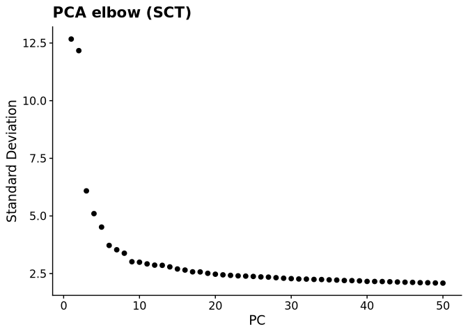

## Resolution sweep

``` r
res_cols <- paste0("SCT_snn_res.", resolutions)

res_summary <- purrr::map_dfr(resolutions, function(res) {
  col <- paste0("SCT_snn_res.", res)
  cl <- as.character(blood_cdc[[col]][, 1])
  sizes <- table(cl)
  # Dataset purity: max dataset fraction within each cluster, then mean over clusters
  purity <- sapply(names(sizes), function(k) {
    max(prop.table(table(blood_cdc$dataset_id[cl == k])))
  })
  tibble::tibble(
    resolution = res,
    n_clusters = length(sizes),
    min_size = min(sizes),
    median_size = as.numeric(median(sizes)),
    max_size = max(sizes),
    n_tiny_lt_50 = sum(sizes < 50),
    mean_max_dataset_frac = mean(purity)
  )
})

res_summary
```

    # A tibble: 6 × 7
      resolution n_clusters min_size median_size max_size n_tiny_lt_50
           <dbl>      <int>    <int>       <dbl>    <int>        <int>
    1       0.05          9       94       2048     13302            0
    2       0.1          12       94       2012.    12572            0
    3       0.2          15       94       1907      8593            0
    4       0.3          15       94       2029      6425            0
    5       0.4          19       94       1155      6175            0
    6       0.6          24       59        902.     4084            0
    # ℹ 1 more variable: mean_max_dataset_frac <dbl>

``` r
# Adjacent-resolution stability (ARI if aricode available)
adj_ari <- tibble::tibble()
if (requireNamespace("aricode", quietly = TRUE) && length(resolutions) > 1) {
  adj_ari <- purrr::map_dfr(seq_len(length(resolutions) - 1), function(i) {
    a <- as.character(blood_cdc[[res_cols[i]]][, 1])
    b <- as.character(blood_cdc[[res_cols[i + 1]]][, 1])
    tibble::tibble(
      res_a = resolutions[i],
      res_b = resolutions[i + 1],
      ARI = aricode::ARI(a, b)
    )
  })
  adj_ari
}
```

    # A tibble: 5 × 3
      res_a res_b   ARI
      <dbl> <dbl> <dbl>
    1  0.05   0.1 0.867
    2  0.1    0.2 0.732
    3  0.2    0.3 0.778
    4  0.3    0.4 0.877
    5  0.4    0.6 0.781

``` r
# Cross-tab of a mid pair (0.2 vs 0.3) for splitting pattern
if (all(c("SCT_snn_res.0.2", "SCT_snn_res.0.3") %in% colnames(blood_cdc[[]]))) {
  print(table(
    res0.2 = blood_cdc$SCT_snn_res.0.2,
    res0.3 = blood_cdc$SCT_snn_res.0.3
  ))
}
```

          res0.3
    res0.2    0    1    2    3    4    5    6    7    8    9   10   11   12   13
        0  5993    0    0 2595    3    0    0    2    0    0    0    0    0    0
        1     0 6197    1    6    0  146    0    0    0  349    0    0    1    0
        2     0    0 3804    2    0    0    0    0    0    0    0   43    0    0
        3   432    0    0   71 2477    0    0    0    0    0  435    0    0    0
        4     0    0    0   56    0    0    0 2027    0    0    0    0    0    0
        5     0    0    0    0    0    0 2048    0    0    0    0    0    0    0
        6     0    0    0    0    0    0    0    0 1977    0    0    0    0    0
        7     0    0    0    0    0 1906    0    0    0    1    0    0    0    0
        8     0    1    1    0    0    0    0    0    0  611    0    0  471    0
        9     0   98    1  904    0    0    0    0    0    0    0    0    0    0
        10    0    0    0    0    0    0    0    0    0    1    0  701    0    0
        11    0    0    0    0    0    0    0    0    0    0  384    0    0    0
        12    0    0    0    0    0    0    0    0    0  251    0    0    0    0
        13    0    0    0    0    0    0    0    0    0    0    0    0    0  156
        14    0    0    0    0    0    0    0    0    0    0    0    0    0    0
          res0.3
    res0.2   14
        0     0
        1     0
        2     0
        3     0
        4     0
        5     0
        6     0
        7     0
        8     0
        9     0
        10    0
        11    0
        12    0
        13    0
        14   94

### Primary resolution choice

Choose the lowest resolution that is stable versus its neighbour (ARI ≥
0.7 when available), has ≥ 2 clusters, few tiny clusters (\< 50 cells),
and moderate mean dataset purity (\< 0.95). Prefer not to pick solely
because `n_clusters` is 2 or 3.

``` r
primary_res <- 0.2
selection_note <- "fallback default 0.2"
if (nrow(res_summary) > 0) {
  cand <- res_summary |>
    dplyr::filter(n_clusters >= 2, n_tiny_lt_50 <= 2, mean_max_dataset_frac < 0.95)
  if (nrow(cand) == 0) {
    cand <- res_summary
    selection_note <- "no candidate met size/purity filters; used full sweep"
  } else {
    selection_note <- "filtered for >=2 clusters, few tiny clusters, non-extreme dataset purity"
  }
  if (nrow(adj_ari) > 0) {
    stable <- adj_ari |> dplyr::filter(ARI >= 0.7)
    if (nrow(stable) > 0) {
      cand2 <- cand |> dplyr::filter(resolution %in% c(stable$res_a, stable$res_b))
      if (nrow(cand2) > 0) {
        cand <- cand2
        selection_note <- paste0(selection_note, "; preferred ARI>=0.7 adjacent stability")
      }
    }
  }
  # Prefer lower resolution among candidates (less fragmentation; not forced to 2/3)
  primary_res <- cand$resolution[which.min(cand$resolution)]
}

primary_res_col <- paste0("SCT_snn_res.", primary_res)
Idents(blood_cdc) <- primary_res_col
blood_cdc$seurat_clusters <- Idents(blood_cdc)

tibble::tibble(
  primary_resolution = primary_res,
  n_clusters = dplyr::n_distinct(blood_cdc$seurat_clusters),
  selection_note = selection_note
)
```

    # A tibble: 1 × 3
      primary_resolution n_clusters selection_note                                  
                   <dbl>      <int> <chr>                                           
    1               0.05          9 filtered for >=2 clusters, few tiny clusters, n…

``` r
table(blood_cdc$seurat_clusters)
```


        0     1     2     3     4     5     6     7     8 
    13302 10039  3852  2078  2048  1977   700   156    94 

# Step 4 — Dataset / sample structure diagnostics

``` r
DimPlot(blood_cdc, reduction = "umap", group.by = "seurat_clusters", label = TRUE) +
  ggtitle(paste0("Clusters (res=", primary_res, ")"))
```

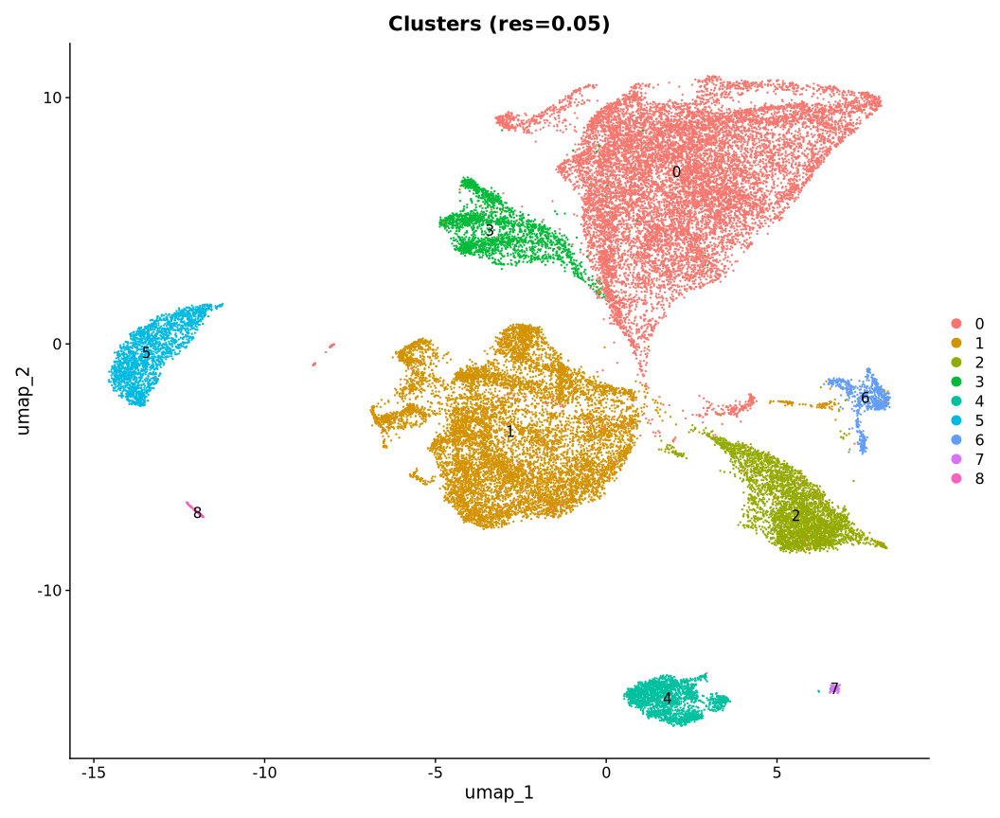

``` r
DimPlot(blood_cdc, reduction = "umap", group.by = "dataset_id") +
  ggtitle("dataset_id") +
  theme(legend.position = "none")
```

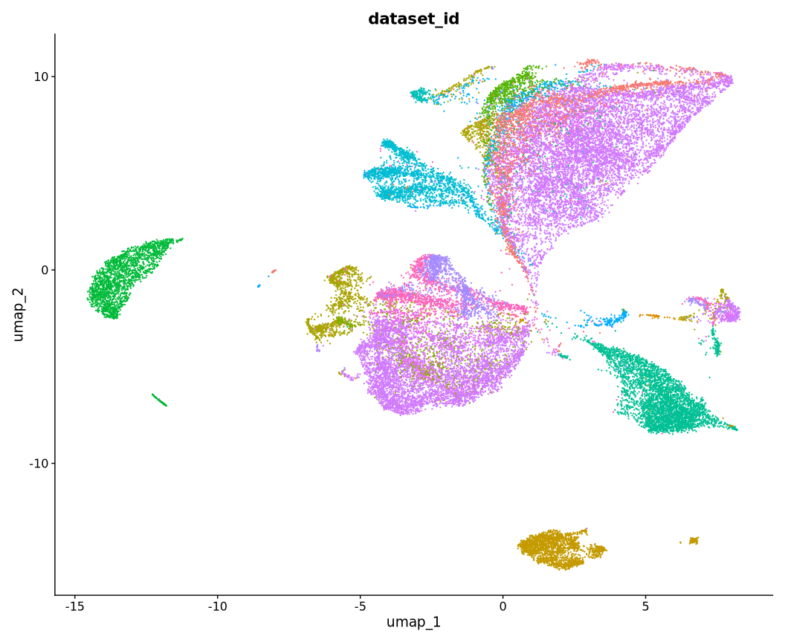

``` r
DimPlot(blood_cdc, reduction = "umap", group.by = "cell_type_unified_ensemble") +
  ggtitle("frozen label (sanity: all cdc)")
```

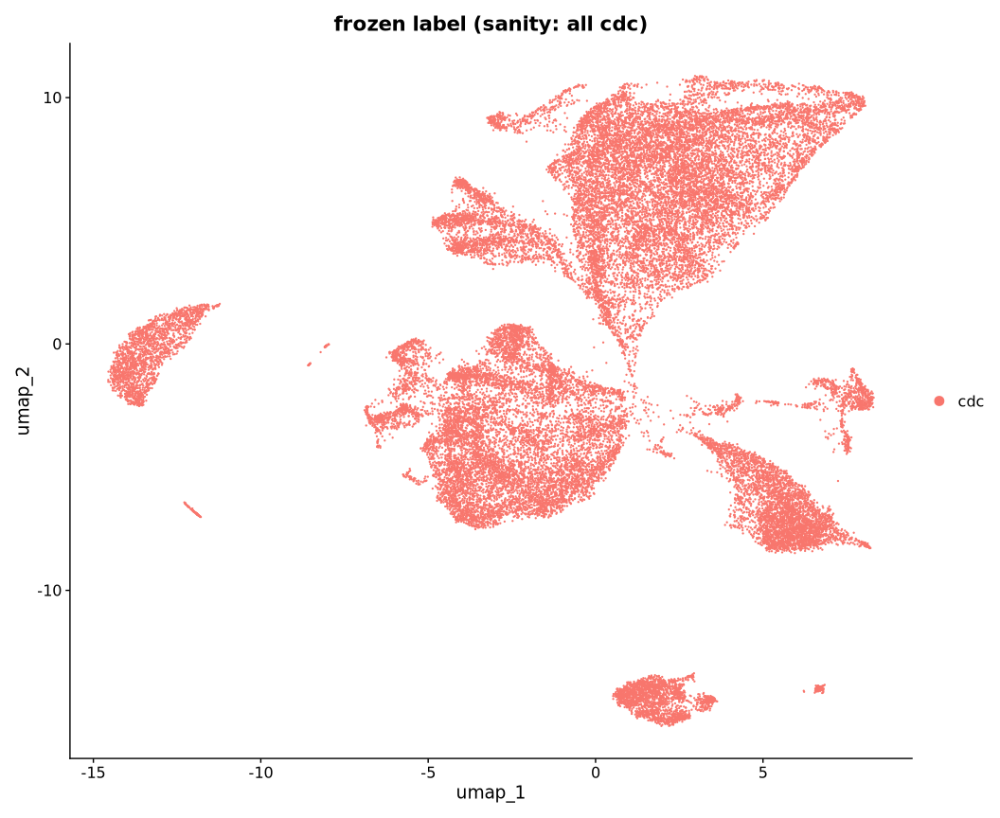

``` r
cluster_dataset_n <- table(
  cluster = blood_cdc$seurat_clusters,
  dataset_id = blood_cdc$dataset_id
)
cluster_dataset_prop <- prop.table(cluster_dataset_n, margin = 1)

# Raw counts (paged)
as.data.frame.matrix(cluster_dataset_n) |>
  tibble::rownames_to_column("cluster")
```

      cluster 01ad3cd7-3929-4654-84c0-6db05bd5fd59
    1       0                                 1913
    2       1                                    5
    3       2                                    1
    4       3                                    7
    5       4                                    0
    6       5                                    0
    7       6                                    0
    8       7                                    0
    9       8                                    0
      19e46756-9100-4e01-8b0e-23b557558a4c 1b9d8702-5af8-4142-85ed-020eb06ec4f6
    1                                   10                                    4
    2                                    0                                   91
    3                                    0                                    4
    4                                    5                                    0
    5                                    0                                    0
    6                                    0                                    0
    7                                    0                                    3
    8                                    0                                    0
    9                                    0                                    0
      218acb0f-9f2f-4f76-b90b-15a4b7c7f629 242c6e7f-9016-4048-af70-d631f5eea188
    1                                    0                                  482
    2                                    0                                 1144
    3                                    0                                    1
    4                                    0                                    0
    5                                 2048                                    0
    6                                    0                                    0
    7                                    0                                   68
    8                                  156                                    0
    9                                    0                                    0
      2a498ace-872a-4935-984b-1afa70fd9886 2adb1f8a-a6b1-4909-8ee8-484814e2d4bf
    1                                   19                                  708
    2                                  735                                    0
    3                                    7                                    0
    4                                    0                                    3
    5                                    0                                    0
    6                                    0                                    0
    7                                   21                                    0
    8                                    0                                    0
    9                                    0                                    0
      2c820d53-cbd7-4e0a-be7a-a0ad1989a98f 30cd5311-6c09-46c9-94f1-71fe4b91813c
    1                                    0                                  291
    2                                    0                                    0
    3                                    0                                    0
    4                                    0                                    0
    5                                    0                                    0
    6                                 1977                                    0
    7                                    0                                    0
    8                                    0                                    0
    9                                   94                                    0
      3faad104-2ab8-4434-816d-474d8d2641db 456e8b9b-f872-488b-871d-94534090a865
    1                                   20                                  178
    2                                   11                                    0
    3                                 3804                                    0
    4                                    2                                    0
    5                                    0                                    0
    6                                    0                                    0
    7                                  132                                    0
    8                                    0                                    0
    9                                    0                                    0
      59b69042-47c2-47fd-ad03-d21beb99818f 5af90777-6760-4003-9dba-8f945fec6fdf
    1                                   42                                  657
    2                                    0                                    0
    3                                    0                                    0
    4                                 1838                                    0
    5                                    0                                    0
    6                                    0                                    0
    7                                    0                                    0
    8                                    0                                    0
    9                                    0                                    0
      5e717147-0f75-4de1-8bd2-6fda01b8d75f 8c42cfd0-0b0a-46d5-910c-fc833d83c45e
    1                                  213                                   17
    2                                    5                                    4
    3                                    1                                    7
    4                                  210                                    0
    5                                    0                                    0
    6                                    0                                    0
    7                                    0                                    2
    8                                    0                                    0
    9                                    0                                    0
      9dbab10c-118d-496b-966a-67f1763a6b7d b0e547f0-462b-4f81-b31b-5b0a5d96f537
    1                                   76                                 7538
    2                                 1139                                 4659
    3                                    0                                   11
    4                                    0                                    6
    5                                    0                                    0
    6                                    0                                    0
    7                                   73                                  286
    8                                    0                                    0
    9                                    0                                    0
      c7775e88-49bf-4ba2-a03b-93f00447c958 de2c780c-1747-40bd-9ccf-9588ec186cee
    1                                 1063                                   69
    2                                  844                                  134
    3                                    6                                   10
    4                                    1                                    6
    5                                    0                                    0
    6                                    0                                    0
    7                                   39                                   18
    8                                    0                                    0
    9                                    0                                    0
      ebc2e1ff-c8f9-466a-acf4-9d291afaf8b3 fa8605cf-f27e-44af-ac2a-476bee4410d3
    1                                    2                                    0
    2                                 1236                                   32
    3                                    0                                    0
    4                                    0                                    0
    5                                    0                                    0
    6                                    0                                    0
    7                                   57                                    1
    8                                    0                                    0
    9                                    0                                    0

``` r
# Row-normalised proportions
as.data.frame.matrix(round(cluster_dataset_prop, 3)) |>
  tibble::rownames_to_column("cluster")
```

      cluster 01ad3cd7-3929-4654-84c0-6db05bd5fd59
    1       0                                0.144
    2       1                                0.000
    3       2                                0.000
    4       3                                0.003
    5       4                                0.000
    6       5                                0.000
    7       6                                0.000
    8       7                                0.000
    9       8                                0.000
      19e46756-9100-4e01-8b0e-23b557558a4c 1b9d8702-5af8-4142-85ed-020eb06ec4f6
    1                                0.001                                0.000
    2                                0.000                                0.009
    3                                0.000                                0.001
    4                                0.002                                0.000
    5                                0.000                                0.000
    6                                0.000                                0.000
    7                                0.000                                0.004
    8                                0.000                                0.000
    9                                0.000                                0.000
      218acb0f-9f2f-4f76-b90b-15a4b7c7f629 242c6e7f-9016-4048-af70-d631f5eea188
    1                                    0                                0.036
    2                                    0                                0.114
    3                                    0                                0.000
    4                                    0                                0.000
    5                                    1                                0.000
    6                                    0                                0.000
    7                                    0                                0.097
    8                                    1                                0.000
    9                                    0                                0.000
      2a498ace-872a-4935-984b-1afa70fd9886 2adb1f8a-a6b1-4909-8ee8-484814e2d4bf
    1                                0.001                                0.053
    2                                0.073                                0.000
    3                                0.002                                0.000
    4                                0.000                                0.001
    5                                0.000                                0.000
    6                                0.000                                0.000
    7                                0.030                                0.000
    8                                0.000                                0.000
    9                                0.000                                0.000
      2c820d53-cbd7-4e0a-be7a-a0ad1989a98f 30cd5311-6c09-46c9-94f1-71fe4b91813c
    1                                    0                                0.022
    2                                    0                                0.000
    3                                    0                                0.000
    4                                    0                                0.000
    5                                    0                                0.000
    6                                    1                                0.000
    7                                    0                                0.000
    8                                    0                                0.000
    9                                    1                                0.000
      3faad104-2ab8-4434-816d-474d8d2641db 456e8b9b-f872-488b-871d-94534090a865
    1                                0.002                                0.013
    2                                0.001                                0.000
    3                                0.988                                0.000
    4                                0.001                                0.000
    5                                0.000                                0.000
    6                                0.000                                0.000
    7                                0.189                                0.000
    8                                0.000                                0.000
    9                                0.000                                0.000
      59b69042-47c2-47fd-ad03-d21beb99818f 5af90777-6760-4003-9dba-8f945fec6fdf
    1                                0.003                                0.049
    2                                0.000                                0.000
    3                                0.000                                0.000
    4                                0.885                                0.000
    5                                0.000                                0.000
    6                                0.000                                0.000
    7                                0.000                                0.000
    8                                0.000                                0.000
    9                                0.000                                0.000
      5e717147-0f75-4de1-8bd2-6fda01b8d75f 8c42cfd0-0b0a-46d5-910c-fc833d83c45e
    1                                0.016                                0.001
    2                                0.000                                0.000
    3                                0.000                                0.002
    4                                0.101                                0.000
    5                                0.000                                0.000
    6                                0.000                                0.000
    7                                0.000                                0.003
    8                                0.000                                0.000
    9                                0.000                                0.000
      9dbab10c-118d-496b-966a-67f1763a6b7d b0e547f0-462b-4f81-b31b-5b0a5d96f537
    1                                0.006                                0.567
    2                                0.113                                0.464
    3                                0.000                                0.003
    4                                0.000                                0.003
    5                                0.000                                0.000
    6                                0.000                                0.000
    7                                0.104                                0.409
    8                                0.000                                0.000
    9                                0.000                                0.000
      c7775e88-49bf-4ba2-a03b-93f00447c958 de2c780c-1747-40bd-9ccf-9588ec186cee
    1                                0.080                                0.005
    2                                0.084                                0.013
    3                                0.002                                0.003
    4                                0.000                                0.003
    5                                0.000                                0.000
    6                                0.000                                0.000
    7                                0.056                                0.026
    8                                0.000                                0.000
    9                                0.000                                0.000
      ebc2e1ff-c8f9-466a-acf4-9d291afaf8b3 fa8605cf-f27e-44af-ac2a-476bee4410d3
    1                                0.000                                0.000
    2                                0.123                                0.003
    3                                0.000                                0.000
    4                                0.000                                0.000
    5                                0.000                                0.000
    6                                0.000                                0.000
    7                                0.081                                0.001
    8                                0.000                                0.000
    9                                0.000                                0.000

``` r
# Per-cluster: dominant dataset fraction
purity_tbl <- tibble::tibble(
  cluster = rownames(cluster_dataset_prop),
  max_dataset_frac = apply(cluster_dataset_prop, 1, max),
  dominant_dataset = colnames(cluster_dataset_prop)[
    apply(cluster_dataset_prop, 1, which.max)
  ]
) |>
  dplyr::arrange(dplyr::desc(max_dataset_frac))
purity_tbl
```

    # A tibble: 9 × 3
      cluster max_dataset_frac dominant_dataset                    
      <chr>              <dbl> <chr>                               
    1 4                  1     218acb0f-9f2f-4f76-b90b-15a4b7c7f629
    2 5                  1     2c820d53-cbd7-4e0a-be7a-a0ad1989a98f
    3 7                  1     218acb0f-9f2f-4f76-b90b-15a4b7c7f629
    4 8                  1     2c820d53-cbd7-4e0a-be7a-a0ad1989a98f
    5 2                  0.988 3faad104-2ab8-4434-816d-474d8d2641db
    6 3                  0.885 59b69042-47c2-47fd-ad03-d21beb99818f
    7 0                  0.567 b0e547f0-462b-4f81-b31b-5b0a5d96f537
    8 1                  0.464 b0e547f0-462b-4f81-b31b-5b0a5d96f537
    9 6                  0.409 b0e547f0-462b-4f81-b31b-5b0a5d96f537

``` r
# Sample diversity per cluster (avoid huge sample×cluster heatmaps)
blood_cdc[[]] |>
  dplyr::count(seurat_clusters, sample_id) |>
  dplyr::group_by(seurat_clusters) |>
  dplyr::summarise(
    n_samples = dplyr::n(),
    n_cells = sum(n),
    median_cells_per_sample = median(n),
    .groups = "drop"
  )
```

    # A tibble: 9 × 4
      seurat_clusters n_samples n_cells median_cells_per_sample
      <fct>               <int>   <int>                   <dbl>
    1 0                     898   13302                    10  
    2 1                     485   10039                    12  
    3 2                     839    3852                     4  
    4 3                      25    2078                     2  
    5 4                     381    2048                     4  
    6 5                       4    1977                   502. 
    7 6                     338     700                     1  
    8 7                     109     156                     1  
    9 8                       4      94                    24.5

# Step 5 — Markers and cluster-level evidence synthesis

Features in cellNexus counts are **Ensembl IDs**. Canonical symbols are
mapped before plotting. Final cluster identity is **not** decided by a
fixed cDC1−cDC2 module-score threshold; modules remain supporting
evidence only.

Identity is synthesised from: de novo markers, canonical programs,
original HPCell provenance annotations, new Azimuth PBMC L3, and
sample/dataset reproducibility.

``` r
# Expanded canonical / exclusion panels (symbols)
cdc1_genes_symbol <- c(
  "CLEC9A", "XCR1", "CADM1", "BATF3", "IRF8",
  "CLNK", "IDO1", "WDFY4", "C1orf54"
)
cdc2_genes_symbol <- c(
  "CD1C", "FCER1A", "CLEC10A", "CD1E",
  "CD74", "HLA-DPA1", "HLA-DPB1", "HLA-DQA1"
)
exclusion_genes_symbol <- c(
  # monocyte / myeloid
  "LYZ", "S100A8", "S100A9", "FCGR3A", "VCAN", "CD14", "CST3",
  # pDC
  "TCF4", "IRF7", "LILRA4",
  # B / NK / erythroid / progenitor
  "MS4A1", "CD79A", "GNLY", "NKG7", "HBA1", "HBB", "CD34", "SPINK2"
)
focus_symbols <- unique(c(cdc1_genes_symbol, cdc2_genes_symbol, exclusion_genes_symbol))

symbol_to_ensembl <- AnnotationDbi::mapIds(
  org.Hs.eg.db::org.Hs.eg.db,
  keys = focus_symbols,
  column = "ENSEMBL",
  keytype = "SYMBOL",
  multiVals = "first"
)

focus_map <- tibble::tibble(
  symbol = focus_symbols,
  ensembl = unname(symbol_to_ensembl[focus_symbols]),
  present = !is.na(ensembl) & ensembl %in% rownames(blood_cdc),
  panel = dplyr::case_when(
    symbol %in% cdc1_genes_symbol ~ "cDC1",
    symbol %in% cdc2_genes_symbol ~ "cDC2",
    TRUE ~ "exclusion"
  )
)
focus_map
```

    # A tibble: 35 × 4
       symbol  ensembl         present panel
       <chr>   <chr>           <lgl>   <chr>
     1 CLEC9A  ENSG00000197992 TRUE    cDC1 
     2 XCR1    ENSG00000173578 TRUE    cDC1 
     3 CADM1   ENSG00000182985 TRUE    cDC1 
     4 BATF3   ENSG00000123685 TRUE    cDC1 
     5 IRF8    ENSG00000140968 TRUE    cDC1 
     6 CLNK    ENSG00000109684 TRUE    cDC1 
     7 IDO1    ENSG00000131203 TRUE    cDC1 
     8 WDFY4   ENSG00000128815 FALSE   cDC1 
     9 C1orf54 ENSG00000118292 TRUE    cDC1 
    10 CD1C    ENSG00000158481 TRUE    cDC2 
    # ℹ 25 more rows

``` r
cdc1_genes <- focus_map$ensembl[focus_map$panel == "cDC1" & focus_map$present]
cdc2_genes <- focus_map$ensembl[focus_map$panel == "cDC2" & focus_map$present]
exclusion_genes <- focus_map$ensembl[focus_map$panel == "exclusion" & focus_map$present]
names(cdc1_genes) <- focus_map$symbol[match(cdc1_genes, focus_map$ensembl)]
names(cdc2_genes) <- focus_map$symbol[match(cdc2_genes, focus_map$ensembl)]
names(exclusion_genes) <- focus_map$symbol[match(exclusion_genes, focus_map$ensembl)]
focus_present <- c(cdc1_genes, cdc2_genes)
focus_present_excl <- c(focus_present, exclusion_genes)

path_markers <- file.path(
  path_intermediate("fig2_rebuttal_pilot"),
  "blood_cdc_cluster_markers.rds"
)

DefaultAssay(blood_cdc) <- "SCT"
if (file.exists(path_markers)) {
  markers <- readRDS(path_markers)
} else {
  if (length(blood_cdc@assays$SCT@SCTModel.list) > 1) {
    blood_cdc <- PrepSCTFindMarkers(blood_cdc)
  }
  markers <- FindAllMarkers(
    blood_cdc,
    assay = "SCT",
    only.pos = TRUE,
    min.pct = 0.1,
    logfc.threshold = 0.25,
    verbose = FALSE
  )
  markers$symbol <- AnnotationDbi::mapIds(
    org.Hs.eg.db::org.Hs.eg.db,
    keys = markers$gene,
    column = "SYMBOL",
    keytype = "ENSEMBL",
    multiVals = "first"
  )
  saveRDS(markers, path_markers)
  saveRDS(blood_cdc, path_blood_cdc_sct)
}

# Top ~15–20 positive markers per cluster by effect size (avg_log2FC)
markers_top <-
  markers |>
  dplyr::group_by(cluster) |>
  dplyr::slice_max(order_by = avg_log2FC, n = 20, with_ties = FALSE) |>
  dplyr::ungroup()

markers_top |>
  dplyr::group_by(cluster) |>
  dplyr::slice_max(order_by = avg_log2FC, n = 8) |>
  dplyr::ungroup()
```

    # A tibble: 59 × 8
           p_val avg_log2FC pct.1 pct.2 p_val_adj cluster gene            symbol
           <dbl>      <dbl> <dbl> <dbl>     <dbl> <fct>   <chr>           <chr> 
     1 0              1.63  1     0.998 0         0       ENSG00000019582 CD74  
     2 2.34e-251      0.451 0.999 0.886 3.20e-247 0       ENSG00000075624 ACTB  
     3 0              5.76  0.34  0.006 0         1       ENSG00000149925 ALDOA 
     4 0              4.76  0.1   0.004 0         1       ENSG00000127528 KLF2  
     5 0              4.23  0.139 0.008 0         1       ENSG00000123358 NR4A1 
     6 0              3.99  0.187 0.012 0         1       ENSG00000108639 SYNGR2
     7 0              3.93  0.165 0.011 0         1       ENSG00000196924 FLNA  
     8 0              3.88  0.111 0.007 0         1       ENSG00000105329 TGFB1 
     9 0              3.74  0.107 0.006 0         1       ENSG00000131400 NAPSA 
    10 0              3.72  0.196 0.016 0         1       ENSG00000179820 MYADM 
    # ℹ 49 more rows

Canonical and exclusion markers as DotPlots (x-axis = gene **symbol**;
panels indicate the intended biological program). Features in the object
are Ensembl IDs; symbols are mapped for display.

``` r
stopifnot(length(focus_present) > 0)

# Seurat DotPlot groups when features is a named list
dot_features_cdc <- list(
  cDC1 = unname(cdc1_genes),
  cDC2 = unname(cdc2_genes)
)
# Symbol labels for every Ensembl ID in the plot
ens_to_symbol <- c(
  setNames(names(cdc1_genes), unname(cdc1_genes)),
  setNames(names(cdc2_genes), unname(cdc2_genes)),
  setNames(names(exclusion_genes), unname(exclusion_genes))
)

DotPlot(blood_cdc, features = dot_features_cdc) +
  scale_x_discrete(labels = function(x) unname(ens_to_symbol[x])) +
  RotatedAxis() +
  ggtitle("Canonical markers by cluster (grouped: cDC1 vs cDC2)") +
  theme(axis.text.x = element_text(size = 9))
```

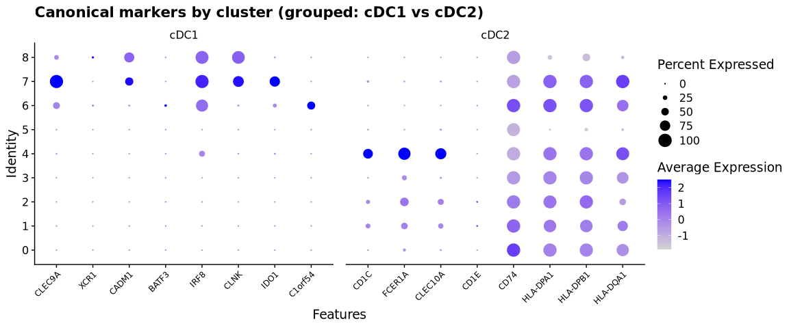

``` r
if (length(exclusion_genes) > 0) {
  DotPlot(
    blood_cdc,
    features = list(`exclusion / alternative lineage` = unname(exclusion_genes))
  ) +
    scale_x_discrete(labels = function(x) unname(ens_to_symbol[x])) +
    RotatedAxis() +
    ggtitle("Exclusion / alternative-lineage markers (monocyte, pDC, B, NK, erythroid, progenitor)") +
    theme(axis.text.x = element_text(size = 8))
}
```

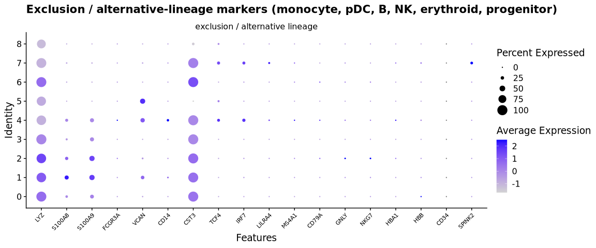

UMAP FeaturePlots of selected canonical markers. Object feature names
are Ensembl IDs (`ENSG…`); panel titles use gene symbols (Ensembl ID as
subtitle).

``` r
fp_n <- min(8L, length(focus_present))
fp_ensembl <- unname(focus_present)[seq_len(fp_n)]
fp_symbol <- names(focus_present)[seq_len(fp_n)]

tibble::tibble(
  panel = seq_len(fp_n),
  symbol = fp_symbol,
  ensembl = fp_ensembl,
  program = dplyr::if_else(fp_ensembl %in% unname(cdc1_genes), "cDC1", "cDC2")
)
```

    # A tibble: 8 × 4
      panel symbol  ensembl         program
      <int> <chr>   <chr>           <chr>  
    1     1 CLEC9A  ENSG00000197992 cDC1   
    2     2 XCR1    ENSG00000173578 cDC1   
    3     3 CADM1   ENSG00000182985 cDC1   
    4     4 BATF3   ENSG00000123685 cDC1   
    5     5 IRF8    ENSG00000140968 cDC1   
    6     6 CLNK    ENSG00000109684 cDC1   
    7     7 IDO1    ENSG00000131203 cDC1   
    8     8 C1orf54 ENSG00000118292 cDC1   

``` r
fp_list <- FeaturePlot(
  blood_cdc,
  features = fp_ensembl,
  reduction = "umap",
  order = TRUE,
  combine = FALSE
)
fp_list <- lapply(seq_along(fp_list), function(i) {
  fp_list[[i]] +
    ggtitle(fp_symbol[i]) +
    labs(subtitle = paste0(fp_ensembl[i], " · ", dplyr::if_else(
      fp_ensembl[i] %in% unname(cdc1_genes), "cDC1 marker", "cDC2 marker"
    ))) +
    theme(plot.subtitle = element_text(size = 8, colour = "grey30"))
})
patchwork::wrap_plots(fp_list, ncol = 4)
```

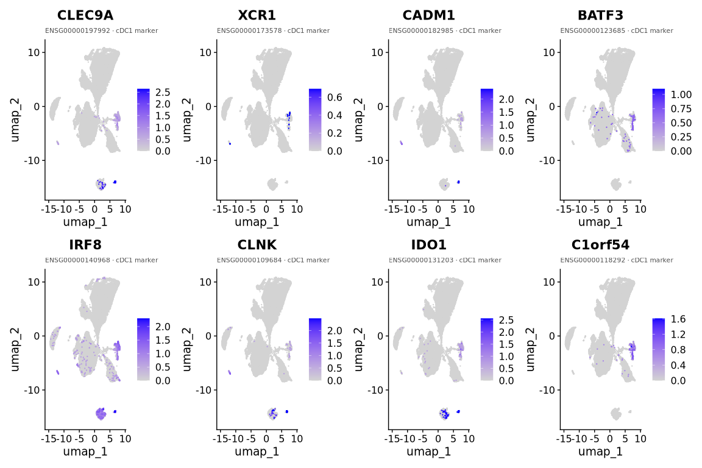

``` r
# Supporting module scores from *core* subtype markers only.
# Broader HLA/CD74 genes are inspected in DotPlots above but are too ubiquitous
# to define the module score.
cdc1_core_symbol <- c("CLEC9A", "XCR1", "CADM1", "BATF3", "IRF8", "CLNK", "IDO1", "C1orf54")
cdc2_core_symbol <- c("CD1C", "FCER1A", "CLEC10A", "CD1E")
focus_present_cdc1 <- unname(cdc1_genes[names(cdc1_genes) %in% cdc1_core_symbol])
focus_present_cdc2 <- unname(cdc2_genes[names(cdc2_genes) %in% cdc2_core_symbol])
stopifnot(length(focus_present_cdc1) > 0, length(focus_present_cdc2) > 0)
tibble::tibble(
  cDC1_core_used = paste(names(cdc1_genes)[names(cdc1_genes) %in% cdc1_core_symbol], collapse = ", "),
  cDC2_core_used = paste(names(cdc2_genes)[names(cdc2_genes) %in% cdc2_core_symbol], collapse = ", ")
)
```

    # A tibble: 1 × 2
      cDC1_core_used                                        cDC2_core_used          
      <chr>                                                 <chr>                   
    1 CLEC9A, XCR1, CADM1, BATF3, IRF8, CLNK, IDO1, C1orf54 CD1C, FCER1A, CLEC10A, …

``` r
expr <- tryCatch(
  GetAssayData(blood_cdc, assay = "SCT", layer = "data"),
  error = function(e) GetAssayData(blood_cdc, assay = "SCT", slot = "data")
)
blood_cdc$cDC1_module <- Matrix::colMeans(expr[focus_present_cdc1, , drop = FALSE])
blood_cdc$cDC2_module <- Matrix::colMeans(expr[focus_present_cdc2, , drop = FALSE])

module_by_cluster <-
  blood_cdc[[]] |>
  dplyr::group_by(seurat_clusters) |>
  dplyr::summarise(
    cDC1_module = mean(cDC1_module),
    cDC2_module = mean(cDC2_module),
    n = dplyr::n(),
    .groups = "drop"
  )
module_by_cluster
```

    # A tibble: 9 × 4
      seurat_clusters cDC1_module cDC2_module     n
      <fct>                 <dbl>       <dbl> <int>
    1 0                 0.000208      0.0290  13302
    2 1                 0.00191       0.203   10039
    3 2                 0.00269       0.255    3852
    4 3                 0.0000834     0.0599   2078
    5 4                 0.0518        1.20     2048
    6 5                 0.00165       0.0105   1977
    7 6                 0.214         0.00124   700
    8 7                 1.11          0.0305    156
    9 8                 0.333         0          94

``` r
VlnPlot(
  blood_cdc,
  features = c("cDC1_module", "cDC2_module"),
  group.by = "seurat_clusters",
  pt.size = 0
)
```

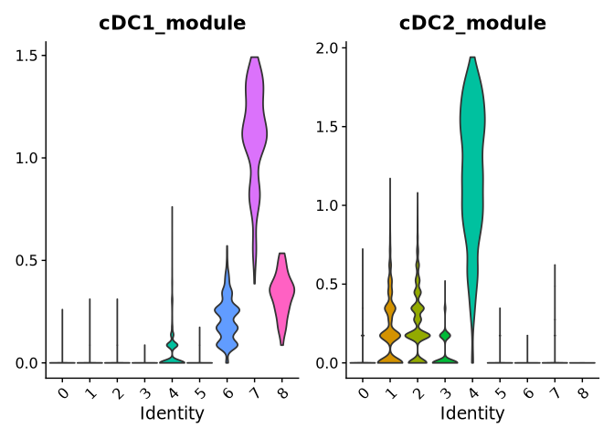

## Provenance columns available in this object

``` r
provenance_candidates <- c(
  "cell_annotation_azimuth_l2",
  "cell_annotation_blueprint_singler",
  "cell_annotation_monaco_singler",
  "cell_type",
  "cell_type_unified",
  "cell_type_unified_ensemble",
  "data_driven_ensemble"
)
provenance_cols <- provenance_candidates[provenance_candidates %in% colnames(blood_cdc[[]])]
missing_provenance <- setdiff(provenance_candidates, provenance_cols)
tibble::tibble(
  available = paste(provenance_cols, collapse = ", "),
  missing = paste(missing_provenance, collapse = ", ")
)
```

    # A tibble: 1 × 2
      available                                                              missing
      <chr>                                                                  <chr>  
    1 cell_annotation_azimuth_l2, cell_annotation_blueprint_singler, cell_a… cell_t…

Final cluster identity synthesis (combining markers, provenance, new
Azimuth L3, and dataset reproducibility) is completed **after** the
Azimuth PBMC mapping step below, so that the new L3 labels are
available.

# Step 6 — LogNormalize sensitivity check

Same cells; previous-pilot-style workflow. Compare major structure only.

``` r
if (file.exists(path_blood_cdc_lognorm)) {
  blood_cdc_ln <- readRDS(path_blood_cdc_lognorm)
} else {
  blood_cdc_ln <- readRDS(path_blood_cdc)
  if (!"RNA" %in% Assays(blood_cdc_ln) && "counts" %in% Assays(blood_cdc_ln)) {
    blood_cdc_ln[["RNA"]] <- blood_cdc_ln[["counts"]]
  }
  DefaultAssay(blood_cdc_ln) <- "RNA"
  blood_cdc_ln <- NormalizeData(blood_cdc_ln, verbose = FALSE)
  blood_cdc_ln <- FindVariableFeatures(blood_cdc_ln, verbose = FALSE)
  blood_cdc_ln <- ScaleData(blood_cdc_ln, verbose = FALSE)
  blood_cdc_ln <- RunPCA(blood_cdc_ln, verbose = FALSE)
  blood_cdc_ln <- FindNeighbors(blood_cdc_ln, dims = pca_dims, verbose = FALSE)
  blood_cdc_ln <- FindClusters(blood_cdc_ln, resolution = primary_res, verbose = FALSE)
  blood_cdc_ln <- RunUMAP(blood_cdc_ln, dims = pca_dims, verbose = FALSE)
  saveRDS(blood_cdc_ln, path_blood_cdc_lognorm)
}

# Align cells and cross-tab SCT vs LogNormalize clusters
common_cells <- intersect(colnames(blood_cdc), colnames(blood_cdc_ln))
sct_cl <- as.character(Idents(blood_cdc)[common_cells])
ln_cl <- as.character(Idents(blood_cdc_ln)[common_cells])
print(table(SCT = sct_cl, LogNorm = ln_cl))
```

       LogNorm
    SCT     0     1     2     3     4     5     6     7     8
      0 11812   556   122     0     0   742    70     0     0
      1  8454   291   178     0     0    70  1046     0     0
      2    90  3748     6     0     0     8     0     0     0
      3    50    23  2005     0     0     0     0     0     0
      4     0     0     0  2046     0     0     0     2     0
      5     0     0     0     0  1976     0     0     0     1
      6     5    15     0     0     0   680     0     0     0
      7     0     0     0     2     0     0     0   154     0
      8     0     0     0     0     0     0     0     0    94

``` r
if (requireNamespace("aricode", quietly = TRUE)) {
  tibble::tibble(
    ARI_SCT_vs_LogNorm = aricode::ARI(sct_cl, ln_cl),
    NMI_SCT_vs_LogNorm = aricode::NMI(sct_cl, ln_cl)
  )
}
```

    # A tibble: 1 × 2
      ARI_SCT_vs_LogNorm NMI_SCT_vs_LogNorm
                   <dbl>              <dbl>
    1              0.463              0.625

``` r
DimPlot(blood_cdc_ln, label = TRUE) + ggtitle(paste0("LogNorm clusters (res=", primary_res, ")"))
```

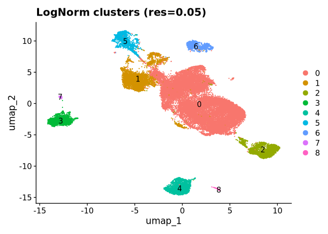

# Step 7 — Azimuth PBMC annotation (independent)

Run on a **separate copy** built from the RNA/counts representation so
SCT clustering is untouched.

``` r
azimuth_ok <- requireNamespace("Azimuth", quietly = TRUE)

if (!azimuth_ok) {
  message("Azimuth is not installed; skip mapping section.")
} else if (file.exists(path_blood_cdc_azimuth)) {
  blood_cdc_az <- readRDS(path_blood_cdc_azimuth)
} else {
  library(Azimuth)
  # Fresh query from counts/RNA — convert Ensembl -> SYMBOL for PBMC reference
  blood_cdc_az <- readRDS(path_blood_cdc)
  counts_assay <- if ("counts" %in% Assays(blood_cdc_az)) "counts" else "RNA"
  counts_mat <- tryCatch(
    GetAssayData(blood_cdc_az, assay = counts_assay, layer = "counts"),
    error = function(e) GetAssayData(blood_cdc_az, assay = counts_assay, slot = "counts")
  )

  ens <- rownames(counts_mat)
  sym <- AnnotationDbi::mapIds(
    org.Hs.eg.db::org.Hs.eg.db,
    keys = ens,
    column = "SYMBOL",
    keytype = "ENSEMBL",
    multiVals = "first"
  )
  keep <- !is.na(sym) & !duplicated(sym)
  counts_mat <- counts_mat[keep, , drop = FALSE]
  rownames(counts_mat) <- unname(sym[keep])

  meta_az <- blood_cdc_az[[]][colnames(counts_mat), , drop = FALSE]
  blood_cdc_az <- CreateSeuratObject(
    counts = counts_mat,
    meta.data = meta_az,
    assay = "RNA"
  )
  cat(
    "Azimuth query features after Ensembl->SYMBOL:",
    nrow(blood_cdc_az),
    "genes /",
    ncol(blood_cdc_az),
    "cells\n"
  )

  blood_cdc_az <- RunAzimuth(
    query = blood_cdc_az,
    reference = "pbmcref"
  )
  saveRDS(blood_cdc_az, path_blood_cdc_azimuth)
}

if (azimuth_ok || file.exists(path_blood_cdc_azimuth)) {
  # Identify L3 annotation / score columns programmatically
  az_cols <- colnames(blood_cdc_az[[]])
  az_cols

  l3_candidates <- az_cols[
    grepl("predicted\\.celltype\\.l3$|celltype\\.l3$", az_cols, ignore.case = TRUE) &
      !grepl("score|prob", az_cols, ignore.case = TRUE)
  ]
  l3_score_candidates <- az_cols[
    grepl("predicted\\.celltype\\.l3\\.score|celltype\\.l3\\.score", az_cols, ignore.case = TRUE)
  ]

  azimuth_l3_col <- l3_candidates[1]
  azimuth_l3_score_col <- if (length(l3_score_candidates)) l3_score_candidates[1] else NA_character_
  tibble::tibble(
    azimuth_l3_col = azimuth_l3_col,
    azimuth_l3_score_col = azimuth_l3_score_col
  )

  if (!is.na(azimuth_l3_col) && length(azimuth_l3_col) > 0) {
    blood_cdc_az$azimuth_l3 <- as.character(blood_cdc_az[[azimuth_l3_col]][[1]])
    if (!is.na(azimuth_l3_score_col)) {
      blood_cdc_az$azimuth_l3_score <- as.numeric(blood_cdc_az[[azimuth_l3_score_col]][[1]])
    }
    sort(table(blood_cdc_az$azimuth_l3, useNA = "ifany"), decreasing = TRUE)
  }
}
```


                   cDC2_2                cDC2_1             CD14 Mono 
                    17979                  8682                  2935 
                     HSPC                  cDC1                   pDC 
                     2034                  1000                   481 
                 ASDC_pDC        B memory kappa              ASDC_mDC 
                      432                   316                   232 
                    Eryth                  NK_2 B intermediate lambda 
                      125                    29                     1 

# Step 8 — Evidence synthesis, final annotation, and Azimuth comparison

Transfer Azimuth L3 onto the primary SCT object, then build the
cluster-level evidence table and final annotation.

``` r
if (exists("blood_cdc_az") && "azimuth_l3" %in% colnames(blood_cdc_az[[]])) {
  az_lab <- setNames(as.character(blood_cdc_az$azimuth_l3), colnames(blood_cdc_az))
  blood_cdc$azimuth_l3 <- unname(az_lab[colnames(blood_cdc)])
  if ("azimuth_l3_score" %in% colnames(blood_cdc_az[[]])) {
    az_sc <- setNames(as.numeric(blood_cdc_az$azimuth_l3_score), colnames(blood_cdc_az))
    blood_cdc$azimuth_l3_score <- unname(az_sc[colnames(blood_cdc)])
  }
}
tibble::tibble(
  has_azimuth_l3 = "azimuth_l3" %in% colnames(blood_cdc[[]]),
  n_azimuth_l3_non_na = if ("azimuth_l3" %in% colnames(blood_cdc[[]])) {
    sum(!is.na(blood_cdc$azimuth_l3))
  } else {
    0L
  }
)
```

    # A tibble: 1 × 2
      has_azimuth_l3 n_azimuth_l3_non_na
      <lgl>                        <int>
    1 TRUE                         34246

## Cluster evidence table

``` r
# Explicit, editable dataset-association threshold
dataset_assoc_threshold <- 0.8

majority_label <- function(x) {
  x <- as.character(x)
  x <- x[!is.na(x) & nzchar(x)]
  if (length(x) == 0) {
    return(list(label = NA_character_, fraction = NA_real_))
  }
  tab <- sort(table(x), decreasing = TRUE)
  list(label = names(tab)[1], fraction = as.numeric(tab[1]) / length(x))
}

clusters <- sort(unique(as.character(blood_cdc$seurat_clusters)))

top_marker_str <-
  markers_top |>
  dplyr::mutate(cluster = as.character(cluster)) |>
  dplyr::group_by(cluster) |>
  dplyr::slice_max(order_by = avg_log2FC, n = 8, with_ties = FALSE) |>
  dplyr::summarise(
    top_markers = paste(dplyr::coalesce(symbol, gene), collapse = ", "),
    .groups = "drop"
  )

evidence_rows <- lapply(clusters, function(cl) {
  cells <- as.character(blood_cdc$seurat_clusters) == cl
  md <- blood_cdc[[]][cells, , drop = FALSE]

  az_l2 <- if ("cell_annotation_azimuth_l2" %in% names(md)) {
    majority_label(md$cell_annotation_azimuth_l2)
  } else {
    list(label = NA_character_, fraction = NA_real_)
  }
  bp <- if ("cell_annotation_blueprint_singler" %in% names(md)) {
    majority_label(md$cell_annotation_blueprint_singler)
  } else {
    list(label = NA_character_, fraction = NA_real_)
  }
  monaco <- if ("cell_annotation_monaco_singler" %in% names(md)) {
    majority_label(md$cell_annotation_monaco_singler)
  } else {
    list(label = NA_character_, fraction = NA_real_)
  }
  cxg_col <- intersect(c("cell_type", "cell_type_unified"), names(md))[1]
  cxg <- if (!is.na(cxg_col)) {
    majority_label(md[[cxg_col]])
  } else {
    list(label = NA_character_, fraction = NA_real_)
  }
  dde <- if ("data_driven_ensemble" %in% names(md)) {
    majority_label(md$data_driven_ensemble)
  } else {
    list(label = NA_character_, fraction = NA_real_)
  }
  az_l3 <- if ("azimuth_l3" %in% names(md)) {
    majority_label(md$azimuth_l3)
  } else {
    list(label = NA_character_, fraction = NA_real_)
  }
  ds <- majority_label(md$dataset_id)

  tibble::tibble(
    cluster = cl,
    n_cells = nrow(md),
    n_samples = dplyr::n_distinct(md$sample_id),
    n_donors = dplyr::n_distinct(md$donor_id),
    n_datasets = dplyr::n_distinct(md$dataset_id),
    dominant_dataset = ds$label,
    max_dataset_fraction = ds$fraction,
    cDC1_module = mean(md$cDC1_module, na.rm = TRUE),
    cDC2_module = mean(md$cDC2_module, na.rm = TRUE),
    old_azimuth_l2_majority = az_l2$label,
    old_azimuth_l2_fraction = az_l2$fraction,
    blueprint_majority = bp$label,
    blueprint_fraction = bp$fraction,
    monaco_majority = monaco$label,
    monaco_fraction = monaco$fraction,
    cellxgene_majority = cxg$label,
    cellxgene_fraction = cxg$fraction,
    data_driven_ensemble_majority = dde$label,
    data_driven_ensemble_fraction = dde$fraction,
    new_azimuth_l3_majority = az_l3$label,
    new_azimuth_l3_fraction = az_l3$fraction,
    new_azimuth_l3_median_score = if ("azimuth_l3_score" %in% names(md)) {
      median(md$azimuth_l3_score, na.rm = TRUE)
    } else {
      NA_real_
    }
  )
})

cluster_evidence <-
  dplyr::bind_rows(evidence_rows) |>
  dplyr::left_join(top_marker_str, by = "cluster") |>
  dplyr::mutate(
    dataset_association = dplyr::if_else(
      max_dataset_fraction >= dataset_assoc_threshold,
      "dataset-associated",
      "not dataset-associated"
    )
  )

cluster_evidence
```

    # A tibble: 9 × 24
      cluster n_cells n_samples n_donors n_datasets dominant_dataset                
      <chr>     <int>     <int>    <int>      <int> <chr>                           
    1 0         13302       898      549         18 b0e547f0-462b-4f81-b31b-5b0a5d9…
    2 1         10039       485      384         13 b0e547f0-462b-4f81-b31b-5b0a5d9…
    3 2          3852       839      836         10 3faad104-2ab8-4434-816d-474d8d2…
    4 3          2078        25       20          9 59b69042-47c2-47fd-ad03-d21beb9…
    5 4          2048       381       77          1 218acb0f-9f2f-4f76-b90b-15a4b7c…
    6 5          1977         4        1          1 2c820d53-cbd7-4e0a-be7a-a0ad198…
    7 6           700       338      307         11 b0e547f0-462b-4f81-b31b-5b0a5d9…
    8 7           156       109       52          1 218acb0f-9f2f-4f76-b90b-15a4b7c…
    9 8            94         4        1          1 2c820d53-cbd7-4e0a-be7a-a0ad198…
    # ℹ 18 more variables: max_dataset_fraction <dbl>, cDC1_module <dbl>,
    #   cDC2_module <dbl>, old_azimuth_l2_majority <chr>,
    #   old_azimuth_l2_fraction <dbl>, blueprint_majority <chr>,
    #   blueprint_fraction <dbl>, monaco_majority <chr>, monaco_fraction <dbl>,
    #   cellxgene_majority <chr>, cellxgene_fraction <dbl>,
    #   data_driven_ensemble_majority <chr>, data_driven_ensemble_fraction <dbl>,
    #   new_azimuth_l3_majority <chr>, new_azimuth_l3_fraction <dbl>, …

``` r
anno_plot_cols <- c(
  "cell_annotation_azimuth_l2",
  "cell_annotation_blueprint_singler",
  "cell_annotation_monaco_singler",
  "azimuth_l3"
)
anno_plot_cols <- anno_plot_cols[anno_plot_cols %in% colnames(blood_cdc[[]])]

anno_method_labels <- c(
  cell_annotation_azimuth_l2 = "Old Azimuth L2",
  cell_annotation_blueprint_singler = "Blueprint SingleR",
  cell_annotation_monaco_singler = "Monaco SingleR",
  azimuth_l3 = "New Azimuth L3"
)

anno_long <-
  blood_cdc[[]] |>
  dplyr::select(seurat_clusters, dplyr::all_of(anno_plot_cols)) |>
  tidyr::pivot_longer(
    cols = -seurat_clusters,
    names_to = "method",
    values_to = "label"
  ) |>
  dplyr::mutate(
    label = as.character(label),
    label = dplyr::if_else(is.na(label) | !nzchar(label), "NA", label),
    method = unname(anno_method_labels[method])
  ) |>
  dplyr::count(seurat_clusters, method, label) |>
  dplyr::group_by(seurat_clusters, method) |>
  dplyr::mutate(frac = n / sum(n)) |>
  dplyr::ungroup()

ggplot(anno_long, aes(x = seurat_clusters, y = frac, fill = label)) +
  geom_col(width = 0.9) +
  facet_wrap(~method, ncol = 2, scales = "free_y") +
  theme_bw(base_size = 11) +
  theme(
    legend.position = "bottom",
    legend.text = element_text(size = 6),
    legend.key.size = unit(0.35, "cm"),
    legend.margin = margin(0, 0, 0, 0),
    legend.box.margin = margin(0, 0, 0, 0),
    strip.text = element_text(face = "bold", size = 9)
  ) +
  labs(
    title = "Cluster × annotation-method composition",
    x = "Seurat cluster",
    y = "Proportion",
    fill = NULL
  ) +
  guides(fill = guide_legend(ncol = 8, byrow = TRUE))
```

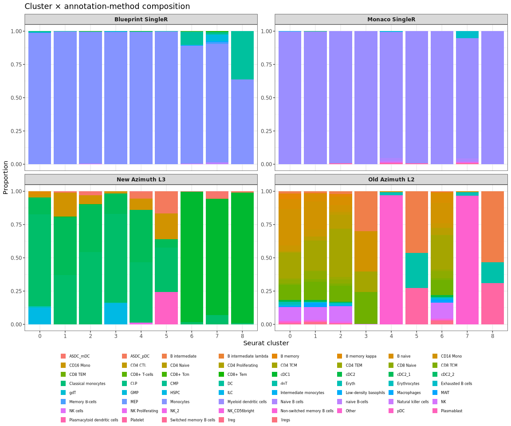

### Final cluster annotation

Identity is synthesised from de novo markers + canonical modules +
cross-method agreement + sample/dataset reproducibility.

Conservative labels: `cDC1`, `cDC2`, `ambiguous cDC`, `non-cDC-like`.
Finer Azimuth L3 subtypes (`cDC2_1` / `cDC2_2`) remain supporting
evidence only. Dataset association (`max_dataset_fraction >= 0.8`) is
recorded separately.

``` r
cluster_annotation <-
  cluster_evidence |>
  dplyr::mutate(
    top_has_cdc1 = grepl(
      "CLEC9A|XCR1|CADM1|BATF3|IRF8|CLNK|IDO1|C1orf54|WDFY4",
      top_markers
    ),
    top_has_cdc2 = grepl(
      "CD1C|FCER1A|CLEC10A|CD1E",
      top_markers
    ),
    az_is_cdc1 = grepl("^cDC1$", new_azimuth_l3_majority),
    az_is_cdc2 = grepl("^cDC2", new_azimuth_l3_majority),
    az_is_non_cdc = grepl(
      "Mono|HSPC|pDC|ASDC|B |NK|Eryth|TCM|TEM|Treg|Platelet",
      new_azimuth_l3_majority,
      ignore.case = TRUE
    ) & !az_is_cdc1 & !az_is_cdc2,
    # Require clearer subtype support than ubiquitous MHC-II / CD74 alone
    final_annotation = dplyr::case_when(
      (top_has_cdc1 | cDC1_module >= 0.15) &
        az_is_cdc1 &
        new_azimuth_l3_fraction >= 0.5 ~ "cDC1",
      (top_has_cdc2 | cDC2_module >= 0.15) &
        az_is_cdc2 &
        new_azimuth_l3_fraction >= 0.4 &
        cDC2_module > cDC1_module ~ "cDC2",
      az_is_non_cdc & cDC1_module < 0.05 & cDC2_module < 0.1 ~ "non-cDC-like",
      TRUE ~ "ambiguous cDC"
    ),
    annotation_confidence = dplyr::case_when(
      final_annotation == "cDC1" &
        top_has_cdc1 & az_is_cdc1 &
        new_azimuth_l3_fraction >= 0.7 &
        n_samples >= 50 &
        dataset_association == "not dataset-associated" ~ "high",
      final_annotation == "cDC2" &
        az_is_cdc2 &
        cDC2_module >= 0.15 &
        new_azimuth_l3_fraction >= 0.4 &
        n_samples >= 50 &
        dataset_association == "not dataset-associated" ~ "high",
      final_annotation %in% c("cDC1", "cDC2") &
        (dataset_association == "dataset-associated" | n_samples < 50) ~ "moderate",
      final_annotation %in% c("cDC1", "cDC2") ~ "moderate",
      final_annotation == "ambiguous cDC" &
        n_samples >= 100 &
        az_is_cdc2 ~ "moderate",
      TRUE ~ "low"
    ),
    final_label = dplyr::if_else(
      dataset_association == "dataset-associated",
      paste0(final_annotation, " — dataset-associated"),
      final_annotation
    ),
    annotation_rationale = dplyr::case_when(
      final_annotation == "cDC1" ~
        paste0(
          "cDC1-supporting de novo markers and/or module (cDC1=",
          signif(cDC1_module, 3),
          "); new Azimuth L3 majority ",
          new_azimuth_l3_majority,
          " (",
          round(100 * new_azimuth_l3_fraction, 1),
          "%); n_samples=",
          n_samples,
          ", max_dataset_frac=",
          round(max_dataset_fraction, 2),
          "."
        ),
      final_annotation == "cDC2" ~
        paste0(
          "cDC2-supporting module/markers (cDC2=",
          signif(cDC2_module, 3),
          "); new Azimuth L3 majority ",
          new_azimuth_l3_majority,
          " (",
          round(100 * new_azimuth_l3_fraction, 1),
          "%); Monaco mostly ",
          monaco_majority,
          "; n_samples=",
          n_samples,
          ", max_dataset_frac=",
          round(max_dataset_fraction, 2),
          "."
        ),
      final_annotation == "non-cDC-like" ~
        paste0(
          "Weak canonical cDC modules with non-cDC Azimuth L3 majority ",
          new_azimuth_l3_majority,
          "; retained as non-cDC-like."
        ),
      TRUE ~
        paste0(
          "Mixed/weak subtype evidence (cDC1=",
          signif(cDC1_module, 3),
          ", cDC2=",
          signif(cDC2_module, 3),
          "; Azimuth L3 ",
          new_azimuth_l3_majority,
          "; old Azimuth L2 ",
          old_azimuth_l2_majority,
          "); retained as ambiguous cDC."
        )
    )
  ) |>
  dplyr::select(
    cluster,
    n_cells,
    n_samples,
    n_donors,
    n_datasets,
    max_dataset_fraction,
    top_markers,
    cDC1_module,
    cDC2_module,
    old_azimuth_l2_majority,
    old_azimuth_l2_fraction,
    blueprint_majority,
    blueprint_fraction,
    monaco_majority,
    monaco_fraction,
    cellxgene_majority,
    cellxgene_fraction,
    new_azimuth_l3_majority,
    new_azimuth_l3_fraction,
    new_azimuth_l3_median_score,
    final_annotation,
    dataset_association,
    annotation_confidence,
    final_label,
    annotation_rationale
  ) |>
  dplyr::arrange(as.numeric(cluster))

cluster_annotation
```

    # A tibble: 9 × 25
      cluster n_cells n_samples n_donors n_datasets max_dataset_fraction top_markers
      <chr>     <int>     <int>    <int>      <int>                <dbl> <chr>      
    1 0         13302       898      549         18                0.567 CD74, ACTB 
    2 1         10039       485      384         13                0.464 ALDOA, KLF…
    3 2          3852       839      836         10                0.988 MRPL23, SN…
    4 3          2078        25       20          9                0.885 EEF1B2     
    5 4          2048       381       77          1                1     FAM43A, C1…
    6 5          1977         4        1          1                1     PRKCA, XYL…
    7 6           700       338      307         11                0.409 C1orf54, C…
    8 7           156       109       52          1                1     CCND1, CAD…
    9 8            94         4        1          1                1     SDK1, ENOX…
    # ℹ 18 more variables: cDC1_module <dbl>, cDC2_module <dbl>,
    #   old_azimuth_l2_majority <chr>, old_azimuth_l2_fraction <dbl>,
    #   blueprint_majority <chr>, blueprint_fraction <dbl>, monaco_majority <chr>,
    #   monaco_fraction <dbl>, cellxgene_majority <chr>, cellxgene_fraction <dbl>,
    #   new_azimuth_l3_majority <chr>, new_azimuth_l3_fraction <dbl>,
    #   new_azimuth_l3_median_score <dbl>, final_annotation <chr>,
    #   dataset_association <chr>, annotation_confidence <chr>, …

``` r
anno_map <- setNames(cluster_annotation$final_annotation, cluster_annotation$cluster)
label_map <- setNames(cluster_annotation$final_label, cluster_annotation$cluster)
conf_map <- setNames(cluster_annotation$annotation_confidence, cluster_annotation$cluster)
blood_cdc$final_annotation <- unname(anno_map[as.character(blood_cdc$seurat_clusters)])
blood_cdc$final_label <- unname(label_map[as.character(blood_cdc$seurat_clusters)])
blood_cdc$annotation_confidence <- unname(conf_map[as.character(blood_cdc$seurat_clusters)])
blood_cdc$manual_cdc_annotation <- blood_cdc$final_annotation

path_cluster_annotation <- file.path(
  path_intermediate("fig2_rebuttal_pilot"),
  "blood_cdc_cluster_annotation_table.rds"
)
saveRDS(cluster_annotation, path_cluster_annotation)
saveRDS(blood_cdc, path_blood_cdc_sct)
```

``` r
# Separate chunk so knitr applies fig size to this DimPlot (all final_label levels)
n_final_labels <- dplyr::n_distinct(blood_cdc$final_label)
DimPlot(
  blood_cdc,
  group.by = "final_label",
  reduction = "umap",
  label = TRUE,
  repel = TRUE,
  pt.size = 0.3
) +
  ggtitle("Final cluster annotation (evidence synthesis)") +
  theme(
    legend.position = "bottom",
    legend.text = element_text(size = 9),
    legend.title = element_text(size = 10),
    plot.margin = margin(5, 5, 5, 5)
  ) +
  guides(colour = guide_legend(
    title = "Final label",
    ncol = max(2L, ceiling(n_final_labels / 2)),
    override.aes = list(size = 3),
    byrow = TRUE
  ))
```

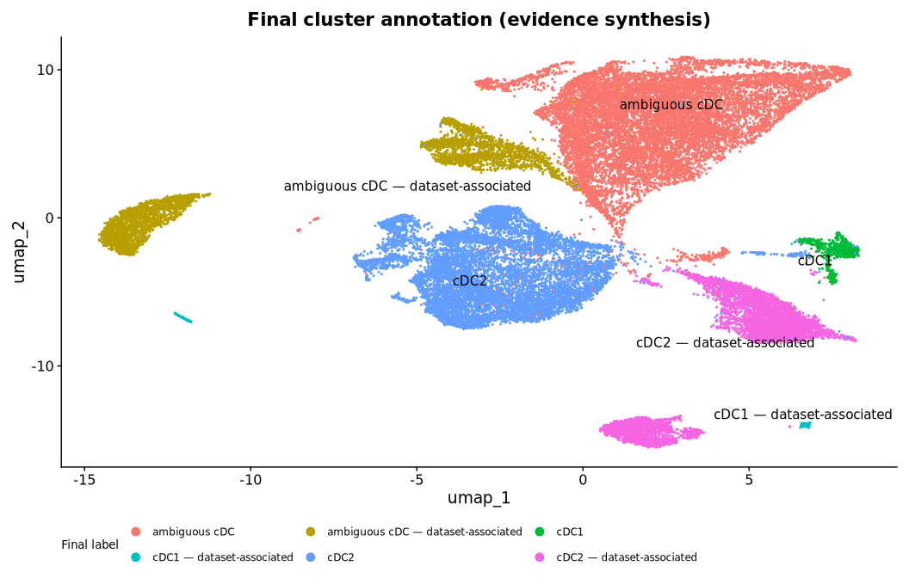

``` r
cat(
  "Clusters confidently annotated as cDC1: ",
  paste(cluster_annotation$cluster[
    cluster_annotation$final_annotation == "cDC1" &
      cluster_annotation$annotation_confidence == "high"
  ], collapse = ", "),
  "\n",
  "Clusters annotated as cDC1 (any confidence): ",
  paste(cluster_annotation$cluster[cluster_annotation$final_annotation == "cDC1"], collapse = ", "),
  "\n",
  "Clusters confidently annotated as cDC2: ",
  paste(cluster_annotation$cluster[
    cluster_annotation$final_annotation == "cDC2" &
      cluster_annotation$annotation_confidence == "high"
  ], collapse = ", "),
  "\n",
  "Clusters annotated as cDC2 (any confidence): ",
  paste(cluster_annotation$cluster[cluster_annotation$final_annotation == "cDC2"], collapse = ", "),
  "\n",
  "Dataset-associated but biologically interpretable clusters: ",
  paste(cluster_annotation$cluster[
    cluster_annotation$dataset_association == "dataset-associated" &
      cluster_annotation$final_annotation %in% c("cDC1", "cDC2")
  ], collapse = ", "),
  "\n",
  "Ambiguous clusters: ",
  paste(cluster_annotation$cluster[cluster_annotation$final_annotation == "ambiguous cDC"], collapse = ", "),
  "\n",
  "Potential non-cDC-like clusters: ",
  paste(cluster_annotation$cluster[cluster_annotation$final_annotation == "non-cDC-like"], collapse = ", "),
  "\n",
  sep = ""
)
```

    Clusters confidently annotated as cDC1: 6
    Clusters annotated as cDC1 (any confidence): 6, 7, 8
    Clusters confidently annotated as cDC2: 1
    Clusters annotated as cDC2 (any confidence): 1, 2, 4
    Dataset-associated but biologically interpretable clusters: 2, 4, 7, 8
    Ambiguous clusters: 0, 3, 5
    Potential non-cDC-like clusters: 

## Compare unsupervised clusters, final annotation, and Azimuth L3

``` r
if ("azimuth_l3" %in% colnames(blood_cdc[[]])) {
  DimPlot(blood_cdc, group.by = "seurat_clusters", label = TRUE) +
    ggtitle("Unsupervised cluster")
  DimPlot(blood_cdc, group.by = "final_label", label = TRUE, repel = TRUE, pt.size = 0.3) +
    ggtitle("Final annotation") +
    theme(legend.position = "bottom", legend.text = element_text(size = 9)) +
    guides(colour = guide_legend(
      ncol = max(2L, ceiling(dplyr::n_distinct(blood_cdc$final_label) / 2)),
      override.aes = list(size = 3),
      byrow = TRUE
    ))
  DimPlot(blood_cdc, group.by = "azimuth_l3", label = TRUE, repel = TRUE, pt.size = 0.3) +
    ggtitle("Azimuth L3") +
    theme(legend.position = "bottom", legend.text = element_text(size = 7)) +
    guides(colour = guide_legend(ncol = 4, override.aes = list(size = 3), byrow = TRUE))

  ct <- table(
    cluster = blood_cdc$seurat_clusters,
    azimuth_l3 = blood_cdc$azimuth_l3
  )
  as.data.frame.matrix(ct) |> tibble::rownames_to_column("cluster")

  as.data.frame.matrix(round(prop.table(ct, margin = 1), 3)) |>
    tibble::rownames_to_column("cluster")

  print(table(
    final = blood_cdc$final_annotation,
    azimuth_l3 = blood_cdc$azimuth_l3
  ))

  if ("azimuth_l3_score" %in% colnames(blood_cdc[[]])) {
    ggplot(
      tibble::as_tibble(blood_cdc[[]]),
      aes(x = seurat_clusters, y = azimuth_l3_score, fill = azimuth_l3)
    ) +
      geom_boxplot(outlier.size = 0.2) +
      theme_bw() +
      theme(legend.position = "bottom") +
      ggtitle("Azimuth L3 prediction score by cluster")
  }

  if (requireNamespace("aricode", quietly = TRUE)) {
    cl <- as.character(unlist(blood_cdc$seurat_clusters))
    azl <- as.character(unlist(blood_cdc$azimuth_l3))
    fin <- as.character(unlist(blood_cdc$final_annotation))
    ok <- !is.na(cl) & !is.na(azl) & !is.na(fin) & nzchar(cl) & nzchar(azl) & nzchar(fin)
    if (sum(ok) > 1) {
      tryCatch(
        {
          tibble::tibble(
            ARI_cluster_vs_azimuth = aricode::ARI(cl[ok], azl[ok]),
            NMI_cluster_vs_azimuth = aricode::NMI(cl[ok], azl[ok]),
            ARI_final_vs_azimuth = aricode::ARI(fin[ok], azl[ok]),
            n_cells_scored = sum(ok)
          )
        },
        error = function(e) {
          message("ARI/NMI skipped: ", conditionMessage(e))
          tibble::tibble(n_cells_scored = sum(ok), note = conditionMessage(e))
        }
      )
    }
  }

  az_dc_labels <- unique(blood_cdc$azimuth_l3[
    grepl("cdc|dc", blood_cdc$azimuth_l3, ignore.case = TRUE)
  ])
  az_dc_labels
}
```

                   azimuth_l3
    final           ASDC_mDC ASDC_pDC B intermediate lambda B memory kappa
      ambiguous cDC        2      332                     0            316
      cDC1                 9        3                     0              0
      cDC2               221       97                     1              0
                   azimuth_l3
    final           CD14 Mono  cDC1 cDC2_1 cDC2_2 Eryth  HSPC  NK_2   pDC
      ambiguous cDC       711     5   2119  11233   125  2034     0   480
      cDC1                  0   914      1     23     0     0     0     0
      cDC2               2224    81   6562   6723     0     0    29     1

    [1] "cDC2_2"   "cDC1"     "cDC2_1"   "ASDC_mDC" "pDC"      "ASDC_pDC"

``` r
saveRDS(blood_cdc, path_blood_cdc_sct)
```

# Conclusion

Short factual read-out after inspecting the tables/plots above:

- Blood frozen `cdc` contains internal transcriptional structure under
  SCT subclustering (primary resolution printed above).
- Final cluster identities use evidence synthesis (markers + canonical
  programs + HPCell provenance + new Azimuth L3 + sample/dataset
  reproducibility), not a fixed module-score threshold and not Azimuth
  alone.
- Dataset association is recorded separately from biological identity.
- This workflow remains a template before extending annotation to other
  tissues and before re-running Figure 2 compositional modelling.

``` r
tibble::tibble(
  n_blood_cdc_cells = ncol(blood_cdc),
  n_samples = dplyr::n_distinct(blood_cdc$sample_id),
  primary_resolution = primary_res,
  n_clusters = dplyr::n_distinct(blood_cdc$seurat_clusters),
  n_cDC1 = sum(blood_cdc$final_annotation == "cDC1", na.rm = TRUE),
  n_cDC2 = sum(blood_cdc$final_annotation == "cDC2", na.rm = TRUE),
  n_ambiguous = sum(blood_cdc$final_annotation == "ambiguous cDC", na.rm = TRUE),
  n_non_cdc = sum(blood_cdc$final_annotation == "non-cDC-like", na.rm = TRUE),
  azimuth_available = "azimuth_l3" %in% colnames(blood_cdc[[]])
)
```

    # A tibble: 1 × 9
      n_blood_cdc_cells n_samples primary_resolution n_clusters n_cDC1 n_cDC2
                  <int>     <int>              <dbl>      <int>  <int>  <int>
    1             34246      2507               0.05          9    950  15939
    # ℹ 3 more variables: n_ambiguous <int>, n_non_cdc <int>,
    #   azimuth_available <lgl>

## Session info

``` r
sessionInfo()
```

    R version 4.5.3 (2026-03-11)
    Platform: x86_64-conda-linux-gnu
    Running under: Red Hat Enterprise Linux 8.4 (Ootpa)

    Matrix products: default
    BLAS/LAPACK: /home/a1237163/miniconda3/envs/R_env/lib/libopenblasp-r0.3.29.so;  LAPACK version 3.12.0

    locale:
     [1] LC_CTYPE=en_US.UTF-8       LC_NUMERIC=C              
     [3] LC_TIME=en_US.UTF-8        LC_COLLATE=en_US.UTF-8    
     [5] LC_MONETARY=en_US.UTF-8    LC_MESSAGES=en_US.UTF-8   
     [7] LC_PAPER=en_US.UTF-8       LC_NAME=C                 
     [9] LC_ADDRESS=C               LC_TELEPHONE=C            
    [11] LC_MEASUREMENT=en_US.UTF-8 LC_IDENTIFICATION=C       

    time zone: Australia/Adelaide
    tzcode source: system (glibc)

    attached base packages:
    [1] grid      stats4    stats     graphics  grDevices utils     datasets 
    [8] methods   base     

    other attached packages:
     [1] shinyBS_0.65.0       aricode_1.1.0        patchwork_1.3.2     
     [4] org.Hs.eg.db_3.22.0  AnnotationDbi_1.72.0 IRanges_2.44.0      
     [7] S4Vectors_0.48.1     Biobase_2.70.0       BiocGenerics_0.56.0 
    [10] generics_0.1.4       sctransform_0.4.3    Seurat_5.5.1        
    [13] SeuratObject_5.4.0   sp_2.2-3             cellNexus_0.99.35   
    [16] sccomp_2.2.0         instantiate_0.2.3    lubridate_1.9.5     
    [19] forcats_1.0.1        stringr_1.6.0        dplyr_1.2.1         
    [22] purrr_1.2.2          readr_2.2.0          tidyr_1.3.2         
    [25] tibble_3.3.1         ggplot2_4.0.3        tidyverse_2.0.0     

    loaded via a namespace (and not attached):
      [1] ProtGenerics_1.42.0               fs_2.1.0                         
      [3] matrixStats_1.5.0                 spatstat.sparse_3.2-0            
      [5] bitops_1.1-0                      DirichletMultinomial_1.52.0      
      [7] TFBSTools_1.48.0                  httr_1.4.9                       
      [9] RColorBrewer_1.1-3                tools_4.5.3                      
     [11] backports_1.5.1                   DT_0.34.0                        
     [13] utf8_1.2.6                        R6_2.6.1                         
     [15] lazyeval_0.2.3                    uwot_0.2.5                       
     [17] rhdf5filters_1.22.0               withr_3.0.3                      
     [19] gridExtra_2.3.1                   progressr_1.0.0                  
     [21] cli_3.6.6                         spatstat.explore_3.8-2           
     [23] fastDummies_1.7.6                 EnsDb.Hsapiens.v86_2.99.0        
     [25] shinyjs_2.1.1                     labeling_0.4.3                   
     [27] sass_0.4.10                       S7_0.2.2                         
     [29] spatstat.data_3.1-9               ggridges_0.5.7                   
     [31] pbapply_1.7-5                     Rsamtools_2.26.0                 
     [33] dichromat_2.0-1                   parallelly_1.48.0                
     [35] BSgenome_1.78.0                   RSQLite_3.53.3                   
     [37] BiocIO_1.20.0                     gtools_3.9.5                     
     [39] ica_1.0-3                         spatstat.random_3.5-1            
     [41] googlesheets4_1.1.2               distributional_0.9.0             
     [43] Matrix_1.7-6                      ggbeeswarm_0.7.3                 
     [45] rclipboard_0.2.1                  abind_1.4-8                      
     [47] lifecycle_1.0.5                   yaml_2.3.12                      
     [49] SummarizedExperiment_1.40.0       rhdf5_2.54.1                     
     [51] SparseArray_1.10.10               Rtsne_0.17                       
     [53] blob_1.3.0                        promises_1.5.0                   
     [55] shinydashboard_0.7.3              pwalign_1.6.0                    
     [57] crayon_1.5.3                      dir.expiry_1.18.0                
     [59] miniUI_0.1.2                      lattice_0.23-1                   
     [61] cowplot_1.2.0                     GenomicFeatures_1.62.0           
     [63] cigarillo_1.0.0                   KEGGREST_1.50.0                  
     [65] pillar_1.11.1                     knitr_1.52                       
     [67] GenomicRanges_1.62.1              rjson_0.2.23                     
     [69] future.apply_1.20.2               codetools_0.2-20                 
     [71] fastmatch_1.1-8                   glue_1.8.1                       
     [73] spatstat.univar_3.2-0             data.table_1.18.6.1              
     [75] vctrs_0.7.3                       png_0.1-9                        
     [77] spam_2.11-4                       cellranger_1.1.0                 
     [79] gtable_0.3.6                      cachem_1.1.0                     
     [81] xfun_0.61                         Signac_1.17.1                    
     [83] S4Arrays_1.10.1                   mime_0.13                        
     [85] Seqinfo_1.0.0                     survival_3.8-12                  
     [87] gargle_1.6.1                      RcppRoll_0.4.0                   
     [89] SingleCellExperiment_1.32.0       fitdistrplus_1.2-6               
     [91] ROCR_1.0-12                       nlme_3.1-171                     
     [93] bit64_4.8.6                       filelock_1.0.3                   
     [95] RcppAnnoy_0.0.23                  GenomeInfoDb_1.46.2              
     [97] rprojroot_2.1.1                   tensorA_0.36.2.1                 
     [99] bslib_0.12.0                      irlba_2.3.7                      
    [101] vipor_0.4.7                       KernSmooth_2.23-27               
    [103] otel_0.2.0                        seqLogo_1.76.0                   
    [105] SeuratDisk_0.0.0.9021             DBI_1.3.0                        
    [107] zellkonverter_1.20.1              duckdb_1.5.5                     
    [109] ggrastr_1.0.2                     tidyselect_1.2.1                 
    [111] processx_3.9.0                    bit_4.6.0                        
    [113] compiler_4.5.3                    curl_8.0.0                       
    [115] hdf5r_1.3.16                      DelayedArray_0.36.1              
    [117] plotly_4.12.1                     posterior_1.7.1                  
    [119] rtracklayer_1.70.1                caTools_1.18.4                   
    [121] checkmate_2.3.4                   scales_1.4.0                     
    [123] lmtest_0.9-40                     callr_3.8.0                      
    [125] rappdirs_0.3.4                    anndataR_1.0.2                   
    [127] digest_0.6.39                     goftest_1.2-3                    
    [129] presto_1.0.0                      spatstat.utils_3.2-5             
    [131] rmarkdown_2.32                    basilisk_1.22.0                  
    [133] XVector_0.50.0                    htmltools_0.5.9                  
    [135] pkgconfig_2.0.3                   sparseMatrixStats_1.22.0         
    [137] MatrixGenerics_1.22.0             ensembldb_2.34.0                 
    [139] dbplyr_2.6.0                      fastmap_1.2.0                    
    [141] rlang_1.3.0                       htmlwidgets_1.6.4                
    [143] UCSC.utils_1.6.1                  shiny_1.14.0                     
    [145] farver_2.1.2                      jquerylib_0.1.4                  
    [147] zoo_1.9-0                         jsonlite_2.0.0                   
    [149] BiocParallel_1.44.0               RCurl_1.98-1.20                  
    [151] magrittr_2.0.5                    dotCall64_1.2                    
    [153] Rhdf5lib_1.32.0                   Rcpp_1.1.2                       
    [155] reticulate_1.47.0                 stringi_1.8.9                    
    [157] MASS_7.3-66                       plyr_1.8.9                       
    [159] parallel_4.5.3                    listenv_1.0.0                    
    [161] ggrepel_0.9.8                     deldir_2.0-4                     
    [163] Biostrings_2.78.0                 splines_4.5.3                    
    [165] tensor_1.5.1                      hms_1.1.4                        
    [167] BSgenome.Hsapiens.UCSC.hg38_1.4.5 ps_1.9.3                         
    [169] igraph_2.3.3                      spatstat.geom_3.8-3              
    [171] RcppHNSW_0.7.0                    reshape2_1.4.5                   
    [173] TFMPvalue_1.0.0                   XML_3.99-0.24                    
    [175] evaluate_1.0.5                    JASPAR2020_0.99.10               
    [177] tzdb_0.5.0                        httpuv_1.6.17                    
    [179] RANN_2.6.3                        polyclip_1.10-7                  
    [181] SeuratData_0.2.2.9002             future_1.75.0                    
    [183] scattermore_1.2                   xtable_1.8-8                     
    [185] AnnotationFilter_1.34.0           restfulr_0.0.17                  
    [187] RSpectra_0.16-2                   later_1.4.8                      
    [189] googledrive_2.1.2                 viridisLite_0.4.3                
    [191] Azimuth_0.5.1                     memoise_2.0.1                    
    [193] beeswarm_0.4.0                    GenomicAlignments_1.46.0         
    [195] cluster_2.1.8.3                   timechange_0.4.0                 
    [197] shinyWidgets_0.9.1                globals_0.19.1                   
    [199] cmdstanr_0.9.0                    here_1.0.2                       
