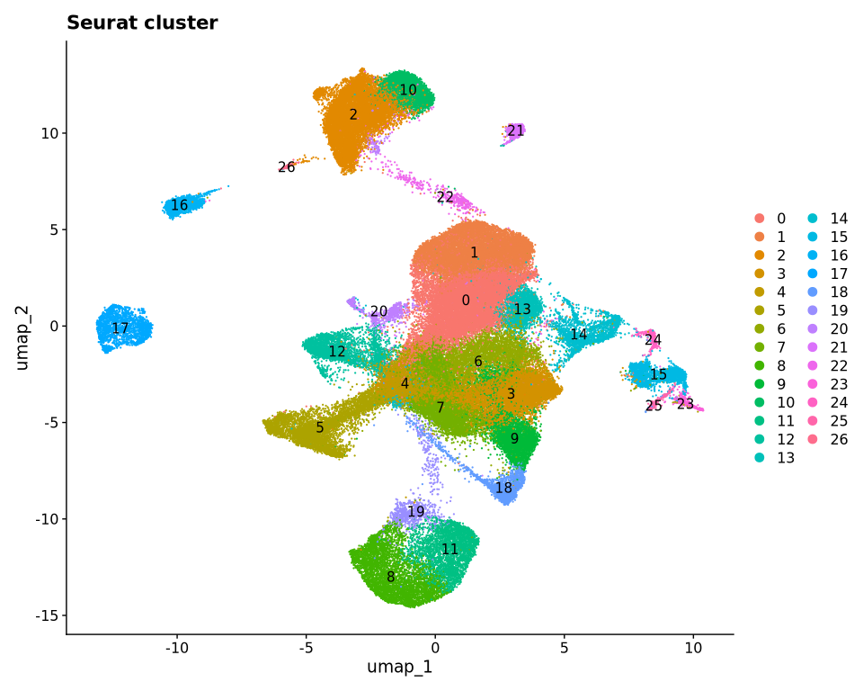
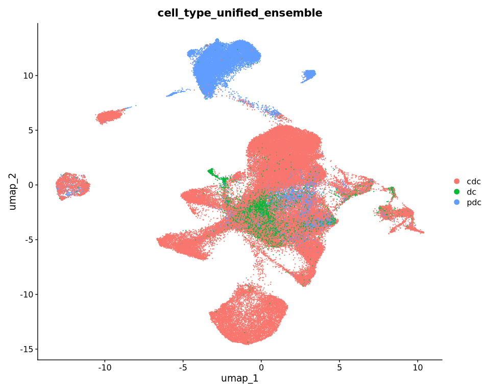
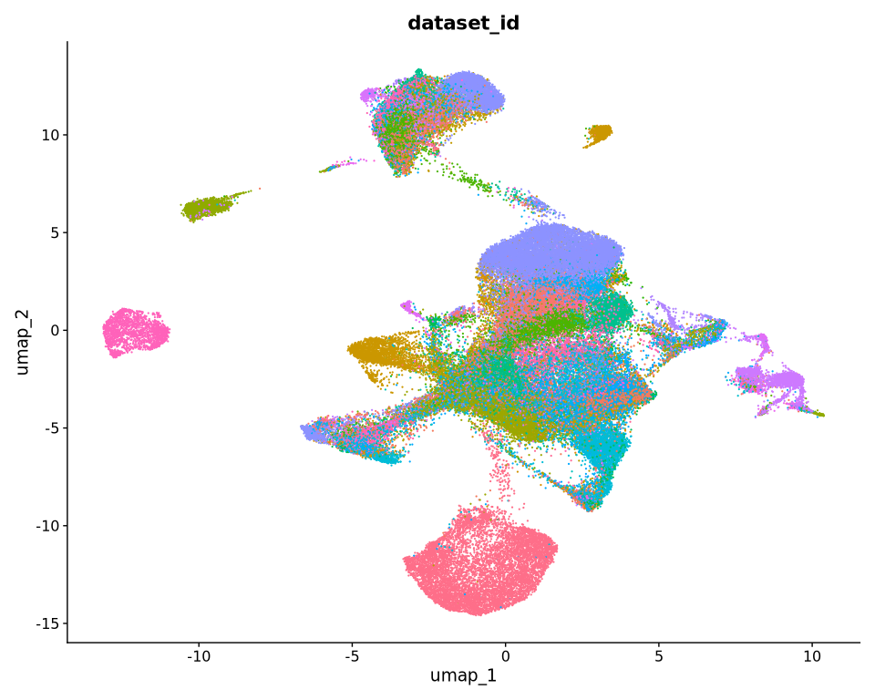
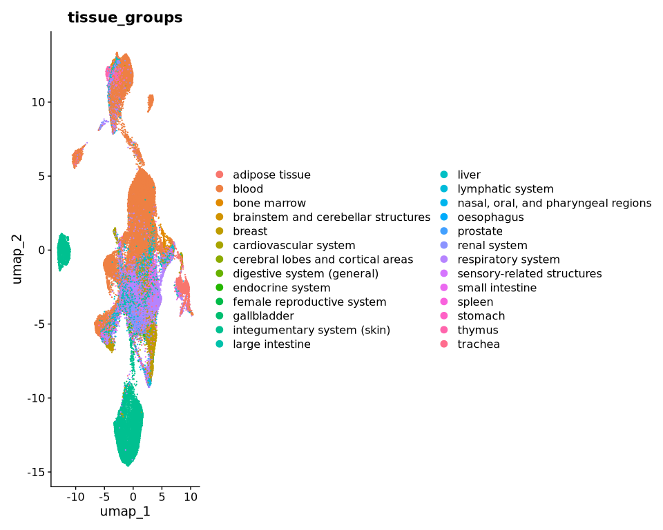

# Figure 2 rebuttal — pilot cell-type further annotation (dendritic
cells)
Chen Zhan
22 Sep 2026

- [Overview](#overview)
- [Setup](#setup)
- [Step 1 — Recover and verify the original paper sample
  universe](#step-1--recover-and-verify-the-original-paper-sample-universe)
  - [1. Sample IDs from the fitted compositional
    model](#1-sample-ids-from-the-fitted-compositional-model)
  - [2. Latest hca2024 metadata
    (cellNexus)](#2-latest-hca2024-metadata-cellnexus)
  - [3. Exact sample-ID match](#3-exact-sample-id-match)
- [Step 1b — Define the DC compartment
  (metadata)](#step-1b--define-the-dc-compartment-metadata)
- [Step 2 — Retrieve Seurat object and initial
  clustering](#step-2--retrieve-seurat-object-and-initial-clustering)
  - [Retrieve counts via
    `get_seurat()`](#retrieve-counts-via-get_seurat)
  - [Confirm key metadata](#confirm-key-metadata)
  - [Initial unsupervised clustering](#initial-unsupervised-clustering)
  - [Diagnostic UMAPs](#diagnostic-umaps)
- [Stop](#stop)
  - [Session info](#session-info)

# Overview

Reviewer-motivated pilot for **Figure 2** immune-cell annotation
refinement.

**This report stops after initial DC Seurat clustering and diagnostic
UMAPs.** No subtype annotation, batch correction, Harmony/integration,
marker analysis, or compositional modelling yet.

Questions answered here:

1.  Can every sample used in the original paper composition model be
    found in the latest `hca2024` metadata?
2.  Can we retrieve QC-filtered DC cells from that sample universe as a
    Seurat object and inspect initial unsupervised structure?

``` r
# From vignettes/rebuttal_analyse/:
quarto::quarto_render(
  "Figure_2_rebuttal_analysis_pilot_cell_type_further_annotation.qmd",
  output_format = "html"
)
quarto::quarto_render(
  "Figure_2_rebuttal_analysis_pilot_cell_type_further_annotation.qmd",
  output_format = "gfm"
)
# Outputs in this folder:
#   Figure_2_rebuttal_analysis_pilot_cell_type_further_annotation.html
#   Figure_2_rebuttal_analysis_pilot_cell_type_further_annotation.md
```

# Setup

``` r
.path_candidates <- c(
  file.path("..", "R", "paths.R"),
  if (requireNamespace("here", quietly = TRUE)) {
    file.path(here::here(), "vignettes", "R", "paths.R")
  },
  file.path("R", "paths.R")
)
.path_candidates <- .path_candidates[!is.na(.path_candidates) & nzchar(.path_candidates)]
.path_file <- .path_candidates[file.exists(.path_candidates)][1]
if (is.na(.path_file)) {
  stop("Cannot find vignettes/R/paths.R (run from vignettes/rebuttal_analyse/).")
}
source(.path_file)

dir.create(path_intermediate("fig2_rebuttal_pilot"), recursive = TRUE, showWarnings = FALSE)
```

``` r
library(tidyverse)
library(sccomp)
library(cellNexus)
library(Seurat)
```

# Step 1 — Recover and verify the original paper sample universe

## 1. Sample IDs from the fitted compositional model

Exact `sample_id` values from the L3 scRNA compositional-model
`count_data` (same estimates object used for Figure 2).

``` r
est_l3 <- readRDS(
  path_sccomp_estimates(
    "estimates_age_decade___L3___disease_FALSE___immune_only_TRUE.rds"
  )
)

paper_sample_ids <-
  est_l3 |>
  attr("count_data") |>
  sccomp:::.subset(sample_id) |>
  dplyr::distinct(sample_id) |>
  dplyr::pull(sample_id)

n_paper_samples <- length(paper_sample_ids)
n_paper_samples
```

    [1] 4483

## 2. Latest hca2024 metadata (cellNexus)

Use the current `hca_2024` alias (`hca2024_v2.4.0.parquet`), not the
publication-locked `metadata.1.0.12` helper.

``` r
# Fixed lab cellNexus cache (metadata + assay files)
cache_dir <- path.expand("~/lab/cellNexus")

hca2024_meta <- cellNexus::get_metadata(
  cloud_metadata = cellNexus::get_metadata_url("hca_2024"),
  cache_directory = cache_dir
)

hca2024_meta
```

    # A query:  ?? x 33
    # Database: DuckDB 1.5.5 [a1237163@Linux 4.18.0-305.el8.x86_64:R 4.5.3/:memory:]
       cell_id observation_joinid dataset_id        sample_id donor_id feature_count
         <dbl> <chr>              <chr>             <chr>     <chr>            <int>
     1    7951 V^DVv&wmix         ca46ffe6-0a26-4d… 86fbf754… Hs254            28675
     2     430 bE&g|Ty{lq         ca46ffe6-0a26-4d… 86fbf754… Hs254            28675
     3   10537 +P10$OJbtq         ca46ffe6-0a26-4d… 86fbf754… Hs254            28675
     4    4681 `rtxaAa~)4         ca46ffe6-0a26-4d… 86fbf754… Hs254            28675
     5   10538 YTZT;WA*H1         ca46ffe6-0a26-4d… 86fbf754… Hs254            28675
     6   11685 q6&?h```1s         ca46ffe6-0a26-4d… 86fbf754… Hs254            28675
     7   10539 {Ij`DT8SD?         ca46ffe6-0a26-4d… 86fbf754… Hs254            28675
     8    4682 s1e`j)^y54         ca46ffe6-0a26-4d… 86fbf754… Hs254            28675
     9    4683 0G5XsAaJ&m         ca46ffe6-0a26-4d… 86fbf754… Hs254            28675
    10   10540 GPsK`oVmW=         ca46ffe6-0a26-4d… 86fbf754… Hs254            28675
    # ℹ more rows
    # ℹ 27 more variables: age_days <int>, nFeature_expressed_in_sample <int>,
    #   nCount_RNA <dbl>, empty_droplet <lgl>, cell_type_unified_ensemble <chr>,
    #   is_immune <lgl>, subsets_Mito_percent <int>, subsets_Ribo_percent <int>,
    #   high_mitochondrion <lgl>, high_ribosome <lgl>, alive <lgl>,
    #   scDblFinder.class <chr>, file_id_cellNexus_single_cell <chr>,
    #   file_id_cellNexus_pseudobulk <chr>, count_upper_bound <dbl>, …

## 3. Exact sample-ID match

Every original paper sample must be present. Do not drop or substitute.

``` r
hca2024_paper_sample_ids <-
  hca2024_meta |>
  dplyr::filter(sample_id %in% !!paper_sample_ids) |>
  dplyr::distinct(sample_id) |>
  dplyr::collect() |>
  dplyr::pull(sample_id)

n_found <- length(hca2024_paper_sample_ids)

missing_paper_sample_ids <- tibble::tibble(
  sample_id = setdiff(paper_sample_ids, hca2024_paper_sample_ids)
)

n_missing <- nrow(missing_paper_sample_ids)

tibble::tibble(
  n_paper_samples = n_paper_samples,
  n_found = n_found,
  n_missing = n_missing
)
```

    # A tibble: 1 × 3
      n_paper_samples n_found n_missing
                <int>   <int>     <int>
    1            4483    4483         0

``` r
missing_paper_sample_ids
```

    # A tibble: 0 × 1
    # ℹ 1 variable: sample_id <chr>

``` r
if (n_missing > 0) {
  stop(
    "Step 1 incomplete: ", n_missing,
    " original paper sample(s) missing from latest hca2024 metadata. ",
    "Investigate sample-ID mapping before Step 1b."
  )
}
```

# Step 1b — Define the DC compartment (metadata)

Current broad Cell Nexus labels (no subtype split yet).
`paper_sample_ids` stays complete for later composition analysis even if
some samples lack DCs.

``` r
dc_labels <- c("cdc", "dc", "pdc")

dc_meta <-
  hca2024_meta |>
  dplyr::filter(
    sample_id %in% !!paper_sample_ids,
    cell_type_unified_ensemble %in% !!dc_labels
  ) |>
  cellNexus::keep_quality_cells()

dc_meta |>
  dplyr::count(cell_type_unified_ensemble, name = "n_cells") |>
  dplyr::collect() |>
  dplyr::arrange(dplyr::desc(n_cells))
```

    # A tibble: 3 × 2
      cell_type_unified_ensemble n_cells
      <chr>                        <dbl>
    1 cdc                          74784
    2 pdc                          18871
    3 dc                            5714

``` r
dc_meta |>
  dplyr::summarise(
    n_dc_cells = dplyr::n(),
    n_dc_samples = dplyr::n_distinct(sample_id)
  ) |>
  dplyr::collect()
```

    # A tibble: 1 × 2
      n_dc_cells n_dc_samples
           <dbl>        <dbl>
    1      99369         3721

# Step 2 — Retrieve Seurat object and initial clustering

## Retrieve counts via `get_seurat()`

``` r
path_dc_seurat <- file.path(
  path_intermediate("fig2_rebuttal_pilot"),
  "dc_seurat_paper_samples_hca2024.rds"
)
path_dc_clustered <- file.path(
  path_intermediate("fig2_rebuttal_pilot"),
  "dc_seurat_clustered_paper_samples_hca2024.rds"
)

if (file.exists(path_dc_clustered)) {
  dc_seurat <- readRDS(path_dc_clustered)
} else if (file.exists(path_dc_seurat)) {
  dc_seurat <- readRDS(path_dc_seurat)
} else {
  # Assay files are cached under hca_2024/0.4.1 (metadata atlas_id is 0.5.0).
  # repository = NULL uses the local cache without re-sync.
  dc_seurat <-
    dc_meta |>
    dplyr::mutate(atlas_id = "hca_2024/0.4.1") |>
    cellNexus::get_seurat(
      assays = "counts",
      cache_directory = cache_dir,
      repository = NULL
    )
  saveRDS(dc_seurat, path_dc_seurat)
}

dc_seurat
```

    An object of class Seurat 
    11212 features across 99369 samples within 1 assay 
    Active assay: counts (11212 features, 2000 variable features)
     3 layers present: counts, data, scale.data
     2 dimensional reductions calculated: pca, umap

## Confirm key metadata

`tissue_groups` / `sex` are not in current hca2024 cell metadata; join
the paper compositional-model sample covariates by `sample_id`.

``` r
paper_sample_cov <-
  est_l3 |>
  attr("count_data") |>
  sccomp:::.subset(sample_id) |>
  dplyr::distinct(sample_id, tissue_groups, sex, age_decade)

if (!"tissue_groups" %in% colnames(dc_seurat[[]])) {
  dc_seurat$tissue_groups <- paper_sample_cov$tissue_groups[
    match(dc_seurat$sample_id, paper_sample_cov$sample_id)
  ]
  dc_seurat$sex <- paper_sample_cov$sex[
    match(dc_seurat$sample_id, paper_sample_cov$sample_id)
  ]
  dc_seurat$age_decade <- paper_sample_cov$age_decade[
    match(dc_seurat$sample_id, paper_sample_cov$sample_id)
  ]
}

tibble::tibble(
  n_cells = ncol(dc_seurat),
  n_samples = dplyr::n_distinct(dc_seurat$sample_id),
  has_sample_id = "sample_id" %in% colnames(dc_seurat[[]]),
  has_donor_id = "donor_id" %in% colnames(dc_seurat[[]]),
  has_dataset_id = "dataset_id" %in% colnames(dc_seurat[[]]),
  has_tissue_groups = "tissue_groups" %in% colnames(dc_seurat[[]]),
  has_cell_type = "cell_type_unified_ensemble" %in% colnames(dc_seurat[[]]),
  has_age_days = "age_days" %in% colnames(dc_seurat[[]]),
  has_sex = "sex" %in% colnames(dc_seurat[[]])
)
```

    # A tibble: 1 × 9
      n_cells n_samples has_sample_id has_donor_id has_dataset_id has_tissue_groups
        <int>     <int> <lgl>         <lgl>        <lgl>          <lgl>            
    1   99369      3721 TRUE          TRUE         TRUE           TRUE             
    # ℹ 3 more variables: has_cell_type <lgl>, has_age_days <lgl>, has_sex <lgl>

``` r
head(dc_seurat[[]], 5)
```

            orig.ident nCount_originalexp nFeature_originalexp observation_joinid
    17_1 SeuratProject               5622                 2433         YNxZR+M_)D
    29_1 SeuratProject              26606                 5259         Es_#hT<pcm
    41_1 SeuratProject               9700                 3217         kXUyEmC9ah
    51_1 SeuratProject               7168                 2882         RwFs>n@KKa
    60_1 SeuratProject               7196                 2714         D8;ONPem`i
                                   dataset_id                        sample_id
    17_1 de2c780c-1747-40bd-9ccf-9588ec186cee 9f450a1015173a475de5045dbb13bb36
    29_1 de2c780c-1747-40bd-9ccf-9588ec186cee 9f450a1015173a475de5045dbb13bb36
    41_1 de2c780c-1747-40bd-9ccf-9588ec186cee 9f450a1015173a475de5045dbb13bb36
    51_1 de2c780c-1747-40bd-9ccf-9588ec186cee 9f450a1015173a475de5045dbb13bb36
    60_1 de2c780c-1747-40bd-9ccf-9588ec186cee 9f450a1015173a475de5045dbb13bb36
         donor_id feature_count age_days nFeature_expressed_in_sample nCount_RNA
    17_1 Normal 4         33145    22995                         3003       7691
    29_1 Normal 4         33145    22995                         6482      35335
    41_1 Normal 4         33145    22995                         3892      13366
    51_1 Normal 4         33145    22995                         3572       9779
    60_1 Normal 4         33145    22995                         3324      10808
         empty_droplet cell_type_unified_ensemble is_immune subsets_Mito_percent
    17_1         FALSE                        pdc      TRUE                    3
    29_1         FALSE                        cdc      TRUE                    6
    41_1         FALSE                        cdc      TRUE                    5
    51_1         FALSE                        pdc      TRUE                    8
    60_1         FALSE                        cdc      TRUE                    6
         subsets_Ribo_percent high_mitochondrion high_ribosome alive
    17_1                   32              FALSE         FALSE  TRUE
    29_1                   25              FALSE         FALSE  TRUE
    41_1                   21              FALSE         FALSE  TRUE
    51_1                   23              FALSE         FALSE  TRUE
    60_1                   28              FALSE         FALSE  TRUE
         scDblFinder.class             file_id_cellNexus_single_cell
    17_1           singlet 002d7d1240ff504c477d92cc88cda817___1.h5ad
    29_1           singlet 002d7d1240ff504c477d92cc88cda817___1.h5ad
    41_1           singlet 002d7d1240ff504c477d92cc88cda817___1.h5ad
    51_1           singlet 002d7d1240ff504c477d92cc88cda817___1.h5ad
    60_1           singlet 002d7d1240ff504c477d92cc88cda817___1.h5ad
                      file_id_cellNexus_pseudobulk count_upper_bound
    17_1 a63aeaf47acb8ec1cdbaaff49354de36___1.h5ad                10
    29_1 a63aeaf47acb8ec1cdbaaff49354de36___1.h5ad                10
    41_1 a63aeaf47acb8ec1cdbaaff49354de36___1.h5ad                10
    51_1 a63aeaf47acb8ec1cdbaaff49354de36___1.h5ad                10
    60_1 a63aeaf47acb8ec1cdbaaff49354de36___1.h5ad                10
         nfeature_expressed_threshold inversed_inferred_distribution
    17_1                          200                       identity
    29_1                          200                       identity
    41_1                          200                       identity
    51_1                          200                       identity
    60_1                          200                       identity
         inferred_distribution cell_annotation_blueprint_singler
    17_1                   raw                               CLP
    29_1                   raw                         Monocytes
    41_1                   raw                         Monocytes
    51_1                   raw                         Monocytes
    60_1                   raw                         Monocytes
         cell_annotation_monaco_singler cell_annotation_azimuth_l2
    17_1   Plasmacytoid dendritic cells                    CD4 TCM
    29_1        Myeloid dendritic cells                    CD4 TCM
    41_1        Myeloid dendritic cells                    CD4 TCM
    51_1   Plasmacytoid dendritic cells                    CD4 TCM
    60_1        Myeloid dendritic cells                    CD4 TCM
         ethnicity_flagging_score low_confidence_ethnicity .aggregated_cells
    17_1                       NA                     <NA>                13
    29_1                       NA                     <NA>                43
    41_1                       NA                     <NA>                43
    51_1                       NA                     <NA>                13
    60_1                       NA                     <NA>                43
         imputed_ethnicity max_lt_10.min_lt_0.rounding_error       atlas_id
    17_1       South Asian                             0,0,0 hca_2024/0.4.1
    29_1       South Asian                             0,0,0 hca_2024/0.4.1
    41_1       South Asian                             0,0,0 hca_2024/0.4.1
    51_1       South Asian                             0,0,0 hca_2024/0.4.1
    60_1       South Asian                             0,0,0 hca_2024/0.4.1
         original_cell_ nCount_counts nFeature_counts tissue_groups  sex age_decade
    17_1             17          5622            2433         blood male          7
    29_1             29         26606            5259         blood male          7
    41_1             41          9700            3217         blood male          7
    51_1             51          7168            2882         blood male          7
    60_1             60          7196            2714         blood male          7
         counts_snn_res.0.8 seurat_clusters
    17_1                  2               2
    29_1                 13              13
    41_1                 13              13
    51_1                  2               2
    60_1                 13              13

## Initial unsupervised clustering

Standard Seurat workflow from raw counts. No Harmony / integration /
annotation.

``` r
if (!"umap" %in% names(dc_seurat@reductions)) {
  DefaultAssay(dc_seurat) <- "counts"
  dc_seurat <- NormalizeData(dc_seurat)
  dc_seurat <- FindVariableFeatures(dc_seurat)
  dc_seurat <- ScaleData(dc_seurat)
  dc_seurat <- RunPCA(dc_seurat)
  dc_seurat <- FindNeighbors(dc_seurat, dims = 1:30)
  dc_seurat <- FindClusters(dc_seurat)
  dc_seurat <- RunUMAP(dc_seurat, dims = 1:30)
  saveRDS(dc_seurat, path_dc_clustered)
}

table(Idents(dc_seurat))
```


        0     1     2     3     4     5     6     7     8     9    10    11    12 
    13804 11165 10817  7955  5940  5430  5246  4667  4417  3738  3683  3069  2933 
       13    14    15    16    17    18    19    20    21    22    23    24    25 
     2390  2210  2112  2018  1876  1775   931   892   585   568   459   309   197 
       26 
      183 

## Diagnostic UMAPs

``` r
DimPlot(dc_seurat, reduction = "umap", label = TRUE) + ggtitle("Seurat cluster")
```



``` r
DimPlot(dc_seurat, reduction = "umap", group.by = "cell_type_unified_ensemble") +
  ggtitle("cell_type_unified_ensemble")
```



``` r
DimPlot(dc_seurat, reduction = "umap", group.by = "dataset_id") +
  ggtitle("dataset_id") +
  theme(legend.position = "none")
```



``` r
DimPlot(dc_seurat, reduction = "umap", group.by = "tissue_groups") +
  ggtitle("tissue_groups")
```



# Stop

Inspect these diagnostic UMAPs before deciding on batch correction
and/or DC subtype annotation. No Harmony, integration, marker
annotation, or compositional modelling in this report.

## Session info

``` r
sessionInfo()
```

    R version 4.5.3 (2026-03-11)
    Platform: x86_64-conda-linux-gnu
    Running under: Red Hat Enterprise Linux 8.4 (Ootpa)

    Matrix products: default
    BLAS/LAPACK: /home/a1237163/miniconda3/envs/R_env/lib/libopenblasp-r0.3.29.so;  LAPACK version 3.12.0

    locale:
     [1] LC_CTYPE=en_US.UTF-8       LC_NUMERIC=C              
     [3] LC_TIME=en_US.UTF-8        LC_COLLATE=en_US.UTF-8    
     [5] LC_MONETARY=en_US.UTF-8    LC_MESSAGES=en_US.UTF-8   
     [7] LC_PAPER=en_US.UTF-8       LC_NAME=C                 
     [9] LC_ADDRESS=C               LC_TELEPHONE=C            
    [11] LC_MEASUREMENT=en_US.UTF-8 LC_IDENTIFICATION=C       

    time zone: Australia/Adelaide
    tzcode source: system (glibc)

    attached base packages:
    [1] stats     graphics  grDevices utils     datasets  methods   base     

    other attached packages:
     [1] Seurat_5.5.1       SeuratObject_5.4.0 sp_2.2-3           cellNexus_0.99.35 
     [5] sccomp_2.2.0       instantiate_0.2.3  lubridate_1.9.5    forcats_1.0.1     
     [9] stringr_1.6.0      dplyr_1.2.1        purrr_1.2.2        readr_2.2.0       
    [13] tidyr_1.3.2        tibble_3.3.1       ggplot2_4.0.3      tidyverse_2.0.0   

    loaded via a namespace (and not attached):
      [1] RcppAnnoy_0.0.23            splines_4.5.3              
      [3] later_1.4.8                 filelock_1.0.3             
      [5] polyclip_1.10-7             fastDummies_1.7.6          
      [7] lifecycle_1.0.5             rprojroot_2.1.1            
      [9] globals_0.19.1              processx_3.9.0             
     [11] lattice_0.23-1              MASS_7.3-66                
     [13] backports_1.5.1             magrittr_2.0.5             
     [15] plotly_4.12.1               sass_0.4.10                
     [17] rmarkdown_2.32              jquerylib_0.1.4            
     [19] yaml_2.3.12                 httpuv_1.6.17              
     [21] otel_0.2.0                  sctransform_0.4.3          
     [23] spam_2.11-4                 spatstat.sparse_3.2-0      
     [25] reticulate_1.47.0           cowplot_1.2.0              
     [27] pbapply_1.7-5               DBI_1.3.0                  
     [29] RColorBrewer_1.1-3          abind_1.4-8                
     [31] Rtsne_0.17                  GenomicRanges_1.62.1       
     [33] BiocGenerics_0.56.0         tensorA_0.36.2.1           
     [35] IRanges_2.44.0              S4Vectors_0.48.1           
     [37] ggrepel_0.9.8               irlba_2.3.7                
     [39] listenv_1.0.0               spatstat.utils_3.2-5       
     [41] goftest_1.2-3               RSpectra_0.16-2            
     [43] spatstat.random_3.5-1       fitdistrplus_1.2-6         
     [45] parallelly_1.48.0           codetools_0.2-20           
     [47] DelayedArray_0.36.1         tidyselect_1.2.1           
     [49] rclipboard_0.2.1            farver_2.1.2               
     [51] shinyWidgets_0.9.1          matrixStats_1.5.0          
     [53] stats4_4.5.3                spatstat.explore_3.8-2     
     [55] Seqinfo_1.0.0               duckdb_1.5.5               
     [57] jsonlite_2.0.0              progressr_1.0.0            
     [59] ggridges_0.5.7              survival_3.8-12            
     [61] tools_4.5.3                 ica_1.0-3                  
     [63] Rcpp_1.1.2                  glue_1.8.1                 
     [65] gridExtra_2.3.1             SparseArray_1.10.10        
     [67] xfun_0.61                   here_1.0.2                 
     [69] cmdstanr_0.9.0              MatrixGenerics_1.22.0      
     [71] distributional_0.9.0        withr_3.0.3                
     [73] fastmap_1.2.0               basilisk_1.22.0            
     [75] callr_3.8.0                 digest_0.6.39              
     [77] timechange_0.4.0            R6_2.6.1                   
     [79] mime_0.13                   scattermore_1.2            
     [81] tensor_1.5.1                dichromat_2.0-1            
     [83] spatstat.data_3.1-9         utf8_1.2.6                 
     [85] generics_0.1.4              data.table_1.18.6.1        
     [87] httr_1.4.9                  htmlwidgets_1.6.4          
     [89] S4Arrays_1.10.1             uwot_0.2.5                 
     [91] pkgconfig_2.0.3             gtable_0.3.6               
     [93] blob_1.3.0                  lmtest_0.9-40              
     [95] S7_0.2.2                    SingleCellExperiment_1.32.0
     [97] XVector_0.50.0              htmltools_0.5.9            
     [99] dotCall64_1.2               scales_1.4.0               
    [101] Biobase_2.70.0              png_0.1-9                  
    [103] posterior_1.7.1             spatstat.univar_3.2-0      
    [105] knitr_1.52                  tzdb_0.5.0                 
    [107] reshape2_1.4.5              checkmate_2.3.4            
    [109] nlme_3.1-171                curl_8.0.0                 
    [111] anndataR_1.0.2              cachem_1.1.0               
    [113] zoo_1.9-0                   KernSmooth_2.23-27         
    [115] parallel_4.5.3              miniUI_0.1.2               
    [117] zellkonverter_1.20.1        pillar_1.11.1              
    [119] grid_4.5.3                  vctrs_0.7.3                
    [121] RANN_2.6.3                  promises_1.5.0             
    [123] dbplyr_2.6.0                xtable_1.8-8               
    [125] cluster_2.1.8.3             evaluate_1.0.5             
    [127] cli_3.6.6                   compiler_4.5.3             
    [129] rlang_1.3.0                 crayon_1.5.3               
    [131] future.apply_1.20.2         labeling_0.4.3             
    [133] ps_1.9.3                    plyr_1.8.9                 
    [135] fs_2.1.0                    stringi_1.8.9              
    [137] viridisLite_0.4.3           deldir_2.0-4               
    [139] spatstat.geom_3.8-3         Matrix_1.7-6               
    [141] dir.expiry_1.18.0           RcppHNSW_0.7.0             
    [143] hms_1.1.4                   patchwork_1.3.2            
    [145] future_1.75.0               shiny_1.14.0               
    [147] SummarizedExperiment_1.40.0 ROCR_1.0-12                
    [149] igraph_2.3.3                bslib_0.12.0               
